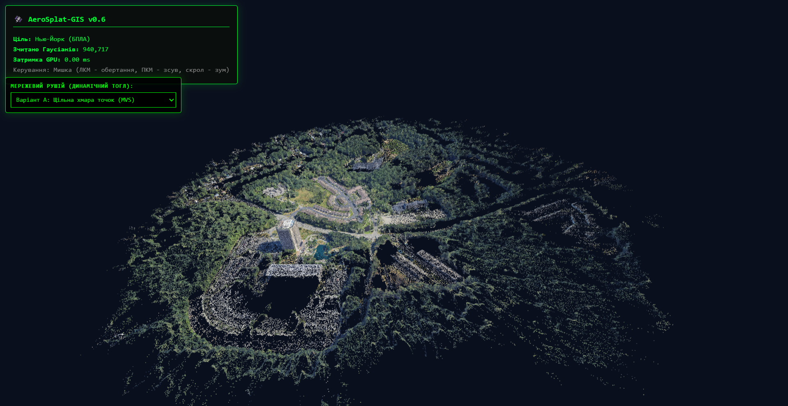
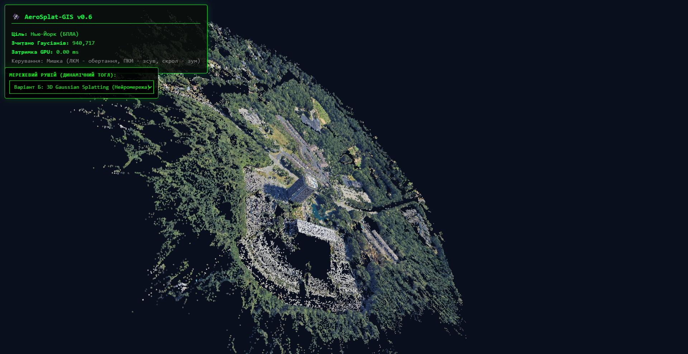

#  AeroSplat-GIS

## UAV-Based 3D Terrain Reconstruction and GIS Visualization Engine

AeroSplat-GIS is a geospatial reconstruction and visualization framework
designed for generating metrically accurate 3D terrain models from UAV
imagery and simulation environments.

The project combines traditional photogrammetry techniques (**Structure
from Motion** and **Multi-View Stereo**) with modern neural scene
representations based on **3D Gaussian Splatting (3DGS)**, enabling
interactive visualization of reconstructed environments.

The system is optimized for **interactive real-time visualization on
modern consumer GPUs**.

------------------------------------------------------------------------

## Reconstruction Examples

| Dense Point Cloud (MVS) | 3D Gaussian Splatting |
|---|---|
|  |  |
| Classical point-based reconstruction | Neural Gaussian representation |

------------------------------------------------------------------------

#  Features

## Dual Reconstruction Pipeline

AeroSplat-GIS supports two independent reconstruction approaches:

### Dense Point Cloud Reconstruction

Based on classical photogrammetry:

-   Structure-from-Motion (SfM)
-   Multi-View Stereo (MVS)
-   Dense point cloud generation

### Neural Scene Reconstruction

Based on:

-   3D Gaussian Splatting (3DGS)
-   Differentiable rendering
-   PyTorch optimization pipeline

Both approaches can be compared and visualized depending on required
accuracy and performance characteristics.

------------------------------------------------------------------------

##  Georeferenced Reconstruction

The pipeline supports geographic alignment through metadata processing
and coordinate injection.

Supported parameters:

-   Latitude
-   Longitude
-   Altitude

The reconstructed scene is scaled into real-world metric coordinates.

    1 unit in 3D space ≈ 1 meter in the real environment

------------------------------------------------------------------------

##  GPU Rendering Optimization

The visualization layer uses:

-   WebGL
-   Three.js
-   Custom GLSL shaders

Optimization techniques include:

-   Depth-based visibility filtering
-   Frustum culling
-   Efficient GPU-side rendering
-   Binary tensor streaming

------------------------------------------------------------------------

##  Binary Tensor Streaming

The backend supports direct streaming of serialized PyTorch tensors to
the WebGL frontend.

This reduces loading overhead compared to traditional text-based formats
and allows efficient transfer of large reconstructed scenes.

------------------------------------------------------------------------

# Architecture Pipeline

```text
Raw UAV Images
        │
        ▼
exif_injector.py
GPS metadata injection
        │
        ▼
sfm_runner.py
Sparse reconstruction (COLMAP SfM)
        │
        ▼
dense_runner.py
Dense reconstruction (MVS)
        │
        ▼
ply_parser.py
Point cloud processing
        │
        ├──────────────────────┐
        │                      │
        ▼                      ▼
Dense Point Cloud       3D Gaussian Splatting
                               │
                               ▼
                        gs_trainer.py
                        PyTorch optimization
                               │
                               ▼
                         FastAPI Backend
                               │
                               ▼
                      WebGL Viewer (Three.js)
```

------------------------------------------------------------------------

#  Repository Structure

    AeroSplat-GIS/
    ├── src/
    │   ├── starter.py            # оркестратор (`aerosplat run`)
    │   ├── doctor.py             # діагностика (`aerosplat doctor`)
    │   ├── aerosplat/            # пакет: config, paths, logging_utils
    │   │   ├── pipeline/         # стадії, RunLayout, manifest.json
    │   │   ├── geo/              # earthstudio_to_colmap, exif_injector
    │   │   ├── sfm/              # sfm_runner, dense_runner
    │   │   ├── io/               # cloud_io, ply_parser, colmap_parser
    │   │   └── gs/               # trainer (3DGS)
    │   └── server/main.py        # FastAPI (`aerosplat serve`)
    ├── web/                      # власний WebGL-в'ювер
    ├── tools/                    # дослідницькі/діагностичні скрипти
    ├── legacy/                   # застарілий код (лише для історії)
    ├── docs/                     # ARCHITECTURE, ROADMAP, DECISIONS, REAL_DRONES
    ├── data/                     # НЕ в git, див. data/README.md
    ├── pyproject.toml
    └── requirements.txt

------------------------------------------------------------------------

#  System Requirements

## Hardware

Recommended:

-   NVIDIA GPU with CUDA support
-   Minimum 6 GB VRAM for larger scenes

## Software

Required:

-   Python 3.x
-   CUDA-enabled PyTorch
-   COLMAP installed and available in system PATH

Supported:

-   Windows 10/11
-   Linux distributions

------------------------------------------------------------------------

#  Installation

``` bash
# PyTorch під вашу CUDA (приклад для CUDA 12.6)
pip install torch==2.6.0 torchvision==0.21.0 --index-url https://download.pytorch.org/whl/cu126
pip install -e .
aerosplat doctor
```

COLMAP має бути в `PATH` (або `--colmap-bin`). Опційно: CUDA-растерізатор Inria
(`diff-gaussian-rasterization/`, **non-commercial**, збирається локально) —
без нього використовується повільніший PyTorch-растерізатор.

------------------------------------------------------------------------

#  Reconstruction Pipeline Usage

Датасет кладеться в `data/<ds>/` (див. [data/README.md](data/README.md)).

``` bash
aerosplat run --dataset dataset_v6            # весь пайплайн
aerosplat run --dataset dataset_v6 --dry-run  # показати команди
aerosplat run --dataset dataset_v6 --from sfm
```

`camera_source` за замовчуванням `auto`: Earth Studio JSON, якщо він є, інакше
synthetic-режим. Тренер без `--self-test` вимагає явні `--input/--colmap/--images`.

------------------------------------------------------------------------

#  Launch Visualization Server

``` bash
aerosplat serve   # або: python src/server/main.py
```

Open:

    http://127.0.0.1:8000/web/

Recommended browsers:

-   Google Chrome
-   Microsoft Edge

------------------------------------------------------------------------

## Reconstruction Modes Comparison

| Feature | Dense Point Cloud (MVS) | 3D Gaussian Splatting |
|---|---|---|
| Data Representation | XYZ coordinates with RGB attributes | Optimized Gaussian primitives with position, covariance, opacity, and color |
| Scene Model | Discrete sampled geometry | Continuous volumetric scene representation |
| Vegetation Handling | Fragmented and sparse reconstruction | Smooth volumetric reconstruction of complex structures |
| Rendering Pipeline | `THREE.Points` / point-based rendering | GPU-accelerated GLSL Gaussian splatting renderer |
| Memory Consumption | Lower storage requirements | Higher memory usage due to additional Gaussian parameters |
| Visual Quality | Moderate realism | High-fidelity photorealistic reconstruction |
| Real-Time Performance | Limited by point count | Optimized for interactive GPU rendering |

#  Development Status

Current version:

    v0.6.1 (Фаза 0 — стабілізація, див. docs/ROADMAP.md)

Implemented:

-   GPS metadata injection
-   COLMAP SfM reconstruction
-   Dense MVS reconstruction
-   Point cloud processing
-   3D Gaussian Splatting optimization
-   FastAPI backend
-   WebGL visualization frontend

------------------------------------------------------------------------

#  Future Improvements

-   Distance measurement tools
-   Elevation profile generation
-   GIS overlay support
-   Terrain analysis utilities
-   Additional export formats
-   Large-scale scene optimization

------------------------------------------------------------------------

#  License

Код проєкту — MIT. **Виняток:** `diff-gaussian-rasterization` (Inria) —
Gaussian-Splatting License, лише некомерційні дослідження; це опційна
залежність, не частина репозиторію. Докладніше: [docs/DECISIONS.md](docs/DECISIONS.md).
