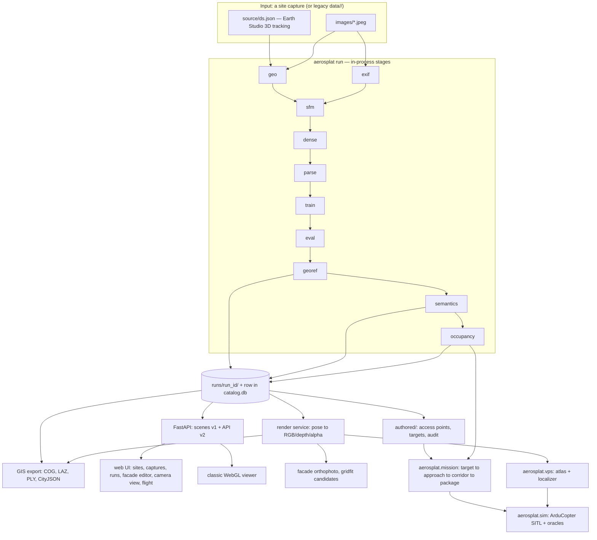

# AeroSplat-GIS

**Aerial imagery → metric, georeferenced 3D twin → building semantics and access points →
drone delivery missions → the whole chain flown in ArduPilot SITL against that same twin.**

AeroSplat-GIS turns aerial footage (today: Google Earth Studio renders that imitate a UAV; real
drone imagery is a planned input adapter) into two scene representations — a dense
photogrammetric point cloud (COLMAP SfM + MVS) and a 3D Gaussian Splatting scene — places both in
a **fixed metric site frame tied to WGS84**, derives a semantic layer on top (terrain, buildings,
facades, windows, landing pads, occupancy/ESDF), lets an operator designate a delivery target,
plans the approach corridor, exports an ArduPilot mission package, and then **flies that package
in a pinned ArduCopter SITL build**, judging it against ground truth with a set of safety
oracles — including GNSS-denied flight on visual positioning rendered from the twin itself.

It is a research and engineering system, not a product. Every number below is either measured and
cited, or explicitly marked as an estimate.

> **Documentation language.** This README is in English by request. The reference documents under
> [`docs/`](docs/) are written in Ukrainian (project convention: docs in Ukrainian, code and code
> comments in English). Where this README and the code disagree, the code is the truth; where this
> README and [`docs/ARCHITECTURE.md`](docs/ARCHITECTURE.md) disagree, that document is the more
> detailed source.

---

## Reconstruction examples

| Dense point cloud (MVS) | 3D Gaussian Splatting |
|---|---|
|  |  |
| Classical point-based reconstruction | Neural Gaussian representation |

---

## Status at a glance

| | |
|---|---|
| Version | `0.6.1` |
| State of the tree | Everything described here is merged: `HEAD` = `phase-7-1-editor` = `main` = `origin/main` (`4e2412a`) |
| Code | 156 Python modules, ~39 000 lines under `src/aerosplat/`; 63 test files, 982 test functions |
| Phases complete | 0, 1, 2.1, 2.2, 3.1, 3.2, 6.1–6.4 (+ tails), 7.1, 7.3 step 1, 8.1a, 8.1b |
| Simulation complete | SIM-0, SIM-1, SIM-2n, SIM-3 (VPS in the loop), VPS layer A bench |
| Not done | 2.3, 3.3, 3.4, Phase 4 (wire format, new viewer), Phase 5 (real-drone adapters), 7.2, 7.3 steps 2+, 7.4, 8.1c, 8.2, 8.3, 8.4, SIM-2 (own physics backend), SIM-4…SIM-6 |
| The one blocker code cannot fix | **No real imagery yet.** Earth Studio twins are accurate to ≈2–3 m. Everything downstream can be built and tested, but final-metre accuracy cannot be measured without the "golden site" (milestone M0). |
| Target hardware | NVIDIA RTX 4060 (8 GB), Windows 11, Python 3.11, PyTorch 2.6 + CUDA 12.6; SITL in WSL2 Ubuntu 24.04 |

---

## Contents

1. [What the system does — and what it deliberately does not](#1-what-the-system-does--and-what-it-deliberately-does-not)
2. [Quick start](#2-quick-start)
3. [End-to-end picture](#3-end-to-end-picture)
4. [Data model and on-disk layout](#4-data-model-and-on-disk-layout)
5. [Coordinate systems and georeferencing](#5-coordinate-systems-and-georeferencing)
6. [The reconstruction pipeline, stage by stage](#6-the-reconstruction-pipeline-stage-by-stage)
7. [Module map](#7-module-map)
8. [Platform: catalog, job queue, API, web UI, authentication](#8-platform-catalog-job-queue-api-web-ui-authentication)
9. [Render service](#9-render-service)
10. [GIS export](#10-gis-export)
11. [Semantics and access points](#11-semantics-and-access-points)
12. [Occupancy and ESDF](#12-occupancy-and-esdf)
13. [Targets and missions](#13-targets-and-missions)
14. [The drone side: how it actually flies](#14-the-drone-side-how-it-actually-flies)
15. [Simulation levels, test suites, hazard log](#15-simulation-levels-test-suites-hazard-log)
16. [Quality baselines](#16-quality-baselines)
17. [Phase-by-phase status](#17-phase-by-phase-status)
18. [Testing, lint, CI](#18-testing-lint-ci)
19. [Configuration reference](#19-configuration-reference)
20. [Honest limits](#20-honest-limits)
21. [Open decisions waiting on the owner](#21-open-decisions-waiting-on-the-owner)
22. [Repository layout](#22-repository-layout)
23. [Documentation index](#23-documentation-index)
24. [Licence](#24-licence)

---

## 1. What the system does — and what it deliberately does not

### Does

1. **Ingests imagery into one georeferenced metric frame.** Earth Studio exports (JSON camera
   track + frames) today; drone photo/video, handheld and internet imagery are designed for but
   not implemented (Phase 5 / 7.2).
2. **Reconstructs** the scene: COLMAP SfM (known-pose triangulation + BA, or the free mapper),
   COLMAP dense MVS, and 3D Gaussian Splatting with three interchangeable rasterizers.
3. **Georeferences end-to-end.** The fixed Site ENU origin reaches the server as
   `scene-meta.metric`, so one unit really is one metre and any point maps to lat/lon/h.
4. **Builds a semantic layer**: DSM/DTM/nDSM, building footprints, facade planes, per-facade
   coverage maps, facade orthophotos, access points (windows, doors, roof and yard pads),
   addressing (floor / row / column), CityJSON export.
5. **Builds a flight-safety layer**: a voxel occupancy grid with `free / occupied / unknown`
   plus a ray space-carving pass, and an ESDF distance field.
6. **Plans missions**: confirmed target → approach geometry → corridor clearance check → a QGC
   `.waypoints` / `.plan` / `.parm` package with geofence and rally points.
7. **Flies and judges them** in a pinned ArduCopter SITL build with truth-based oracles,
   including GNSS-denied navigation driven by visual positioning against the twin.
8. **Exports standard GIS products**: orthophoto COG, DSM/DTM/nDSM COG, LAS/LAZ, 3DGS `.ply`,
   CityJSON 2.0 — each carrying an explicit georeferencing error budget.
9. **Serves all of it** from one FastAPI process with a React web UI, a job queue with a single
   GPU slot, a long-lived GPU render service, and token authentication for non-loopback access.

### Does not

* **It is not an autopilot.** The last metres to a window belong to onboard guidance. The system
  produces planning-grade geometry, references and an uncertainty budget
  ([ADR-0009](docs/decisions/0009-human-in-the-loop-planning-grade.md)).
* **It is not fleet dispatch or UTM.** Integration happens through the API and the exports.
* **It does not promise accuracy sufficient for flight without an onboard check.** Every
  geometry carries an explicit σ.
* **It does not guess.** Unknown space counts as occupied. An unknown σ is a refusal, not a zero.
  A detector whose cues disagree refuses with a named reason instead of producing boxes.

---

## 2. Quick start

### 2.1 Install

```bash
pip install torch==2.6.0 torchvision==0.21.0 --index-url https://download.pytorch.org/whl/cu126
```

```bash
pip install -e . && aerosplat doctor
```

Optional extras:

| Extra | Brings | Needed for |
|---|---|---|
| `dev` | pytest, ruff, mypy, httpx | tests and lint |
| `gis` | rasterio, laspy, lazrs | GeoTIFF/COG and LAS/LAZ export |
| `sim` | pymavlink 2.4.50 | ArduPilot SITL harness, `pytest -m sitl` |
| `vps` | opencv-python-headless (<5) | visual positioning (ORB / AKAZE / PnP) |
| `tensorboard` | tensorboard | optional training log |

External requirements:

* **COLMAP** on `PATH` (or `--colmap-bin`); GLOMAP optional.
* **gsplat 1.5.3** for the `gsplat` rasterizer, the render service and the GIS orthophoto export.
  On Windows it JIT-compiles a CUDA extension and only builds inside
  [`tools/gsplat_env.bat`](tools/gsplat_env.bat) (VS 2022 plus the CUDA version torch was built
  with). `aerosplat up` wraps the GPU worker and the render service in that environment
  automatically, and the pipeline checks gsplat in **pre-flight, before the first stage**, so a
  missing toolchain fails immediately instead of after SfM and dense have already run.
* **`diff-gaussian-rasterization`** (Inria) is an *optional, non-commercial* CUDA rasterizer built
  locally from an untracked directory. Without it the trainer falls back to the pure-PyTorch tile
  rasterizer (slower) or to gsplat.

### 2.2 Verify the install on a small sample

```bash
python tools/make_sample_dataset.py
```

```bash
aerosplat run --dataset sample --iterations 500 && aerosplat doctor --dataset sample
```

This is the Phase 0 readiness criterion: 16 frames of `dataset_v6` at 960×540, all stages in
~63 s on an RTX 4060, `doctor` with no red crosses.

### 2.3 The main path: site runs

```bash
aerosplat catalog create-site --project default --site mysite --lat 40.891 --lon -74.216 --alt 233
```

```bash
aerosplat catalog import-earthstudio --site default/mysite --export <earth-studio-export-dir>
```

```bash
aerosplat run --site default/mysite
```

```bash
aerosplat run --site default/mysite --resume --from semantics
```

Every run is immutable and reproducible: `manifest.json` records the config, the code commit,
input hashes, per-stage durations and key metrics. `aerosplat doctor --site default/mysite`
diagnoses the latest run read-only.

### 2.4 Server, workers, web UI

```bash
cd web/app && npm ci && npm run build
```

```bash
aerosplat up
```

`aerosplat up` starts the API (<http://127.0.0.1:8000/>, UI at `/app/`), a GPU worker, a CPU
worker and the render service (`:8001`) in one command, and stops them together. Individually:
`aerosplat serve`, `aerosplat worker --resource gpu|cpu`, `aerosplat render-service`. For UI
development with hot reload, `cd web/app && npm run dev` proxies the API to `:8000`.

### 2.5 Network access: tokens and TLS

From this machine (`127.0.0.1`) everything works with no configuration. To expose the server,
create a token first — without one, `aerosplat up` refuses a non-loopback bind:

```bash
aerosplat token create alice
```

```bash
aerosplat up --host 0.0.0.0 --tls-self-signed
```

The secret is printed once; only its SHA-256 is stored. The browser UI asks for the token itself
and then keeps an HttpOnly session cookie; scripts send `Authorization: Bearer <token>`. Changes
made with a token are signed `token:<name>` in the audit log. `aerosplat token list|revoke`
manages them, and a revocation takes effect from the next request.

**Network access is HTTPS-only.** Without `--tls-self-signed` (an EC P-256 certificate created
once under `<projects>/auth/tls/`, SANs for the machine's names and addresses, SHA-256
fingerprint printed at startup, reissued 30 days before expiry) or `--tls-cert/--tls-key`, a
non-loopback bind does not start. `--insecure-http` exists only for a reverse proxy terminating
TLS on the same machine. `--require-auth` demands a token even from localhost, for tunnels that
carry no proxy headers.

### 2.6 CLI surface

| Command | Purpose |
|---|---|
| `aerosplat run` | the pipeline (`--site project/site`, or legacy `--dataset`) |
| `aerosplat doctor` | read-only diagnosis of every stage |
| `aerosplat catalog` | `list \| create-site \| import-earthstudio \| import-folder \| migrate-dataset \| upgrade \| revision` |
| `aerosplat serve` | FastAPI: scenes v1 + API v2 |
| `aerosplat worker` | job-queue worker (`--resource gpu\|cpu`, `--once`) |
| `aerosplat up` | server + GPU worker + CPU worker + render service |
| `aerosplat token` | `create \| list \| revoke` |
| `aerosplat render-service` | standalone GPU render service |
| `aerosplat export` | GIS export of one run |
| `aerosplat semantics` | `cityjson \| match` |

Plus module entry points: `python -m aerosplat.sim.sitl|runner|params|report`,
`python -m aerosplat.vps.bench|route`, `python -m aerosplat.mission.takeoff`.

Run-stage selection: `--stages a,b,c`, `--from`, `--to`, `--only`, `--skip`, `--resume`,
`--dry-run`; configuration via `--config file.yaml` and repeated `--set KEY=VALUE`.

---

## 3. End-to-end picture



**What is wired to what, in one paragraph.** `aerosplat run` executes stages in-process against a
`RunLayout` that is a *view* onto either a site run or the legacy `data/<ds>` tree; it writes a
run directory and a catalog row. The FastAPI server reads scenes from that catalog, never from a
hard-coded path. The job queue lives in the same SQLite catalog and runs each job as its own child
process, with at most one GPU job at a time. The render service holds one 3DGS scene in VRAM and
answers pose → image in 15–20 ms; the semantics layer uses it for facade orthophotos, the GIS
export uses it for the orthophoto mosaic, the VPS atlas builder uses it for keyframes, and the UI
uses it for "what the drone would see". Authored data (access points, targets, audit) live outside
run directories, so a run can be deleted and recomputed without losing human work. Missions read
the occupancy grid of a run and the authored target; the SITL harness flies the exported package
and judges it against the same occupancy grid.

---

## 4. Data model and on-disk layout

Project → Site → Epoch → Capture, with Runs under epochs
([ADR-0006](docs/decisions/0006-project-site-epoch-capture.md)).

| Entity | Meaning | Created by |
|---|---|---|
| **Project** | Workspace: a customer, a training area, a test range | human |
| **Site** | An area ≤ ~1 km² with a **fixed** ENU origin, a bbox, a kind and enabled taxonomy packs | human (a point on the map) |
| **Epoch** | The state of the site in time: `baseline`, `post-flood-2026-11-03` | human |
| **Capture** | One batch of imagery from one source, with one licence and attribution | ingest |
| **Image** | A frame with sha256, size, WGS84 pose prior + σ, Site ENU pose after registration, status, privacy flags | ingest → register |
| **Run** | An immutable pipeline run for Site × Epoch with config, commit, `earth_model`, `georeferenced` flag and products | jobs / CLI |
| **Feature** | A semantic entity in Site ENU: building, facade, access point, constraint | pipeline (candidate) + human (verified) |
| **MissionTarget** | "This window, by this handover mode", with the evidence of the choice | human only |
| **Mission** | Approach geometry + corridor verdict + export package | pipeline, on request |

```
projects/catalog.db                      # SQLite via SQLAlchemy 2 + Alembic
projects/<project>/project.yaml
projects/<project>/sites/<site>/
├── site.yaml                            # origin (WGS84, immutable), bbox, kind, taxonomy_packs
├── captures/<capture>/
│   └── capture.yaml, images/, images_private/, images.jsonl, source/, masks/?
├── epochs/<epoch>/epoch.yaml
│   └── runs/<run_id>/
│       ├── manifest.json, run.log
│       ├── images/, known_poses/, sfm/, mvs/, gs/
│       ├── semantics/, occupancy/, exports/
│       └── reports/                     # registration.json, metrics.json, report.html
├── authored/                            # NEVER written by the pipeline
│   ├── access_points.json               # current state (atomic replace)
│   ├── targets.json
│   └── audit.jsonl                      # append-only: who, when, what, and what it was
└── missions/<id>/                       # mission.json + exports + sim/<scenario>/ reports
```

Design points that matter:

* **The Site origin is immutable, protected three times**: there is no API operation to change it,
  an ORM validator raises `OriginImmutableError`, and a SQLite trigger `site_origin_immutable`
  enforces it in the database. Recreating a site with a different origin over an existing
  `site.yaml` is rejected as well.
* **`known_poses/` sits outside `sfm/`**, because `sfm --fresh` deletes `sfm/` whole.
* **The catalog returns pydantic models only** and writes YAML copies beside every row
  (`project.yaml`, `site.yaml`, `epoch.yaml`, `capture.yaml`, `images.jsonl`), so the tree stays
  readable and recoverable without the database. Only SQLAlchemy Core types are used, with a
  future PostgreSQL/PostGIS move in mind; migrations are Alembic and run automatically in
  `Catalog.open`, with a test that compares migrations against the models.
* **Building and facade ids are per-run.** A new run renumbers everything (the `dataset_1910`
  tower is `B08` in run 1 and `B04` in run 2), so anything linking authored data to a facade goes
  through the stored *frame* and geometry, never the id (see [§11](#11-semantics-and-access-points)).
* **Ingest does not convert poses.** The `geo` stage of each run does that with the site origin, so
  one capture serves every run and epoch.
* `data/` (legacy datasets) and `projects/` are both in `.gitignore`. The repository is public:
  internal journals, session reports and domain requirements live in a private folder outside git.

A legacy migration path exists: `tools/migrate_dataset.py` (or `aerosplat catalog
migrate-dataset`) turns `data/<ds>` into site `default/<ds>`, taking the origin from the legacy
run's `geo_registration.json`, marking the run `earth_model="sphere-legacy"` and recording its
deviation (`legacy_shift`). It copies by default, is idempotent, and `--dry-run` shows the plan.

---

## 5. Coordinate systems and georeferencing

```
Earth Studio coordinate (lat, lon, alt)  -- spherical angles, radius R + alt (R = 6371008.8 m)
                                                                                      |
        earthstudio_to_colmap + aerosplat.geo.sphere_enu:                             v
        spherical Site ENU (metres), origin = Site.origin (same R) -- FIXED
                                                                                      v
COLMAP world (known poses) = spherical Site ENU, metres  <- consistent with the renders
COLMAP world (synthetic)   = arbitrary similarity, units are NOT metres
                                                                                      v
gs/*.pt (trainer output)   = the same frame as COLMAP (Z-up); eval works here
                                                                                      v
georef -> gs/*_wgs84.pt    = A*x + b, Sigma -> A*Sigma*A^T: WGS84 Site ENU (pyproj topocentric)
                             A, b from reports/registration.json; residual < 1 mm over 1 km^2
                                                                                      v
server                     = minus the median centre (float32-safe); scene-meta.metric:
                             enu = xyz + center, origin (WGS84) -> any point as lat/lon/h
                                                                                      v
viewer sceneRoot           = Rx(-90 deg) * (100 / extent) -> Y-up, radius 100
```

**Why the detour through a sphere.** Earth Studio renders are consistent with a **spherical**
Earth model, not WGS84 — measured, not assumed. With the same feature database and frozen known
poses, mean reprojection error is **0.407 px** for spherical camera centres and **0.571 px** for
WGS84 centres; interpolating the centres as `wgs84 + k·(sphere − wgs84)` puts the minimum at
k ≈ 1.0 with a symmetric parabola. Converting poses to WGS84 *on input* makes them inconsistent
with the frames by ≈1 m and costs camera accuracy after BA (`compare_poses` known→refined: 0.49 m
mean for the sphere versus 1.14 m for WGS84).

So the pipeline reconstructs in **spherical Site ENU** and maps the *products* to WGS84 Site ENU
in the `georef` stage, with an affine map exact to 0.23 mm over a 1 km² × ±250 m box
(`A = diag(1.0025578, 0.9987115, 1.0)` for the `dataset_v6` origin, off-diagonal < 1e-13).
Gaussians transform exactly: μ → Aμ + b, Σ → AΣAᵀ, with spherical harmonics rotated by the
rotational part of A. The sphere→ellipsoid difference itself is up to 1.43 m at the corners of a
1 km² site and is recorded in the registration report.

`Run.earth_model` records which convention a run used:

| Value | Meaning |
|---|---|
| `sphere-enu+affine` | Current Earth Studio path: reconstruct in spherical ENU, products mapped to WGS84 Site ENU |
| `wgs84` | Poses converted to WGS84 on input, or a run with no georeferencing at all |
| `sphere-legacy` | Migrated from before ADR-0006; `legacy_shift` ≈ 1.5 m recorded |

**Heights remain unverified.** A constant vertical shift of all cameras — the +1.2 m hypothesis,
or `altitude` above the EGM96 geoid instead of the ellipsoid (≈ −32 m here) — is a rigid offset
over a 0.4 km site, so triangulation cannot see it. Every product therefore carries
`altitude_reference: unverified` until an external DEM or ground control points settle it. This is
also why missions export **heights above home only**, and AMSL is refused.

---

## 6. The reconstruction pipeline, stage by stage

Ten stages, registered in [`pipeline/stages.py`](src/aerosplat/pipeline/stages.py). Each builds an
argv and calls its module's `main(argv)` **in the same process**, so a failure yields a normal
traceback and every module stays runnable standalone. `semantics` and `occupancy` run only when
named explicitly.

| # | Stage | What it does | Key output |
|---|---|---|---|
| 0 | `geo` | Earth Studio JSON → COLMAP known poses in spherical Site ENU, plus a registration report (A, b, residuals, `legacy_shift`, export check); copies frames and writes GPS EXIF | `known_poses/`, `reports/registration.json` |
| 1 | `exif` | Synthetic GPS EXIF (a circle around a point, or CSV telemetry) via `piexif.insert`, no JPEG re-encoding | `images/` with EXIF |
| 2 | `sfm` | COLMAP `feature_extractor` → matcher (`exhaustive\|sequential\|spatial`) → `mapper`/`glomap`, **or** `point_triangulator` + `bundle_adjuster` for known poses. Auto-detects the option prefix (`SiftExtraction` vs `FeatureExtraction`) from `colmap -h` | `sfm/sparse/0` |
| 3 | `dense` | COLMAP `image_undistorter` → `patch_match_stereo` → `stereo_fusion` | `mvs/fused.ply`, depth maps |
| 4 | `parse` | Vectorised NumPy readers for `points3D.bin` and PLY; filters for non-finite values, reprojection error, track length, MAD outliers, subsampling | `gs/dense.pt`, `gs/cloud.pt` |
| 5 | `train` | 3D Gaussian Splatting, three rasterizers (below) | `gs/splat.pt` |
| 6 | `eval` | PSNR / SSIM / LPIPS on the held-out split, FPS, file size | `reports/metrics.json`, `report.html` |
| 7 | `georef` | Applies the affine map to clouds and splats: μ → Aμ + b, Σ → AΣAᵀ, SH rotated | `gs/*_wgs84.pt` |
| 8 | `semantics` | Terrain → buildings → facades → coverage map (CPU, numpy only) | `semantics/semantics.json`, `terrain.npz`, `coverage.npz` |
| 9 | `occupancy` | Voxel grid (`free`/`occupied`/`unknown`) + ray carving + ESDF | `occupancy/occupancy.npz`, `occupancy.json` |

`--resume` skips stages that already succeeded with the same config and whose outputs exist;
changing a stage invalidates everything after it. `--fresh` deletes only its own stage directory.

Two camera-source modes (`camera_source`, default `auto`): `earthstudio_json` uses real poses from
the Earth Studio JSON and the known-poses SfM path; `synthetic` synthesises GPS on a circle and
lets COLMAP solve poses itself. `auto` picks the JSON when one exists.

### 6.1 The 3DGS trainer

Three rasterizers behind one `rasterizer` config key:

| Backend | What it is | Notes |
|---|---|---|
| `cuda` | Wrapper over Inria `diff-gaussian-rasterization` | Fast; **non-commercial licence**; built locally, untracked |
| `torch` | `TileRasterizer`: an own differentiable tile-based rasterizer in pure PyTorch | The fallback. Samples Gaussians at pixel centres (+0.5), matching COLMAP/Inria/gsplat; a GPU test in `tests/test_gsplat.py` pins agreement with gsplat `classic` at max abs diff ≤ 0.013 |
| `gsplat` | gsplat 1.5.3, a separate `train_gsplat` loop | SH up to degree 3 with progressive activation; `antialiased` mode (Mip-Splatting 2D filter with opacity compensation, matching the viewer shader); MCMC or default densification; per-image exposure |

`auto` means `cuda` if the extension is built, otherwise `torch`; `gsplat` is only ever chosen
explicitly, because a failed JIT build poisons its cache — `require_gsplat()` checks the
environment before the first call.

Shared machinery: the `.pt` cloud, COLMAP cameras and frames, an every-8th-frame test split, a
scene radius and a Morton-code KNN initial scale. A train frame that shares a test frame's pose
(for example the closing frame of an orbit equals frame 0) is excluded from training
(`find_test_twins`), so the test set does not leak.

The `cuda`/`torch` path uses `0.8·L1 + 0.2·(1−SSIM)`, Adam with the Kerbl et al. learning rates,
exponential position-LR decay, clone/split densification on the screen-space gradient, pruning,
opacity reset, a `max_gaussians` budget, camera permutation per epoch, screen-radius pruning
(20 px) and anisotropy regularisation. The `gsplat` path keeps parameters in a `ParameterDict` in
gsplat's layout (`means`, `scales`, `quats`, `opacities`, `sh0`, `shN`) with one Adam per key, and
performs densification surgery through `gsplat.strategy.ops` so Adam state follows the Gaussians.
MCMC is the default strategy: dead Gaussians are relocated, the population grows to
`max_gaussians`, and position noise plus the regularisers are rescaled from the normalised scene
to metres via the scene radius.

Optional supervision and long runs, **all off by default** (with them off the loop is identical;
the torch path bit-for-bit, gsplat within its own non-determinism):

* **Masks** (`masks`, any rasterizer). COLMAP convention: `<frame>.png` in a masks directory, 0
  means ignore; in the pipeline that directory is `masks/` beside the capture frames. Masks are
  resampled conservatively (a pixel is valid only if its whole footprint is). Masked pixels are
  replaced by ground truth in the loss, so they contribute neither error nor gradient — and
  therefore do not drive densification either; L1 and SSIM are averaged over valid pixels only. A
  frame with no mask file is fully valid; a masks directory with no matching mask at all is an
  error. There is deliberately no automatic sky segmenter: the hook is "any segmenter that writes
  these PNGs". The `eval` stage does not yet honour masks.
* **MVS depth regularisation** (`depth_reg: mvs`, gsplat only). Targets are the `dense` stage's
  `dense/stereo/depth_maps/*.geometric.bin`; for every frame the pose and intrinsics of the map
  are checked against the training camera, and distorted training cameras are refused. Loss is the
  mean relative error of gsplat's expected depth (`RGB+ED`) over pixels with a target, render
  opacity > 0.5 and no mask. MVS depths are in the same units as the poses, so no scale or shift
  is fitted — unlike monocular priors. Weight decays log-linearly from `depth_weight` 1.0 to
  `depth_weight_final` 0.01.
* **Checkpoint / resume** (`checkpoint_every`, `checkpoint_keep`, `train_resume`, gsplat only).
  Parameters, Adam states, densification state, exposure, the sampler's camera order, CPU and CUDA
  RNG, the loss history and a run *signature* (options, frames, masks/depth, start cloud). Atomic
  write (`.tmp` + `os.replace`), the last N kept, a corrupt newest file skipped on read. Resuming
  with a different signature is an error that lists the differences. A resumed run reproduces a
  straight run to the same precision that two straight runs reproduce each other (gsplat's
  backward uses non-deterministic atomic adds). A checkpoint is heavy: roughly 3× the `.pt`.
* **TensorBoard** (`tensorboard`), an optional extra: loss, PSNR, Gaussian count, learning rates,
  depth error, test PSNR.

Output contract (`gs/splat.pt`): `{xyz, scale, rotation, opacity, rgb, activations}` — **already
activated** values plus an explicit `activations` contract
([ADR-0002](docs/decisions/0002-trainer-activation-contract.md)) — plus `sh (N, 16, 3)`,
`sh_degree` and `render` on the gsplat path, where `rgb` is the DC component of the SH. SH degree
3 inflates the `.pt` about 3.7× (≈470 MB at 2 M Gaussians).

### 6.2 Legacy trainers

`gs_trainer_v2.py`, `trips_trainer.py` and `optimization/gs_trainer.py` live in `legacy/` and are
not part of the pipeline. TRIPS is not being revived: its niche is covered by 3DGS plus the dense
cloud.

---

## 7. Module map

| Package | Role |
|---|---|
| `aerosplat.starter`, `.doctor` | Orchestrator (`aerosplat run`) and read-only diagnosis of every stage |
| `aerosplat.config`, `.paths`, `.logging_utils`, `.hazards` | Validated `RunConfig` (pydantic), path helpers, one console-encoding fix, the hazard-id registry |
| `aerosplat.pipeline` | `stages`, `runner`, `layout` (`RunLayout`), `manifest`, `site_run` |
| `aerosplat.geo` | `crs` (pyproj WGS84↔ECEF↔ENU), `earthstudio_to_colmap`, `sphere_enu`, `affine`, `georef`, `exif_injector`, `compare_poses` |
| `aerosplat.io` | `cloud_io`, `ply_parser`, `colmap_parser`, `colmap_model` (torch-free .bin/.txt reader) |
| `aerosplat.sfm` | `sfm_runner`, `dense_runner` — COLMAP as an external binary |
| `aerosplat.gs` | `trainer`, `gsplat_backend`, `sh`, `supervision` (masks, depth), `checkpoint`, `evaluate`, `report` |
| `aerosplat.store` | Domain models, SQLite catalog, Alembic migrations, path tree, scene discovery, legacy migration, `aerosplat catalog` |
| `aerosplat.ingest` | `earthstudio`, `folder`, `images`, `upload` (the CPU-worker ingest job) |
| `aerosplat.jobs` | `models`, `queue`, `worker`, `child`, `proctree` — the job queue |
| `aerosplat.auth` | Token store, request context, `aerosplat token` |
| `aerosplat.server` | `main` (scenes v1), `api_v2`, `api_semantics`, `api_mission`, `api_sim`, `api_export`, `auth`, `tls`, `up` |
| `aerosplat.render` | `models`, `camera`, `engine`, `app`, `service` — the GPU render service |
| `aerosplat.semantics` | `terrain`, `buildings`, `facades`, `coverage`, `ortho`, `addressing`, `gridfit`, `matching`, `pads`, `cityjson`, `stage`, `products`, `cli` |
| `aerosplat.taxonomy` | Versioned YAML packs loader and models |
| `aerosplat.authored` | `models`, `store`, `geometry`, `candidates`, `carry` — human-authored data and audit |
| `aerosplat.surface` | `occupancy`, `carving`, `esdf`, `extent`, `models`, `stage`, `products` |
| `aerosplat.mission` | `targets`, `planner`, `corridor`, `takeoff`, `export`, `store`, `models` |
| `aerosplat.sim` | `sitl`, `params`, `scenario`, `faults`, `mavmission`, `runner`, `record`, `oracles`, `report`, `replay`, `extnav`, `vpsloop`, `camera`, `vehicle`, `airframe` |
| `aerosplat.vps` | `features`, `atlas`, `build`, `twin`, `localize`, `geometry`, `perturb`, `route`, `bench` |
| `aerosplat.export` | `run`, `georef`, `ortho`, `dem`, `raster`, `pointcloud`, `splat_ply` |

Frontend: `web/` is the classic WebGL viewer (Three.js r128 from CDN, `appGLSL.js`,
`depth-sort_worker.js`, `aero-debug.js`, `mission-overlay.js`); `web/app/` is the React UI
(Vite + TypeScript + TanStack Query + MapLibre GL + React Router), with Playwright e2e in
`web/app/e2e/` and unit tests in `web/app/tests/`.

---

## 8. Platform: catalog, job queue, API, web UI, authentication

### 8.1 Job queue and workers

Tables in the catalog (Alembic migration `0002`): `jobs` (kind, resource `gpu|cpu`, status
`queued → running → succeeded|failed|cancelled`, priority, site key, payload, result, error,
cancel flag, worker id, timestamps), `job_events` (append-only, the primary key doubles as the
stream cursor; types `status`, `stage`, `log`, `result`), and `workers` (heartbeat). SQLite runs in
**WAL** mode with a busy timeout, because the API, the workers and the job processes all write to
the same file.

* **`JobQueue.claim`** is a single conditional `UPDATE … WHERE status='queued'`, so a job is never
  claimed twice; for `gpu` the same statement also checks that no GPU job is running, which gives
  **exactly one GPU job at a time** no matter how many GPU workers exist. FIFO within a priority
  comes from the autoincrement key.
* **The worker** (`aerosplat worker`) claims a job and launches a **separate process**
  (`python -m aerosplat.jobs.child`) in its own process group. It batches the child's stdout and
  stderr into `log` events (0.5 s / 500 lines), checks for cancellation every second — killing the
  whole process tree (`taskkill /T` on Windows, `killpg` on POSIX, so COLMAP dies too) — and sends
  heartbeats. Exit code 0 is `succeeded`, anything else `failed` with the last 20 output lines in
  `error`. If the job process did not close its run in the catalog (killed, OOM), the worker marks
  the run `failed`. `recover_orphans` fails the running jobs of a stopped or silent (> 45 s) worker.
* **Job kinds**: `pipeline` (runs `starter.main` with stage callbacks that become `stage` events),
  `ingest` (an uploaded capture), `export` (GIS export), `diagnostic` (fake steps for checking the
  worker and the event stream).
* **Upload ingest** is a job, not a request. The API only streams files into
  `captures/.upload-<job id>/files/` on the same disk, makes cheap checks, **seals** the directory
  (`upload.json`, atomically) and queues the job (`202` + `Job`). The job runs `check` → `hash`
  (sha256 and sizes, with progress events) → `register`: the capture tree is built *inside* the
  staging directory, becomes `captures/<id>/` with a single `os.rename`, and is registered in one
  transaction. A capture exists only after that commit, so a half-built one is never visible. Kill
  it at any point and rerunning the same job finishes the work; a directory this upload did not
  create is never touched. Stale staging is cleaned after an hour (completed) or six hours
  (orphaned).

### 8.2 API

**Scenes v1** (the classic viewer): `GET /api/v1/scene-meta`, `GET /api/v1/spatial-chunk`,
`GET /api/v1/status`, `POST /api/v1/reload`. The scene registry is read from the catalog — one
scene per site, its latest successful run with a `splat` or `cloud` product; legacy
`data/<ds>_*.pt` outputs are still picked up until migration finishes. Payloads are lazily loaded
with an LRU cache (1.5 GB budget), served with ETag and `Cache-Control`, in two wire formats:

* **SPLAT16** — 16 float32 per splat = 4 RGBA32F texels (`xyz, opacity | scale, pad | quat wxyz |
  rgb, pad`), padded to a whole texture row of width 2048;
* **dense** — 6 float32 (`xyz, rgb`).

`scene-meta.metric` is filled whenever the run is georeferenced: `{units_to_metres: 1.0,
crs: "ENU", datum: "WGS84 (EPSG:4979)", origin: {lat, lon, h}, served_offset, earth_model,
frame_error_m, site, epoch, run}`. For runs without known poses it is honestly `null` — units are
relative. There is no `load_metric_scale()` stub any more.

**API v2** (torch-free) covers the platform:

| Area | Endpoints |
|---|---|
| Projects / sites | `GET/POST /projects`, `GET /sites`, `POST /projects/{p}/sites`, `GET /sites/{p}/{s}` |
| Captures | `POST …/captures` (multipart → ingest job), image list, thumbnails |
| Runs | `POST …/runs` (→ GPU job), `GET …/runs/{e}/{r}`, `GET …/runs/{e}/{r}/report` |
| Jobs | list, detail, cancel, events from a cursor, **WebSocket** `…/jobs/{id}/stream` |
| System | workers, queue, `nvidia-smi`; `GET /pipeline` (stages, `RunConfig` schema and defaults) |
| Render | `POST …/sites/{p}/{s}/render`, `GET /render/status` |
| Semantics | taxonomy, semantics, facades, facade ortho / address / regularize / gridfit candidates / carried, facade matches, pads candidates, CityJSON export, access points CRUD + reanchor, audit |
| Missions | targets, confirm, takeoff search, missions, export `{waypoints\|plan\|parm}` |
| Simulation | sims, mission geometry, sim reports and trajectories (read-only) |
| GIS export | `POST/GET …/runs/{e}/{r}/exports`, `GET …/exports/{kind}` |

OpenAPI at `/docs`. Facade ids contain `/`, so routes use `{facade_id:path}` and the more
specific routes are declared first — pinned by a test.

### 8.3 Web UI

`web/app`, Vite + React + TypeScript, TanStack Query, MapLibre GL; built to `web/app/dist` and
served from `/app/` with SPA fallback. Basemaps are key-free only: OSM (brightness-inverted in
dark mode) and Esri World Imagery.

| Page | What it does |
|---|---|
| Dashboard | All sites on a map, run statuses, job queue; create a site by clicking the map (that click fixes the origin) |
| Site page | Camera positions on the map, captures with thumbnails, runs with details and metrics, upload dialog, run dialog (stages, parameters), GIS export section |
| Jobs / job monitor | Stage timeline, live log, cancellation |
| Facades / Facade editor | Facade list with coverage and a run switch; the editor draws boxes on the facade orthophoto with the coverage map overlaid |
| Camera view | Perspective/orthographic render from an arbitrary pose, colour/depth/alpha, "fit to scene", E/N under the cursor for nadir views |
| Mission / flight | The mission and its SITL flight in 3D over the 3DGS scene, plus a MapLibre top view and an oracle verdict panel |
| Viewer | The classic WebGL viewer in a frame, until Phase 4.2 |

### 8.4 The classic viewer

`web/index.html` + `appGLSL.js`: splats are **instanced quads** whose parameters are read from a
float texture by `aSplatIndex`; the vertex shader builds Σ, projects it through the Jacobian,
dilates by 0.3 px (with Mip-Splatting opacity compensation only when
`scene-meta.rasterize_mode = antialiased`), aligns the quad to the ellipse axes and cuts off at
3.5σ. Dense clouds render as `THREE.Points` sized by a density estimate. Blending is
back-to-front with `depthWrite=false`. `depth-sort_worker.js` does a 65 536-bucket counting sort in
a Web Worker, run only when the camera actually moves. `aero-debug.js` (F9) is a diagnostics panel
with real byte statistics, a CPU mirror of the vertex shader, a synthetic test scene and **Ref
compare**: the same viewpoint from the render service with a per-pixel PSNR against the viewer.

Known limit: `aSplatIndex*4` in float32 caps the viewer at **4 194 304 splats**, and the wire
format is 64 bytes per splat. Both are Phase 4 work.

### 8.5 Authentication and TLS

One pure ASGI middleware in front of the **whole** application — REST, WebSocket, v1 scenes and
static files — rather than a dependency on each route.

* **Loopback is open with no configuration**, but only when everything holds together: the TCP
  peer (`scope.client`, from the socket, not a header) is loopback; there are **no** proxy headers
  (`X-Forwarded-For`, `Forwarded`, `X-Real-IP`, `CF-Connecting-IP`, `Via`, …), because a proxy or
  tunnel on this machine makes remote traffic look local; `Host` is a loopback name (DNS
  rebinding); and `Origin`, if present, is local (another site in the owner's browser must not
  drive the API even though CORS is `*`). Headers can only **take away** trust, never grant it.
* Otherwise a **token** is required: `Authorization: Bearer` for scripts, or the `aerosplat_token`
  cookie (HttpOnly, SameSite=Strict, 30 days) set by `POST /api/v2/auth/login`. The cookie exists
  because the browser will not attach a header to `` thumbnails, the viewer iframe or a
  WebSocket, and a token in the URL would land in logs and history. For cookie auth, unsafe
  methods and WebSockets must be same-origin.
* **Public without a token**: the UI shell and static files (`/`, `/app/…`, `/web/…` — code, not
  data) and `/api/v2/auth/*`, so the UI can ask for a token.
* **Tokens** are 256-bit random secrets (`asg_…`) stored only as SHA-256 in
  `<projects>/auth/tokens.json`, compared with `hmac.compare_digest` against all active tokens
  without early exit. The server only reads the file (re-reading it when mtime or size change);
  the CLI writes it atomically under a file lock. A corrupt file means no token is valid (remote
  requests refused, loopback still works) and `up --host` will not start. It is deliberately not a
  catalog table: a new Alembic revision would make `catalog.db` unreadable to older branches the
  owner still runs against the same `projects/`.
* **Audit**: the middleware puts the principal in a `contextvar`, and `authored.models.actor()`
  returns `token:<name>` for a token request, ignoring any client-claimed `by`. Access points,
  targets, missions and exports are signed this way.

---

## 9. Render service

A long-lived GPU process that answers "scene + pose → image". It is separate from the API (which
has no torch) and from the workers (a job is a process that ends, whereas this needs millisecond
latency and the scene resident in VRAM).

* **Process** (`aerosplat render-service`, port 8001, localhost only):
  `POST /scenes/{project}/{site}/render`, `GET /health`, `GET /scenes`, `POST /unload`. The
  response is a PNG; the camera, intrinsics, `view_matrix`, georeferencing and timing come back as
  JSON in the `X-Render-Meta` header. Errors: 404 no trained scene, 422 impossible pose (for
  example WGS84 for a scene without georeferencing), 503 not enough VRAM.
* **Engine**: discovers scenes through the catalog exactly as the server does
  (`splat_wgs84.pt` of the latest run, i.e. Site ENU, metres, z up), keeps one scene on the GPU,
  reloads it if the file changes, unloads after `--idle-seconds` (600) so training gets VRAM back,
  and serialises renders with a lock. Rasterisation is `gsplat.rasterization` for any `.pt` (SH if
  present, else `rgb`; `rasterize_mode` from the file), with `pinhole` or `ortho` camera models.
  gsplat is mandatory here: the Inria rasterizer cannot do orthographic projection.
* **Request**: position in Site ENU (`e,n,u`) or WGS84 (`lat,lon,h`); `yaw` (compass, 0 = north),
  `pitch` (−90 = straight down), `roll`, or `look_at`; `fov_deg` for perspective, `extent_m` for
  orthographic; `output` = `rgb | alpha | depth` (16-bit PNG, `metres = value / 65535 · max_m`,
  0 = no data). For a nadir orthographic view the meta carries `ground_grid` (pixel → E, N), i.e.
  ready-made georeferencing for an orthophoto. The optional `run` field **pins** the render to one
  run's splat through the catalog; an unknown run or a run with no splat is a 404, never a silent
  substitution, and the meta says which run was actually rendered.
* **Camera convention**: COLMAP (x right, y down, z forward) in an ENU world. The right axis is
  always horizontal, so a straight-down view is not degenerate — `yaw` then decides what is "up"
  in the frame.
* Measured on `dataset_v6`: 1.94 M Gaussians, 15–20 ms per 1280×720 frame after a 0.3 s scene load.

---

## 10. GIS export

`aerosplat.export` produces standard GIS files from one finished run. This is where products first
leave WGS84 Site ENU for a standard projected CRS.

| Product | Format | Notes |
|---|---|---|
| Orthophoto | GeoTIFF / COG, RGBA | Rendered **directly into the CRS grid** in tiles, never resampled afterwards |
| DSM / DTM / nDSM | GeoTIFF / COG, float32, nodata −9999 | The same rasters the semantics stage used, resampled to a north-up grid |
| Point cloud | LAS 1.4 / LAZ, point format 7 (16-bit RGB) | WKT1 VLR, 1 mm quantisation, Z is ellipsoidal h |
| 3DGS | INRIA-layout `.ply` | Stays in **Site ENU** (PLY has no CRS, and UTM magnitudes break float32); origin and frame in header comments |
| Buildings + openings | CityJSON 2.0 | See [§11](#11-semantics-and-access-points) |

* **CRS**: by default the WGS84 UTM zone containing the site origin — metric and conformal (square
  pixels), the same datum as Site ENU (no datum shift), and an EPSG code every GIS reads. Any other
  metric projected CRS works via `--crs`; a CRS with unknown accuracy, non-metre units, geographic
  (EPSG:4326) or undefined at the origin is refused. **Heights are WGS84 ellipsoidal**, computed
  exactly per point/cell, because u ≠ h (the tangent plane departs from the ellipsoid by d²/2R,
  2 cm at 500 m).
* **Orthophoto mosaic**: ENU → UTM is a similarity on a site (scale k plus meridian convergence),
  so an ortho camera with `yaw` = grid rotation and k pixels per ENU metre puts pixel centres
  exactly on the UTM grid. Every tile is verified twice — the plan (the camera's ground grid
  through the *exact* projection must land on pixel centres, ≤ 0.05 px; measured 0.0025 px on
  `dataset_1910`) and the render (the returned `ground_grid` must equal the planned one, otherwise
  refusal). Colour is un-premultiplied by the alpha render, so areas without opaque splats are
  transparent in GIS rather than black earth.
* **Every file carries a georeferencing error budget** (`AEROSPLAT_GEOREFERENCE` GeoTIFF tags, an
  `AeroSplat` VLR in LAS, PLY header comments, and `exports.json`): `earth_model`, `frame_error_m`
  and what it means for that model, `altitude_reference`, projection parameters (scale, rotation,
  residual, lean, datum-transform accuracy) and — importantly — **`not_included`**: what nobody
  measured (absolute Earth Studio accuracy, reconstruction error, vertical datum).
* **Refusal rather than a quiet file**: a run that is not `ok`, has no georeferencing, whose `.pt`
  lacks the WGS84 frame, whose semantics are not in Site ENU, or a parallel export of the same run
  (file lock). Nothing is written under a product name until the file is complete (temporary name
  → `os.replace`).
* CLI `aerosplat export --site … [--run …] [--kinds …] [--crs …] [--gsd …]`, job kind `export`
  (GPU worker when the orthophoto is included, otherwise CPU), API endpoints, and a "GIS export"
  section in the run details in the UI. Requires the `gis` extra.
* Measured on a copy of `dataset_1910`: a 6431×5004 orthophoto at 0.25 m in 12 tiles, ~1 minute on
  an RTX 4060; DSM/DTM/nDSM 1610×1253 at 1 m; 2.59 M points in LAZ; a 130 MB `.ply`.

---

## 11. Semantics and access points

The `semantics` stage turns the dense cloud into the layer that openings attach to: terrain →
buildings → facades → coverage. Everything is in Site ENU, numpy only, no torch and no GPU (torch
is needed only to read a `.pt`), so it runs on the CPU worker.

* **Terrain** (`terrain.py`): a raster at `semantics_res` (1 m). DSM is the highest point per cell;
  DTM is a progressive morphological filter (Zhang et al.) — the surface is opened with a growing
  window and a cell is lowered only when the drop exceeds what its own slope explains, so buildings
  vanish once the window is wider than they are while hills do not. nDSM = DSM − DTM. Roughness is
  |DSM − median 3×3|.
* **Buildings** (`buildings.py`): height alone is not enough — in a suburb almost everything above
  2.5 m is a tree. The discriminator is **roughness**: a roof is locally flat, a canopy is not (on
  `dataset_v6`, 0.04 m median per building versus 0.29 m for vegetation). Two passes: each tall
  blob is first judged by its **median** roughness measured *before* any filtering (filter cells
  first and every blob looks flat by construction), then survivors are cleaned per cell, which cuts
  off a tree leaning on a wall. The threshold self-calibrates from the roughness of bare ground,
  which is the cloud's own noise. Outlines follow cell edges, then collinear points are dropped and
  Douglas–Peucker runs.
* **Facades** (`facades.py`): a vertical plane in plan view is a line, so the search happens **in
  2D** and verticality is exact by construction. RANSAC fits lines to one building's wall points
  (only near the outline, or roof points drag lines through the middle), refined by total least
  squares, repeated on the residue. Two corrections make the result usable: **contiguity** (a line
  along a street catches the neighbour's wall — only the continuous segment survives) and
  **coplanar merging** (points scatter half a metre either side of the true surface, so RANSAC
  peels the wall off in parallel layers; merging additionally requires overlap along the wall, or a
  row of houses stitches into one 200 m "facade"). Names are `<building>/<octant><number>`,
  numbered left to right as seen from outside facing the wall — the same convention as addressing
  columns.
* **Coverage** (`coverage.py`): for every facade cell, how many frames look at it within 60° of the
  normal with the cell in frame (**visibility**, the geometry of the survey) and at sufficient
  resolution (**coverage**, `coverage_max_gsd`). Separating those two is the whole point: it
  distinguishes "never photographed" from "photographed, but too far away to read". Occlusion is
  **not** tested in v1 (`occlusion_tested: false`): a wall behind a tree counts as visible. The
  stage report counts facades rather than taking a site-wide median, and names the five buildings
  nearest the origin with their own best GSD.

### 11.1 Facade orthophoto

To mark openings, a facade must be seen **frontally and metrically** — that is exactly an
orthographic render along −normal. The render service stays generic: the API builds the pose from
the stored `Facade` (`yaw = azimuth + 180`, `pitch = 0`), which makes the camera's right axis
*exactly* the facade's `u` axis and the down axis world −z, with no residual rotation. The pixel
size is exact by construction (the width in pixels is chosen first and `extent_m` derived from it),
and `facade_grid` in the render meta is the affine pixel → `(u, v)` map plus the facade frame in
ENU. The camera stands `standoff_m` (25 m) in front of the wall: for orthographic projection the
distance does not change the image, but anything behind the camera is clipped, and anything between
camera and wall occludes — which is a truth the operator should see. The render is **pinned to the
facade's own run**, verified against the `run` in the response meta.

### 11.2 Taxonomy and authored data

* **The taxonomy is data, not code** ([ADR-0007](docs/decisions/0007-access-point-taxonomy.md)):
  versioned YAML packs in [`taxonomy/`](taxonomy/) — currently one, `core` v1.1.0, with 8 classes
  (`opening.window`, `opening.door`, `pad.roof_flat`, `pad.roof_pitched`, `pad.ground`,
  `constraint.obstacle`, `constraint.vegetation`, `constraint.no_go`), shared attributes, size
  priors, handover parameters and per-mode σ thresholds. A site enables the packs it needs. The
  loader checks what a single file cannot: that parents exist, that attributes are declared, that
  `requires` is satisfied, that two packs do not define one id, and that the parent chain has no
  cycle. Every Feature stores the pack version (`core@1.0`). An in-memory cache watches mtime and
  size, so editing a pack takes effect without restarting the server.
* **Authored data live outside runs**: `sites/<site>/authored/access_points.json` (current state,
  atomic replace) and `authored/audit.jsonl` (**append-only**: who, when, what changed and what it
  was). A run directory can be deleted and recomputed; the markup survives.
* **An access point** has a ULID id (`ap_…`, time-sortable) and a polygon in facade `(u, v)`, from
  which the ENU centre, normal and metric size are derived. It stores **not just the facade id but
  the facade frame itself** (`host`: origin, normal, u_axis, v_ground), so a new run may move or
  rename the facade and the stored plane is what re-anchoring compares against. Something a human
  drew is immediately `verified`; `rejected` is **never deleted** — it is a negative training
  example. An access point can instead be a **pad** (an outline in Site ENU, height, area centroid).
* **Addressing** (`addressing.py`): rows and columns by clustering the `v` and `u` centres of drawn
  openings; `floor_index` counted from `v_ground`. **Both** numberings are stored (`column`, the
  grid column, and `ordinal_on_floor`, the n-th *existing* opening), because a human says "the third
  window" meaning the second. The module **invents nothing and moves nothing**: if the ground row
  was not drawn or floor spacing is irregular, it sets `floor_ambiguous`, and target confirmation is
  blocked without an explicit human check. A floor error is the most dangerous error this system can
  make.
* **Snap to grid** (`POST …/facades/{id}/regularize`): the same clusters as addressing, per class
  (doors do not define lines for windows), a line being the median of ≥ 2 members. An edge moves
  only if it is closer than `tol_m` (0.15 m), so **no edge ever moves further than the tolerance**;
  the rest stay as drawn. `dry_run` previews. Every shift is an audit row with per-edge deltas, and a
  confirmed target on a moved point gets `target_changed`.

### 11.3 Facade editor

`/app/facades/<p>/<s>` (list with coverage and a run switch) and `/app/facade/<p>/<s>/<id>` (the
editor). The operator drags a box on the orthophoto, picks a class and saves; keyboard review:
`1…9` class, `↵` save, `←`/`→` next, `V`/`X` verify/reject, `Del` delete, `C` coverage,
`A` addressing, `G` grid-fit candidates, `R` snap to grid (preview, then apply), `?` help.

**The coverage map is painted over the image** — not quoted as a number in a report — as a red fill
where no frame is sharp enough. Without it an operator would mark windows that do not exist: on an
uncovered patch, 3DGS paints a facade out of nothing. A facade that is visible but never sharp
enough gets its own warning at the top. Beside each drawn box, its metric size is shown against the
class `size_prior_m`, along with the worst coverage beneath it.

### 11.4 Grid-fit candidates (Phase 7.3, step 1)

The first automatic candidate generator — **no ML, no new dependencies**, numpy only,
deterministic. A regular facade repeats: floors at pitch `h_f`, columns at a bay pitch. On the
metric facade orthophoto that regularity is a strong prior, and the module turns it into
**candidates**, never into `verified`.

Masks (rendered alpha, coverage, vegetation via a green index, and — if a depth render exists —
anything standing more than 2 m in front of the wall plane) exclude cells. Cues are darkness and
blueness, each robustly normalised. Column pitch comes from the autocorrelation of the column
profile; the folded bay is split into opening/wall by Otsu, and a cue counts as periodic only above
a contrast of 0.3. **If both cues see columns, each must confirm the other** (containment, not IoU,
because blueness marks all glass while darkness marks only its shaded part) — disagreement is a
**refusal**, not a guess. Floors come from the profile restricted to opening columns and are checked
against a 2.4–4.2 m prior. The per-cell decision is made against the wall level **of its own floor**
within ±1 bay, because sun and ambient occlusion shade a long wall unevenly.

**A refusal is an answer**, with a code: `not_rendered`, `no_coverage`, `no_columns`,
`cues_disagree`, `no_strips`, `no_floors`, `floor_out_of_prior`, `no_band`, `sparse_grid`.

Measured on `dataset_1910` at ≈8 cm/px against a hand-measured ground truth, versus the earlier
prototype:

| Facade | Prototype | gridfit 1.0.0 |
|---|---|---|
| B08/SW3 (old splat, no depth) | 109 boxes, P 0.85, R 0.71 | 175 boxes, P 0.84, **R 0.98** |
| B04/SW1 (same wall, new run, with depth) | 176 boxes, P 0.81, R 0.72 | 269 boxes, P 0.86, **R 1.00** |
| NE1 (balcony shadows) | 122–293 boxes, mostly on shadows | **refusal** (`no_strips` / `cues_disagree`) |
| SW2, SE1, NW1 | refusal | refusal, with a reason |

On 24 random well-covered facades of other buildings, all 24 were refused (15 `no_coverage` —
depth shows trees or neighbours in the way, 8 `no_columns`, 1 `no_strips`) and not a single box was
produced. The endpoint, with its three renders, takes 0.2–0.7 s per facade. The price of refusing
is real: NE1 does have glazed bays, and their recall there is 0 — a deliberate choice of "refuse
rather than guess".

A proposal that overlaps (≥ 30 % of the smaller shape) **any** existing Feature is dropped:
verified already exists, rejected is not proposed twice, candidate/stale means pressing the button
again adds nothing. Overlap is computed in 3D through the stored `host` frame, so something rejected
on `B08/SW3` in an old run blocks the same wall that a new run calls `B04/SW1`.

### 11.5 Facades across runs, pads, CityJSON

* **Matching** (`semantics/matching.py`): correspondence is geometric in Site ENU (shared by all
  runs of a site), with no re-anchoring. The same side of a wall means normals within 10°, planes
  within `2·√(rms_a² + rms_b²)` (clamped to 1…3 m) where they overlap, ≥ 2 m shared extent along the
  wall and ≥ 30 % in height. The answer is always one of four with a reason: `match` (`same`,
  `inside`, `part`, `partial`), `split`, `ambiguous` (two facades covering the *same* strip —
  nothing is chosen), `none`. A vectorised prefilter handles 1833 × 1276 facades in 0.12 s. On
  `dataset_1910`, run 1 → run 2 gives 294 `match`, 10 `split`, 11 `ambiguous`, 1518 `none`.
* **Nothing is carried automatically.** `GET …/facades/{id}/carried` shows other runs' points on
  this wall (dashed in the editor), and `POST …/access-points/{id}/reanchor` moves one only on human
  request and only when it is unambiguously `placed` on that facade; heights are preserved, the
  shape lands on the new plane, history is kept and the address is cleared because it named the old
  facade.
* **Pad zones** (`semantics/pads.py`) come from the stage rasters with no new data. Roofs: slope
  from a local least-squares plane in a 5 m window, with anything more than 0.3 m above the NaN
  median (a chimney, an air conditioner) an obstacle, and unobserved cells obstacles too. Yards:
  observed bare ground (`DSM − DTM < 0.3 m`, not a building) within 30 m, with a 16-direction **sky
  openness** check so a strip in a canyon between tall walls is cut with a reason. Each connected
  flat patch is fitted (slope ≤ 5°, residual ≤ 5 cm), eroded by `clearance_m` 2 m, and must leave
  ≥ 4 m² where the drone's **centre** may sit; a curved or holed zone becomes a square around the
  point of greatest clearance so the outline never encloses an obstacle. Every refusal has a code
  (`slope`, `rough`, `no_room`, `sky`, `no_data`, `no_roof`). Results are always `candidate`, never
  `verified`.
* **CityJSON 2.0** (`semantics/cityjson.py`): every building becomes a `Building` with **LoD1**
  (footprint extruded from `ground_z` to `roof_z`), and buildings with exported points also get
  **LoD3** walls with openings cut as holes, `Window`/`Door` children, and roof pads as
  `RoofSurface`. Coordinates are in the site origin's UTM zone, heights WGS84 ellipsoidal (stated in
  the metadata title, because there is no geoid in the system). An offline validator checks the
  root, transform, indices, rings, hole orientation, semantics types, parent/children, closed and
  outward shells, unused vertices and extent — and a test breaks the document one rule at a time.
  On `dataset_1910`: 360 buildings, LoD1 in 341, the tower with an LoD3 wall and 170 openings,
  EPSG:32618, clean validation, 1.4 MB.

### 11.6 Honest result on Earth Studio data

On `dataset_v6` the semantics stage finds 122 buildings and 374 facades in 27 s — but the quality is
coarse and **not usable for marking openings**: the point spacing is 3 m and the best frame
resolution is 10 cm/px where 5 is needed, and the stage says so itself. The geometry is ready; the
data is not. That is exactly the gap milestone M0 (a close-range survey of a golden site) exists to
close.

---

## 12. Occupancy and ESDF

The optional `occupancy` stage builds a voxel grid in Site ENU with states **free / occupied /
unknown** and a distance field to the nearest occupied *or unknown* voxel. It feeds corridor checks,
collision oracles and the simulated rangefinders. **Unknown blocks every query exactly as occupied
does.** numpy/scipy only, CPU; a test verifies in a separate interpreter that the package does not
import torch. File format `occupancy-v2`.

**Step 1 — 2.5D.** In each column only what is **above** its surface is free; below it everything is
blocked: a voxel with points is `occupied`, ground beneath a measured column is `occupied`, the rest
is `unknown`. "Ground" means below **both** the DTM **and** the column's lowest point, because a DTM
often runs over a bridge deck or a canopy, which would turn the air underneath into matter no ray
could ever open. Where each column's surface came from is recorded (`ColumnSource`): `points`/`cell`
(measured), `filled` (a hole in the cloud within 5 m: the surrounding surface plus a 1 m margin — an
**assumption**), `skyline` (no data within the radius: unknown up to the roofline plus headroom —
an **assumption**), `pillar` (surface above the grid ceiling: blocked to the sky), `carved` (opened
by step 2 — evidence, not assumption). The surface is also morphologically closed (1 m), so pits
narrower than ~2 m lift to the rim while walls and ledges stay put; without it a single noise point
under a roof opens a shaft of free space into the building, and a test reproduces exactly that.

**Step 2 — ray carving.** A point in `fused.ply` was seen by the cameras whose depth maps produced
it, so the segment from each of them to that point crossed nothing opaque. Visibility comes from
COLMAP's `fused.ply.vis`; the frame-index order is ambiguous between COLMAP versions, so both orders
are tried and one is accepted only if it puts ≥ 99.5 % of pairs in frame (2 px tolerance) and is
**uniquely** so — otherwise the stage fails rather than carve space crookedly. "The camera sees it
because the point is in its frame" is **never** used: a camera framing a point may be looking at a
wall in front of it, and a test shows such a "visibility" would cut straight through a building.

Six rules, each with a test that fails without it: the segment ends at the voxel containing its
point; the last 1 m is not carved (depth noise); a segment that crossed an **occupied** voxel earlier
than that margin is discarded **entirely** (either its point or that voxel is wrong, and a wrong
depth proves nothing) except for the point's own surface, detected via the `fused.ply` normal; a
voxel must be crossed by rays from ≥ 2 **different** cameras; **one-voxel erosion** returns any
crossed voxel that still has blocked space among its 26 neighbours, which erases thin traces; and
only `unknown` voxels are ever carved.

Sampling is hierarchical (8 m then 1 m intervals, rejected only when the interval's lowest sample is
above the highest `free_from` in the covering window), which is **exact** — a test compares against
exhaustive sampling on random grids — and reduces the work from ~3.7 billion samples to 314 million
on the full `dataset_v6` area.

**Grid extent is an explicit choice, not a by-product of where the cloud reached**, because outside
the grid everything is blocked. Default order: `occupancy_bbox` if given, else the site bbox from
`site.yaml`, else a ±`occupancy_radius` (150 m) square around the origin. A choice that does not fit
`occupancy_max_voxels` **fails the stage with a hint about which keys to change**; the grid is never
silently cropped. The chosen extent, where the cloud ran out early, and whether the boundary cuts
buildings all go into the log and `occupancy.json`.

**Queries always return a lower bound — never more than the truth**: `clearance(p)` (exact near
obstacles by enumerating cubes in a window, a Lipschitz bound further out), `path_clearance(polyline)`
(step ≤ r/2 enforced; the minimum minus half a step bounds the *whole* path, and the entry point into
blocked space and what is there are found exactly by a ray; `assumed_free_s` marks the first point in
space that is only *assumed* free), and `raycast` (exact Amanatides–Woo traversal).

Measured on `dataset_v6` (1.09 M points, 10.1 M point–camera pairs, 31 frames):

| Run | Grid | Voxels | Time | Peak memory | Columns relying on assumptions |
|---|---|---|---|---|---|
| whole 891×858 m, 0.5 m, 2.5D only | 1716×1782×96 | 294 M | 68 s | 2.36 GB | 76.3 % |
| same with carving | | | 109 s | 2.53 GB | 67.9 % |
| core 300×300 m, 0.25 m, 2.5D only | 1200×1200×168 | 242 M | 117–129 s | 2.35 GB | 23.2 % |
| same with carving | | | 131 s | 2.52 GB | 17.1 % |

So on Earth Studio data the map is still largely **assumption**, mostly at the periphery where no
rays reached — and the queries say so instead of hiding it.

**Limits, stated plainly.** Wires and thin obstacles are not in the cloud, and rays do not see them
either. Evidence exists only where rays went. Above the grid there is no separate evidence: state and
provenance continue the top layer. Mirrored facades are a known risk: MVS fuses consistent "virtual"
points behind glass, and rays to them cut through a building whose roof is measured — rules 3–5
narrow this case but do not close it (Earth Studio does not render reflections, so `dataset_v6` is
unaffected; for real surveys of glass cities, keeping `occupancy_carve_under` on is the owner's call).

---

## 13. Targets and missions

Confirmed target → approach geometry → corridor check against occupancy → an ArduPilot mission.
numpy only, CPU.

* **A `MissionTarget` is created only from a `verified` access point and only by a named operator.**
  It is stored in `authored/targets.json`, and the confirmation is appended to `authored/audit.jsonl`
  together with the target exactly as confirmed. Confirmation is **blocked with all the reasons at
  once**: `not_verified`, `stale`, `not_redetected`, `floor_ambiguous`, `sigma_unknown`,
  `sigma_too_large`, `mode_not_allowed`, `no_threshold`, `override_relaxes_taxonomy`. Overriding the
  class numbers is allowed **only towards caution**: larger standoff and clearance, narrower cone.
  The target carries a fingerprint of the access point; if the point changes afterwards, planning
  and export refuse with `target_changed`.
* **σ.** `σ_AP` comes from the access point's `uncertainty`, or from the operator's words, and that
  is recorded as such. `σ_georef` is still entered by the operator because no stage measures it.
  **An unknown σ is a refusal, not a zero.** The per-handover-mode threshold lives in the taxonomy.
* **Geometry.** For an opening: `H = c + a·standoff + up·Δh`, `E = c + a·D_entry + up·Δh`, heading
  `−a`, with `a = n`; if the corridor is blocked, directions within the approach cone are tried
  (3 pitches × 8 azimuths) and the cleanest is taken. For a pad: `H = c + up·standoff`, entered from
  above at transit altitude.
* **Corridor.** Home → straight up → transit at `z_t` → over E → E → H (hover) → back the same way →
  land at home. Each leg has its own radius `r = r_drone + m + k·σ`, with
  `σ_total² = σ_AP² + σ_georef² + σ_GNSS²` near the target and the class margin `m`. Transit runs
  above the highest occupied column in an `r`-wide strip. The verdict is
  `feasible` / `feasible_with_risks` / `infeasible` with named reasons (`unknown_space`,
  `obstacle_in_corridor`, `overhang_above`, `standoff_too_small`, `transit_too_high`, `home_unknown`,
  `home_blocked`, `home_not_on_surface` blocking; `assumed_free_air`, `wire_risk`, RTL risks as
  risks). **The surface a leg is meant to end at** (the target wall, the pad roof, the ground under
  home) is excluded from the radius check, because distance to it is onboard guidance's job.
* **A mission outside the grid is a refusal, not an obstacle.** `outside_grid` (HTTP 409) comes with
  the coordinates, the missing margin and a ready-made hint
  `--set occupancy_bbox=…` — because beyond the edge nothing was checked, and what helps there is a
  bigger grid, not a different route. The cone search only tries directions whose E and H fit inside
  the grid, which turns several former refusals near the edge into verified plans.
* **Take-off site search** (`takeoff.py`). The origin is the survey centre, which is usually right at
  or above the target. The search ranks candidate spots by distance to where the planner's transit
  ends, and a spot qualifies only if it is **ground** (a measured column outside building outlines,
  within 1 m of the DTM — not a roof, not a deck, not a truck), **open within the take-off radius**
  (no blocked voxel above surface + relief closer than `r`), and has a **clear vertical column** by
  exactly the same checks the plan uses, so a proposed home never fails the plan's own home and
  take-off checks. Candidates are at least `max(2r, 10 m)` apart. When there is no spot,
  `TakeoffSearch.message` explains why: how many columns failed which check, the most open ground the
  search saw, and the `σ_GNSS` with which it would have passed — and a test verifies that with that σ
  a spot really is found. **The search never relaxes its own criterion.**
* **Export** (`export.py`): `missions/<id>/mission.json` (the full plan) plus `mission.waypoints`
  (QGC WPL 110), `mission.plan` (QGC mission + geofence polygon + rally) and `mission.parm`
  (`FENCE_*`, `RTL_*_M`, `WP_SPD*`, `FS_*`, `BATT_FS_*`, `AVOID_*` — names, units and values for
  Copter-4.7.2, checked by a test against the pinned build's own parameter table).
  **Heights are relative to home only**; AMSL is refused because Earth Studio's absolute altitude is
  unverified and there is no geoid model. Every file is read back before being handed over and must
  return to Site ENU **within 1 cm**. A mixed height frame (an absolute altitude in a relative item,
  an item in another frame, `AltitudeMode ≠ 1`) is caught here, not in flight. The geofence is the
  convex hull of circles of radius `r + margin` around the path vertices, and a test checks that the
  whole corridor lies inside it.
* **Export gates**: `infeasible` is never exported; `feasible_with_risks` only with `accept_risks`
  (and the journal records who accepted which risks); a withdrawn target or a changed access point
  stops the export of an already computed mission.

---

## 14. The drone side: how it actually flies

This is the part that answers "how does it work with a drone". Nothing here is a mock-up of
MAVLink: it is the real ArduCopter firmware, pinned by commit, flying the real exported package.

### 14.1 The pinned stack

| Piece | What |
|---|---|
| Firmware | **ArduCopter Copter-4.7.2**, commit `fb773567…`, in a detached `git worktree` at `~/ardupilot-aerosplat` |
| Where it runs | WSL2 `Ubuntu-24.04` (or plain Linux), built with `waf`; the GPU side stays on Windows |
| Router | MAVProxy 1.8.75 |
| Test client | pymavlink 2.4.50 from Windows |
| Pin file | [`configs/sitl.yaml`](configs/sitl.yaml) — tag, full commit, worktree paths, home site, ports |
| Parameter snapshot | [`configs/ardupilot/Copter-4.7.2.params.json`](configs/ardupilot/) (1370 parameters) and an `extnav` variant taken with ExtNav, flow and rangefinder enabled |

Changing the tag or commit is a firmware update: a separate PR that reruns the whole `pytest -m sitl`
suite. The harness refuses to start a build that is not that commit, and the smoke test checks the
commit the running vehicle reports via `AUTOPILOT_VERSION`.

```bash
pip install -e ".[sim]" && python -m aerosplat.sim.sitl setup
```

```bash
pytest -m sitl
```

```bash
python -m aerosplat.sim.runner scenario.yaml
```

```bash
python -m aerosplat.sim.sitl start
```

A plain `pytest` skips SITL tests; the marker is opt-in (`-m sitl`, `--sitl`, or `AEROSPLAT_SITL=1`).
If a SITL instance is already running, the suite uses it and does not stop it. A requested but
impossible SITL test is a **failure, not a skip**. `sim_vehicle.py` is deliberately not used: without
a terminal it launches processes through `run_in_terminal_window.sh` and they are hard to control
from tests, so the harness runs `arducopter` and MAVProxy under its own foreground supervisor.

**Networking (WSL2 NAT, no system changes):** MAVProxy ↔ SITL over `tcp:127.0.0.1:5760` inside WSL;
pytest connects to MAVProxy's `udpin:0.0.0.0:14560` from Windows as `udpout:<WSL IP>:14560` (the
client sends the first heartbeat, so no inbound firewall rule is needed, and the WSL IP is
re-resolved every time). **Mission Planner connects as a TCP client to `127.0.0.1:5762`** — WSL2
forwards Windows localhost to SITL's SERIAL1 — which needs no firewall or WSL configuration change.
The owner connected this way and loaded a mission plan on 2026-10-19, which closed the SIM-0
criterion. Mirrored WSL networking is an option the owner can enable, and the harness detects it.

### 14.2 What a scenario looks like

```yaml
scenario: street-window-gps-loss
site: demo/street
target: window
mission: missions/msn_01M58...        # the export directory
occupancy: occupancy/                 # the twin the oracles judge against
vehicle: sitl-quad                    # configs/sim/vehicles/
ardupilot: {tag: Copter-4.7.2}        # a different tag is a firmware_mismatch refusal
environment:
  wind: {speed_mps: 0, dir_deg: 0, turbulence: none}
faults:
  - {fault: gps_loss, after: over_exit, at_s: 1}
expect:
  outcome: abort                      # complete | abort | refused | violation
  reason: gps_loss
  modes: [LAND]
  tolerances: {react_s: 5}
seeds: 1
speedup: 3
```

Faults are described **abstractly** (`gps_loss`, `motor_degraded`, `rc_loss`, `gcs_loss`,
`battery_sag`, `wind_gust`) and the runner translates them into the `SIM_*` parameters of the pinned
build, because those names changed between versions. `after` is measured in **simulation time** and
can reference a mission item's role. Before flying, the runner checks that the expectation agrees
with the package: an `abort` on a fault the package says to continue through, or `modes` the package
cannot produce, is a **broken scenario**, not a pass.

### 14.3 A run, step by step

1. **Pre-flight, no SITL.** Every problem is a named refusal: an incomplete package
   (`package_incomplete`); a wrong item frame or AMSL heights in relative items (`altitude_frame`);
   `.waypoints` ≠ `.plan` ≠ `mission.json` beyond 1 cm, a point off the verified legs, or a geofence
   that differs from the plan (`mission_mismatch`); a `.parm` name the pinned build does not have
   (`unknown_parameter`, with the new name suggested) or a value outside the documented range
   (`parameter_value`); a different firmware tag (`firmware_mismatch`); a fault that cannot fire on
   this vehicle (`fault_unavailable`).
2. **SITL.** A fresh instance (`-w`, parameters = stock `copter.parm`) with home = the mission's home
   row. An instance the runner did not start is never stopped. Simulator ground is flat at home
   altitude (`SIM_TERRAIN 0`), because otherwise SITL fetches SRTM for the site coordinates.
3. **Parameters and uploads.** The vehicle's commit must equal the pin, and the live parameter table
   must equal the snapshot. Layers: vehicle profile → runner-as-GCS → environment → the mission
   `.parm`, with every `PARAM_SET` confirmed. Geofence, rally and mission go up as
   `MISSION_ITEM_INT`, are read back and compared.
4. **Flight.** GUIDED → arm → `MISSION_START`. Faults fire on schedule in **simulation time**.
   `SIM_STATE` is recorded at ~10 Hz with the EKF estimate alongside, plus modes, current and reached
   mission items, `STATUSTEXT`, `FENCE_STATUS`, `EKF_STATUS_REPORT` and battery, until landing and
   disarm or a timeout.
5. **Oracles and report.** Verdicts "expected / got", the trajectory over the twin, height above home
   and clearance over time, events, and the parameters that were applied —
   `missions/<id>/sim/<scenario>/report.html`, `report.json`, `trajectory.json`, `clearance.json`.

### 14.4 The oracles

All of them judge the **true** `SIM_STATE` trajectory, never the autopilot's own estimate — that is
the only way to see an EKF that is confidently wrong.

| Oracle | Checks |
|---|---|
| `clearance` | ESDF clearance ≥ `r_drone + m_min` everywhere; entering `occupied`, `unknown` or outside the grid fails with the time and point. Surfaces the mission touches on purpose are excluded, but the distance to the target plane must still exceed the class margin |
| `fence` | Inside the inclusion polygon, under `FENCE_ALT_MAX`, within `FENCE_RADIUS` as loaded |
| `hover` | H reached within tolerance and held; the approach no faster than planned |
| `heading` | Facing the target on arrival at H |
| `altitude_frame` | Home where the plan says, every reached point at its planned height above home |
| `failsafe` | The first mode after a trigger comes from the chain the `.parm` prescribes, within the trigger delay + `T_react`, never before the trigger, never back to `AUTO`. With no fault: no mode but `AUTO` |
| `completion` | `complete` = all items passed, landed within 1.5 m of home, disarmed; `abort` = mission not finished, landed and disarmed; still airborne at timeout = failure |
| `wall_descent` | No descent closer than X m to a wall (hazard H-011) — on every run |
| `navigation` | GNSS-free runs: no GNSS fix at all, origin = Site origin, EKF estimate versus truth with VPS fixes, time to detect spoofing |
| `vps` | VPS-in-the-loop runs: no **sent** fix with a true error > 2 m, and the in-air localised frame rate at or above the profile minimum |

**A positive scenario and a correct refusal are equally green.** A test for "the marker is in the
neighbouring yard" passes when the mission **refuses** with `prior_mismatch`.

### 14.5 SIM-1: missions with GNSS

Suite: a synthetic street, a mission to a window (take off to 9 m, stop at E, approach H at 1 m/s
facing the window, hold 10 s, return, land), 3× speedup. Run of 2026-10-19: **10 passed, 1 xfailed,
7 minutes**.

| Scenario | Expected | Result |
|---|---|---|
| `street-window-delivered` | `complete` | ✅ H held 12.3 s, 0.11 m offset; clearance ≥ 4 m; ≥ 2.87 m to the facade; heading 0° ± 1.8°; landed 0.04 m from home |
| `street-window-yaw-east` | `complete` + heading | ✅ 90° ± 1.6° at H, already 7.9 s before arrival |
| `street-window-through-wall` | `violation: clearance` | ✅ entered `occupied` at y = 15.0 m — SITL has no walls, so it "flew through" |
| `street-window-gps-loss` | `abort` → `LAND` | ✅ `LAND` after 8.1 s; landed 0.6 m from home |
| `street-window-gps-loss-at-h` | `abort` → `LAND`, no collision | ❌ **xfail, H-011**: drifted ~0.5 m/s into the wall at 4.2 m |
| `street-window-fence-breach` | `abort` → `SMART_RTL` | ✅ at the exact moment truth crossed the polygon |
| `street-window-rc-loss` | `abort` → `SMART_RTL` | ✅ after 1.1 s |
| `street-window-gcs-loss` | `abort` → `SMART_RTL` | ✅ after 5.1 s |
| `street-window-battery-low` | `abort` → `SMART_RTL` | ✅ after 10.1 s |

What SITL found and what was fixed, verbatim from the record:

1. **The Phase 8.1b parameter names were wrong for Copter-4.7.2.** 4.7 renamed and metricated them:
   `RTL_ALT` [cm] → `RTL_ALT_M` [m], `RTL_SPEED` → `RTL_SPEED_MS`, `WPNAV_SPEED*` → `WP_SPD*`, and so
   on. **ArduPilot silently ignores unknown names**, so the old package would have "applied" with no
   RTL altitude and no speeds. Fixed, plus `FENCE_ALT_MAX_TP 1`, `RTL_ALT_TYPE 0`, `FS_OPTIONS 8` (no
   failsafe ignored in AUTO) and `FS_DR_ENABLE 1`; a test now checks every name and value against the
   build snapshot.
2. **Approach speed was not honoured**: `DO_CHANGE_SPEED` after a fly-through point E acts too late,
   because Copter plans the next leg ahead at the old speed. A planned 1 m/s approach flew at
   2.4 m/s. Now E holds for 2 s and the `hover` oracle checks approach speed.
3. **Rally altitude is stored as whole metres** (`int16`): 14.89 m became 14 m, below the verified
   height. The read-back check caught it; the export now rounds up.
4. **`BATT_CRT_VOLT` is 0 in stock `copter.parm`**, so the package's `BATT_FS_CRT_ACT` would never
   fire. Thresholds now live in the vehicle profile, and the runner refuses a fault that cannot
   trigger.

On real `dataset_v6` geometry, replanned 8.1b missions passed: window B12/NE4 (clearance ≥ 3.86 m,
≥ 5.88 m to the facade plane, H held 22.1 s, landed 0.03 m from home) and a roof pad on B16
(clearance ≥ 3.88 m, ≥ 5.05 m above the roof).

### 14.6 SIM-2n: flying with no GNSS at all

The same mission flies **without a single GNSS fix from power-on to landing**: EKF3 runs on
ExternalNav from a companion emulator (`aerosplat.sim.extnav`), with optical flow as the degraded
fallback. Decisions are in [ADR-0015](docs/decisions/0015-gnss-denied-navigation.md).

* **The navigation profile is part of the plan and the package** (`PlanningProfile.nav`):
  `gnss: primary | monitor | none`, declared ExtNav σ, rate, latency and camera. The corridor uses
  σ_nav instead of σ_GNSS.
* **The `gnss: none` package** sets `GPS1_TYPE 0`, `VISO_TYPE 1`, `VISO_DELAY_MS`, the `VISO_*_M_NSE`
  noises, EKF source set 1 to ExternalNav for position and yaw, source set 2 to flow, and
  `ARMING_NEED_LOC 1`.
* **Gates**: a package that does not implement its profile, or that would secretly take anything from
  GPS, is refused at export and again by the runner.
* **The companion** sets the EKF origin to the Site origin with `SET_GPS_GLOBAL_ORIGIN` and reads it
  back, streams `ODOMETRY`, monitors GNSS for spoofing, and reacts to VPS loss: immediately switch to
  source set 2 (flow); if a wall is within 6 m on the forward rangefinders, go GUIDED and back off
  along the wall normal at 0.5 m/s (holding heading) to 6 m, brake for 1 s, then LAND; otherwise
  continue on flow for the drift budget (5 s) and then stop and land. One second of fixes again
  restores source set 1.

Results (7 scenarios, ~7 min):

| Scenario | Expected | Result |
|---|---|---|
| `street-window-gnss-none` | `complete` | ✅ H held 12.3 s, mean 0.64 m from H; EKF ↔ truth p95 0.69 m; **no GNSS fix at all**; landed 0.57 m from home |
| `street-window-vps-loss-transit` | `abort` → GUIDED → LAND | ✅ source set 2 in 0.5 s, 3 s on flow, GUIDED at 3.5 s |
| `street-window-vps-gap` | `complete` | ✅ bridged a 2 s gap on flow and finished |
| `street-window-vps-loss-at-h` | `abort` → back off → LAND | ✅ wall 3.1 m → 6.0 m in 6.5 s, landed 6.7 m from the wall. **H-011 closed for this configuration** |
| `street-window-no-extnav` | `refused: arming_refused` | ✅ "Need Position Estimate", "VisOdom: not healthy" |
| `street-window-no-origin` | `refused: arming_refused` | ✅ "Fence requires position" |
| `street-window-gnss-spoof` | `complete`, spoof detected | ✅ a 21 m GNSS/VPS discrepancy flagged in 0.77 s; the EKF did not follow GNSS |

The GNSS-only `street-window-gps-loss-at-h` stays **xfail** as the documented record of the
unprotected case.

### 14.7 Visual positioning against the twin (`aerosplat.vps`)

A camera frame → a pose in Site ENU with a covariance, **or a refusal with a reason**. There is a
hard dependency boundary: what flies on the companion (a Raspberry Pi 5) imports **only numpy and
OpenCV** — a test verifies in a separate interpreter that `torch`, `gsplat` and `pydantic` are not
loaded — while the atlas builder lives on the GPU ground station.

* `features`: pluggable extractors, ORB (32 B) and AKAZE (61 B), both binary/Hamming, bucketed over
  a frame grid because PnP needs points spread across the frame, not merely many of them.
* `atlas`: one pickle-free `.npz` with keyframe poses, features (pixel, descriptor, 3D point in Site
  ENU) and metadata (run, splat sha256, intrinsics, extractor, versions, area). A `content_hash`
  over all arrays and metadata is verified on load, and the mission package names the hash it
  expects — a tampered, corrupt or simply wrong atlas is an `AtlasError`, not a flight.
* `build`: builds from any `Renderer` (RGB + z depth); feature points on silhouettes (depth spread
  > 6 % in a 5×5 window), without depth, or beyond 250 m are dropped, because 3DGS expected depth
  blends roof and street at an edge.
* `twin`: a site run as a `Renderer` — `RenderEngine` in-process pinned to `gs/splat_wgs84.pt`,
  **without the catalog** (nothing under `projects/` is written), with DTM/DSM for heights above
  ground and a check that a pose is not inside a building.
* `localize`: candidates by viewpoint proximity to the EKF/AHRS prior (or a global descriptor
  without one) → matching with a ratio test **against the nearest other 3D point** → PnP-RANSAC
  (AP3P) + LM → checks. Refusal reasons: `bad_input`, `no_features`, `outside_atlas`,
  `too_few_matches`, `pnp_failed`, `too_few_inliers` (< 40), `low_inlier_ratio` (< 0.30),
  `poor_geometry`, `high_residual`, `implausible_pose`, `sigma_too_large` (σ_h > 1.5 m or yaw > 3°),
  `ambiguous`, `prior_mismatch` (beyond 3σ of the prior). The covariance is the Gauss–Newton
  information of the reprojections plus a σ_map floor of 0.3 m for the twin itself.

**Bench on the twin** (`dataset_1910`, a 120×120 m area, 472 keyframes, 100 random query poses,
perturbation groups plus a `noprior` and an `off_atlas` group):

| Resolution / features | Atlas | `clean` fix / false | Horizontal p50 / p95 / max | `strong` fix / false | `off_atlas` accepted | Time p50 (12 / 4 / 1 thread) |
|---|---|---|---|---|---|---|
| 960×540 ORB | 13 MB | 90 % / **0** | 0.06 / 0.23 / 0.57 m | 88 % / **0** | **0 / 30** | 36 / 40 / 71 ms |
| 960×540 AKAZE | 24 MB | 94 % / **0** | 0.04 / 0.15 / 0.18 m | 91 % / **0** | **0 / 30** | 77 / 103 / 145 ms |
| 1920×1080 ORB | 21 MB | 88 % / **0** | 0.04 / 0.13 / 0.18 m | 89 % / **0** | **0 / 30** | 92 / 106 / 144 ms |
| 1920×1080 AKAZE | 36 MB | 95 % / **0** | 0.02 / 0.09 / 0.15 m | 93 % / **0** | **0 / 30** | 323 / 369 / 459 ms |

**Zero false fixes in 1440 attempts**, 100 % refusal outside the atlas, and the declared σ_h ≈ 0.43 m
covers the real error with a factor-of-two margin. **What this does not show:** the atlas and the
queries come from the *same splat*, so this is the ceiling of the method (geometry, matching, refusal
logic, timing), not the domain gap. The `strong` perturbations barely changed anything, which is
itself evidence that they do not model the real gap (season, shadows, cars, construction, distortion,
rolling shutter, vibration blur, time of day). Only real IMX290 frames over a golden site can answer
that. Raspberry Pi 5 timing has **not** been measured.

### 14.8 SIM-3: VPS in the loop

The error model from SIM-2n is replaced by the real pipeline. On every VPS tick (3 Hz from the
vehicle profile) the companion takes the **true** SITL pose, places the camera (vehicle pose + IMX290
4 mm mount at −45°), renders a 960×540 frame in-process, applies rolling shutter from the true
angular rate and camera effects, and the localizer — with a prior taken **from the autopilot**
(`GLOBAL_POSITION_INT` + `ATTITUDE`), not from truth — decides whether to send `ODOMETRY` with the
localizer's covariance and capture time, or nothing at all.

Before the flight, the ground station builds a **corridor atlas** along the planned route and a
**localizability map**:

* `route_poses(plan)` reproduces the flight as ArduCopter will execute it (take-off at the mount
  heading, legs pointing at the next item, approach and hold under `CONDITION_YAW`), timed with a
  trapezoid using a **deliberately low** acceleration so gap durations are over-estimated, never
  under.
* `build_route_atlas` places keyframes every 4 m × 6 headings, and near the target every 1 m with
  ±0.5 m lateral offsets and ±8/16/30° headings. On the `SW3` route: 837 keyframes, 392 k points,
  26.5 MB, ~80 s on an RTX 4060.
* `localizability` queries halfway between track poses once per second, offset by the expected
  deviation from plan, and reports per segment the fix rate, σ_h, error and false fixes, plus the
  **gaps** between fixes. A take-off or interior gap longer than the layer-B drift budget is a
  **blocking** `vps_gap` finding.
* The package then carries the atlas by `content_hash`, the localizability report and a take-off
  anchor. A companion holding a different atlas streams nothing and the vehicle will not arm.

Localizability of the SW3 route (81 queries, **0 false fixes**):

| Segment | Queries | Fixes | σ_h p50 | Error p95 | Refusals |
|---|---|---|---|---|---|
| take-off | 11 | 73 % | 0.43 m | 0.07 m | `no_features` below 5.6 m |
| transit | 9 | 100 % | 0.43 m | 0.04 m | — |
| approach | 11 | 73 % | 0.43 m | 0.07 m | `too_few_inliers` ~3 m before H |
| **hold at H (3 m from the facade)** | 20 | **40 %** | 0.43 m | 0.19 m | `too_few_inliers` / `too_few_matches` |
| egress, return | 14 | 100 % | 0.43 m | 0.05 m | — |
| landing | 16 | 56 % | 0.43 m | 0.04 m | `no_features` below ~9 m |

Gaps: take-off 3.5 s, longest interior 5.0 s (the hold at H — exactly the budget, no more), landing
7.3 s (reported). No blocking finding, but **zero margin at H**.

Flight results (`x500-pi5-imx290`, `gnss: none`, speedup 1): **4 passed, 1 xfailed, 10 minutes**.

| Scenario | Expected | Result |
|---|---|---|
| `sw3-window-vps-loop` | `complete` | ✅ 283 frames in air at 3.00/s, 76 % sent, **0 false fixes**, sent-fix error p50 0.06 / p95 0.22 / max 1.19 m, latency p50 0.13 s; EKF ↔ truth p95 0.75 m; H held 22.2 s at a mean **0.16 m** from H; landed 0.22 m from home |
| `sw3-vps-blind-departure` | `abort` → GUIDED → LAND | ✅ 106 frames, all `no_features`, 0 sent; flow from lift-off, budget, stop, landed 0.5 m from home |
| `sw3-vps-degraded-at-h` | `abort`, no collision | ❌ **xfail, H-015 / H-011**: the forward rays see 6.0 m through the window opening, so the back-off ends immediately and the on-the-spot LAND descends 1.0 m from the facade into unknown space |
| `sw3-vps-wrong-atlas` | `refused: atlas_mismatch` | ✅ no anchor, no VPS, no arming |
| `sw3-vps-wrong-prior` | `complete`, 0 false fixes | ✅ a +15 m prior produced 7 refusals in the window and no false fix |

What reality showed, and what changed because of it:

1. **VPS does not work on the ground.** A camera at −45° from 0.2 m sees soil at arm's length:
   `no_features` up to ~5 m. The ADR's "first pose from VPS while still on the ground" is
   unachievable with this camera, so the package now carries a **take-off anchor** (a surveyed point
   and the mount heading) that the companion streams until lift-off.
2. **Next to a facade the Earth Studio twin is mush.** At H (3 m from the wall) the frame is
   needle-shaped Gaussians, ~170 features instead of ~1000. A keyframe-only atlas left a blocking
   8–10 s gap; the dense near-target lattice brought it to 40 %. The hold did succeed in flight —
   but that is **a render matched against the same render**. A real camera there will see brick and
   frames the twin does not have. The last metres must come from layer C (step 8.2b).
3. **ExternalNav timing.** ArduPilot converts companion timestamps using the **smallest** latency it
   has seen and subtracts `VISO_DELAY_MS`. A zero-latency anchor would make every later fix look
   older. Now nothing is sent earlier than the declared latency, and the anchor is stamped the same
   way: EKF ↔ truth p95 improved from 0.89 m to 0.75 m.
4. **Substitute rangefinders see the ground on touchdown**, which triggered a GUIDED back-off while
   already landed. Wall guarding now ends 1.5 m above ground on the downward rangefinder.
5. **Landing on the spot near buildings is dangerous (H-015).** Both the post-degradation back-off
   and the budget-expiry stop descended into unknown space under the route. Emergency landing pads
   along the route are the fix, and they are not built yet.

### 14.9 The test vehicle

[`configs/sim/vehicles/x500-pi5-imx290.yaml`](configs/sim/vehicles/) — an X500 V2 class quad
(500 mm wheelbase, 10″ props → tips at 0.377 m, **r_drone 0.40 m**), Pixhawk 6C/6X (ArduPilot 4.7),
**Raspberry Pi 5 8 GB** companion over UART MAVLink2 at 921600, **IMX290 4 mm tilted 45° down-forward**
for VPS, an optional IMX296 global-shutter camera for VIO, an optical-flow module with a downward
lidar, three forward rangefinders (0°, ±30°), and an M10 GNSS as a monitor only.

**SITL physics is not this airframe.** SITL flies its built-in "+" quad; the profile contributes
*data* — `r_drone` for the planner, the camera mount for VPS, the sensor layout, 4S battery
thresholds, and `hardware_params` that are only ever sent to real hardware (validated against the
pinned build's parameter table, never sent to SITL). Mass, inertia, motors and propellers are
estimates and are listed as such in `frame.estimated`.

### 14.10 Flight review in the UI

`/app/flight/<project>/<site>` shows the mission and its SITL flight in 3D over the 3DGS scene: the
path and items, the corridor as tubes of each leg's radius `r`, the geofence prism, the access-point
outline, H, E and the heading arrow at H. The true trajectory is coloured by phase, with failsafe
(non-AUTO) in red. A timeline replays the flight — the vehicle, height above home, clearance, mode
and last event — beside an oracle verdict panel (clicking a verdict jumps to the moment) and a
MapLibre top view where the corridor has its real width `2r`. Nothing is recomputed: the API serves
what the run recorded, and clearance is the oracle's own series. The overlay is a child group of
`sceneRoot`, so the viewer's rotation and scale reach it unchanged and there is no second transform
to get wrong. `replay.py` takes only a `Recording` and a plan, which is the foundation for importing
real DataFlash logs later.

---

## 15. Simulation levels, test suites, hazard log

| Level | What is in the loop | Speed | Status |
|---|---|---|---|
| **L0** | Functions: geometry, corridors, EKF maths, state machine | ms | ✅ CI on every PR |
| **L1** | Kinematics + our stack + renders, no ArduPilot; Monte Carlo (NEES/NIS) | thousands of runs/h | ❌ needs the target EKF (8.2a) |
| **L2** | SITL with ArduPilot's **built-in** physics + our runner | ~real time or faster | ✅ SIM-1, SIM-2n |
| **L3** | SITL + **our** JSON physics backend + render + companion | slower than real time | ◐ the VPS/companion half exists (SIM-3); the physics backend (SIM-2) does not |
| **L4** | Bench: a real flight controller (no props) + companion computer | real time | ❌ |
| **L5** | Flights over the golden site, logs back into the system | — | ❌ |

The rule: **a hardware flight only after green L2 + L3 on the same scenario, site and firmware
version.**

**Hazard log** ([`docs/HAZARDS.md`](docs/HAZARDS.md)) — H-001 … H-015, each with causes, mitigations,
a status (`open` / `partial` / `covered` / `withdrawn`) and the tests that cover it. Tests reference
hazards with `@pytest.mark.hazard("H-011")`; an unknown id stops test collection, and
`tests/test_hazards.py` statically compares the markers in `tests/` with the table, failing if a test
appears in the log without a marker, has a marker with no log entry, or does not exist. Highlights:

| Hazard | Subject | Status |
|---|---|---|
| H-001 | Collision with a building en route | partial |
| H-002 | Wrong altitude frame in a mission | partial |
| H-003 | Results do not transfer: wrong firmware or parameters | partial |
| H-004 | An EKF that is confidently wrong, and checks that cannot see it | partial |
| H-005 | Release or landing with a person or animal in the zone | open |
| H-006 | Delivery to the wrong target (neighbouring yard, window, cell) | open |
| H-007 | GNSS error near facades and in yards larger than the corridor margin | open |
| H-008 | Loss of link (RC, GCS, companion) | partial |
| H-009 | Leaving the permitted area | partial |
| H-010 | Fails to hold altitude on take-off, or lands hard | partial |
| H-011 | GNSS lost mid-mission: flies on blind, landing drifts | partial — **closed for the GNSS-free configuration** |
| H-012 | Battery depleted before return | partial |
| H-013 | GNSS-free navigation: lost fix, wrong/absent origin, a package secretly flying on GNSS | partial |
| H-014 | GNSS spoofing: a position exists but is false | partial |
| H-015 | Landing "on the spot" into unverified space after a companion reaction | **open** |

---

## 16. Quality baselines

Compare future changes against the **leak-free** numbers ([`docs/BASELINE.md`](docs/BASELINE.md)).
The 27.53 dB figure from 2026-10-01 is inflated by a test frame leaking into training and is kept
only for history.

`dataset_v6` (Earth Studio, known poses + BA, spherical ENU → WGS84; 5500 iterations, 26 train /
4 test, 2 M Gaussian budget), mean over seeds:

| Variant | PSNR | SSIM | Gaussians | `.pt` | Training | FPS |
|---|---|---|---|---|---|---|
| Inria (`cuda`) — baseline | 26.47 | 0.8913 | 1.94 M | 104 MB | 4.0 min | 127 |
| gsplat, AA, SH3, default densify | 26.51 | 0.8950 | 1.62 M | 384 MB | 7.6 min | 124 |
| gsplat, AA, SH3, default + absgrad | 26.49 | 0.8959 | 1.35 M | 320 MB | 6.9 min | 134 |
| **gsplat, AA, SH3, MCMC** | **27.03** | **0.9000** | 2.00 M | 473 MB | 9.6 min | 84 |
| **gsplat, AA, SH0, MCMC** (the Earth Studio preset) | **27.00** | **0.9002** | 2.00 M | 130 MB | 5.2 min | 95 |

So MCMC is worth **+0.56 dB**, antialiasing +0.004 SSIM, and SH3, absgrad and exposure buy nothing on
Earth Studio data — which makes sense: a mesh with baked textures under uniform lighting.
[`configs/gsplat-earthstudio.yaml`](configs/gsplat-earthstudio.yaml) is the preset (MCMC, AA, SH0).
On a denser survey (`dataset_splater`, 151 frames) MCMC's advantage over Inria does **not**
reproduce: 32.31 versus 32.20 dB, with gsplat's LPIPS slightly worse.

**MVS depth regularisation** (7000 iterations, 2 seeds): photometry unchanged (−0.04 dB, within
noise), but the median relative depth error on test frames improves from 0.149 % to 0.119 % and the
fraction of pixels over 1 % error from 6.8 % to 5.3 % — **about 20 % better geometry** for +10 %
training time. Both seeds agree to the third digit. The owner enabled it in the Earth Studio preset
because geometry feeds semantics, occupancy and missions; the global `RunConfig` default stays `none`.

---

## 17. Phase-by-phase status

### Reconstruction and platform phases

| Phase | Content | Status |
|---|---|---|
| **0 — Stabilisation** | Fix the default config, remove dangerous fallbacks, repository hygiene, archive legacy, rasterizer licence, minimal packaging | ✅ **Done.** Readiness criterion met on the sample dataset: `aerosplat run --dataset sample --iterations 500` passes all stages in 63 s, `doctor` clean. History turned out already clean (4.3 MB pack, no frames/`.pt`/zips in any commit), so no `filter-repo` and no force-push were needed |
| **1 — Engineering foundation** | Package structure, validated pydantic `RunConfig` + YAML presets, in-process stages, `RunLayout` + `manifest.json` + `--resume`, ruff/mypy/eslint, tests + GitHub Actions CI, ADRs instead of comment-journals | ✅ **Done.** The `TileRasterizer` vs gsplat GPU test found and fixed a half-pixel sampling offset (max abs diff 0.25…0.35 → ≤ 0.013) |
| **2.1 — Measure first** | Train/test split, PSNR/SSIM/LPIPS, pose comparison, `report.html` | ✅ **Done** |
| **2.2 — 3DGS trainer** | SH, anti-aliasing, MCMC/absgrad, exposure, masks, MVS depth, scale regularisation, camera permutation, checkpoint/resume, TensorBoard | ✅ **Done.** Remaining: normal regularisation; masks in the `eval` stage; a sky/moving-object segmenter; verification on real imagery; checkpoints for the Inria path (not needed while gsplat is primary) |
| **2.3 — SfM/MVS** | GLOMAP as the default, GPS prior in BA, learned features (hloc) | ❌ **Not done.** The `glomap` mapper and the `spatial` matcher exist as options |
| **3.1 — Georeferencing end-to-end** | ENU origin → manifest → server → `scene-meta.metric` | ✅ **Done** (absorbed into 6.1) |
| **3.2 — GIS export** | Orthophoto COG, DSM/DTM/nDSM, LAS/LAZ, 3DGS `.ply` | ✅ **Done.** Remaining: `.spz`/SOG, 3D Tiles, mesh; DSM from 3DGS depth renders; absolute verification against external control |
| **3.3 — Measurement tools in the viewer** | Point picking, distance, area, height, terrain profile, GeoJSON marks | ❌ **Not done.** The metric reaches the server but the viewer does not use it yet |
| **3.4 — Map context** | Basemap under the scene, or CesiumJS | ❌ **Not done** as specified. The React UI does show sites, cameras, missions and corridors on MapLibre |
| **4.1 — Wire format and server** | ~20–24 bytes/splat, prebuilt static files, no pickle in the network path, progressive LOD | ❌ **Not done.** Still SPLAT16 at 64 bytes/splat |
| **4.2 — Viewer** | Three.js current, WebGL2, GPU sort, SH in the shader, LOD/tiles, Vite + TS | ❌ **Not done.** Still Three.js r128 from CDN, 4.19 M splat cap |
| **4.3 — Large areas** | Block training, LOD hierarchy | ❌ Not needed at ~1 km² (owner decision #4) |
| **5 — Real drones and product** | DJI imagery with XMP/RTK, video frame selection, SRT telemetry, Docker, comparison against ODM/Metashape/Pix4D | ❌ **Not done.** The design is in [`docs/REAL_DRONES.md`](docs/REAL_DRONES.md); the job queue and web UI were pulled out into Phase 6 and are done |
| **6.1 — Catalog** | Project/Site/Epoch/Capture (SQLite), new layout, fixed Site ENU, WGS84 instead of a sphere, migration, `scene-meta.metric` | ✅ **Done.** Remaining: absolute altitude (needs a DEM or control points) |
| **6.2 — Job queue** | GPU slot, worker processes, API v2, WebSocket events | ✅ **Done** |
| **6.3 — Web UI** | Vite + TS + React, MapLibre dashboard, ingest wizard, run monitor, scene view | ✅ **Done** |
| **6.4 — Render service** | 3DGS perspective/orthographic rendering by pose | ✅ **Done** |
| **6 — tails** | Authentication for non-loopback access, ingest on the CPU worker, Playwright e2e, TLS | ✅ **Done.** Remaining (owner decisions): roles and permissions (any token is full access today); retrying a failed ingest from the UI |
| **7.1 — Access points, manual path** | DTM/nDSM, buildings, planes, facades, coverage map, facade orthophoto, taxonomy v1, Facade editor, addressing, roof/yard pads, cross-run facade matching, CityJSON | ✅ **Done.** Open: pad thresholds for Earth Studio data, reviewing the 169 `B08/SW3` candidates computed from another run's splat, LoD2 |
| **7.2 — Registering extra sources** | Retrieval + learned matching + PnP, provenance, privacy filter | ❌ **Not done** |
| **7.3 — Automatic candidates** | Step 1: deterministic grid-fit ✅. Steps 2+: open-vocabulary bootstrap → lift → fuse → regularise → review queue | ◐ **Step 1 done** |
| **7.4 — Data engine** | 3D → 2D labels, the first own model, evaluation protocol, model registry | ❌ **Not done** |
| **8.1a — Occupancy / ESDF** | Voxel grid, carving, distance field, extent control | ✅ **Done** |
| **8.1b — Missions v0** | Targets, approach geometry, corridor, take-off search, QGC/parm export | ✅ **Done** |
| **8.1c — Yards** | `pad.yard` + vertical shaft + sky-view map; `residential` and `logistics` taxonomy packs | ❌ **Not done** |
| **8.2 — Target selection by photo, terminal guidance, onboard model** | 8.2a target EKF, 8.2b window guidance (layer C) | ❌ **Not done** — and 8.2b is the stated precondition for a GNSS-free flight to a window |
| **8.3 — Logistics pack** | Docks, OCR, markers, indoor sites | ❌ **Not done** |
| **8.4 — Epochs and emergencies** | Fast path after an event, water level, change map | ❌ **Not done** |

### Simulation track

| Step | Content | Status |
|---|---|---|
| **SIM-0** | SITL in WSL2 (pinned tag), MAVProxy, Mission Planner on Windows, `sitl` pytest marker, arm→take-off→land smoke, hazard log v0 | ✅ **Done** (Mission Planner over TCP 5762, confirmed by the owner 2026-10-19) |
| **SIM-1** | L2 runner: YAML scenario → SITL → mission from 8.1b → oracles on truth → `report.html`; abstract faults → `SIM_*` | ✅ **Done.** 2 positive + 6 negative scenarios green, 1 known hazard as xfail. Nightly CI is an unverified draft |
| **SIM-2** | Own JSON physics backend: 6DoF, motors, wind, collisions, `rng_1…6` from the ESDF, GNSS modulated by the sky-view map | ❌ **Not done** |
| **SIM-2n** | *(Not in the original plan — ADR-0015 stage 1.)* Missions with no GNSS in SITL: ExternalNav companion emulator, flow fallback, wall back-off, spoof monitor | ✅ **Done** |
| **SIM-3** | *(As implemented = ADR-0015 stage 2.)* VPS in the loop on rendered IMX290 frames, mission corridor atlas by hash, localizability map, `vps` oracle | ✅ **Done.** The original SIM-3 scope — AprilTag markers composited into renders and precision landing via `LANDING_TARGET` — is **not** done |
| **SIM-4** | Full yard scenarios: winch / `PAYLOAD_PLACE`, actors, wind, GNSS glitches | ❌ **Not done** |
| **SIM-5** | Terminal scenarios: Vicon sim, then our marker localizer, UWB fallback | ❌ **Not done** |
| **SIM-6** | Flight review in the web UI, real log import, L4 bench | ◐ **Flight review done** (idea 12); log import and the bench are not |

### Delivery stages (TARGET §13) and domain milestones (ACCESS_POINTS §12)

| | Content | Status |
|---|---|---|
| **S1** | Catalog, new layout, fixed Site ENU, metric end-to-end | ✅ |
| **S2** | Job queue, worker, API v2, web UI skeleton | ✅ |
| **S3** | Planes, facades, facade orthophotos, manual access-point markup, addressing | ✅ |
| **S4** | Registering extra sources, gsplat + appearance | ◐ gsplat done; registration not |
| **S5** | Open-vocab bootstrap, fusion, regularisation, review queue, data engine, first own model | ◐ deterministic grid-fit only |
| **S6** | Targets by address and photo, approach geometry, export, guidance package, simulator scene | ◐ click-designation, geometry and export done; photo and guidance package not |
| **S7** | Epochs, fast path, water level, changes, onboard model | ❌ |
| **M0** | **Golden site + manual markup** — the owner's own close-range survey | ❌ **The blocking dependency.** Everything downstream can be built; none of it can be *measured* without it |
| **M1** | Target by click and address, approach geometry v0, export, simulator scene | ✅ mostly |
| **M2–M6** | Automatic candidates, data engine, photo designation, logistics pack, flood scenario | ❌ |

---

## 18. Testing, lint, CI

```bash
venv\Scripts\python -m ruff check src tests tools
```

```bash
venv\Scripts\python -m pytest -q
```

```bash
cd web/app && npm test && npm run build
```

* **982 test functions in 63 files.** A plain `pytest` runs CPU tests only; GPU and SITL tests are
  behind markers.
* **`pytest -m sitl`** brings SITL up itself and lands the vehicle: the SIM-0 smoke plus 9 L2
  scenarios plus 7 GNSS-free scenarios (~15 min), and `tests/sitl/test_vps_in_loop.py` for the VPS
  loop (needs data and a GPU, otherwise the module is skipped).
* **Playwright e2e** (`cd web/app && npm run e2e`) builds the UI and runs a smoke suite against
  temporary servers on `:18765`/`:18766` with synthetic fixtures in `%TEMP%/aerosplat-e2e` — never
  the owner's `projects/`. Scenarios: site list; create a site by clicking the map → upload frames →
  the ingest job on the CPU worker → the capture appears; the job list; the Facade editor; the
  flight page; and a second server with `--require-auth` exercising the token dialog, a wrong token,
  the right token, the HttpOnly cookie and logout. It is not part of `npm test`; without Chromium it
  is skipped.
* **CI** ([`.github/workflows/ci.yml`](.github/workflows/ci.yml)) on every push to `main` and every
  PR: ruff, mypy on `src`, eslint on `web/`, `npm run build` of the UI, and CPU pytest with a CPU
  torch wheel. [`nightly-sitl.yml`](.github/workflows/) is a draft that **has never run**.
* Lint is deliberately narrow (`E9`, `F` — real errors only) and widens as legacy modules are
  cleaned; mypy runs on `src` with `legacy/`, `tools/` and `tests/` excluded.

---

## 19. Configuration reference

One validated `RunConfig` (pydantic) drives the pipeline; stages receive the config **object**, not
an argv. Presets live in [`configs/`](configs/):

| File | Purpose |
|---|---|
| `configs/earthstudio.yaml` | Earth Studio known-poses preset |
| `configs/gsplat-earthstudio.yaml` | The recommended preset: gsplat, MCMC, antialiased, SH0, MVS depth on |
| `configs/drone.yaml` | Real-drone (synthetic-pose) preset |
| `configs/sitl.yaml` | The ArduPilot pin, WSL paths, home site, ports |
| `configs/ardupilot/*.json` | Parameter table snapshots of the pinned build |
| `configs/sim/vehicles/*.yaml` | `sitl-quad`, `sitl-quad-extnav`, `x500-pi5-imx290` |
| `configs/sim/cameras/*.yaml` | `imx290` (2.8/4/6 mm, rolling shutter), `imx296` |
| `taxonomy/core.yaml` | The access-point taxonomy pack, `core` v1.1.0 |

Config key groups (see [`src/aerosplat/config.py`](src/aerosplat/config.py) for all of them with
ranges and comments):

| Group | Examples |
|---|---|
| Source / geo | `dataset`, `footage_dir`, `camera_source`, `json_path`, `known_poses`, `refine_known_poses`, `lat/lon/altitude/radius/arc`, `telemetry_csv` |
| SfM | `matcher`, `seq_overlap`, `spatial_neighbors`, `mapper`, `sfm_max_image_size`, `known_intrinsics`, `fov_deg` |
| Dense MVS | `dense_max_image_size`, `window_step`, `num_samples`, `num_iterations`, `max_reproj_error`, `skip_stereo` |
| Cloud | `cloud_source`, `mad_k`, `max_points`, `max_error`, `min_track` |
| Training | `iterations`, `rasterizer`, `max_res`, `max_gaussians`, `densify_*`, `opacity_reset`, `max_screen_radius`, `scale_reg`, `max_aniso_ratio`, `train_seed` |
| gsplat | `sh_degree`, `sh_degree_interval`, `rasterize_mode`, `densify_strategy`, `absgrad`, `mcmc_*`, `appearance` |
| Supervision | `masks`, `masks_dir`, `depth_reg`, `depth_weight`, `depth_weight_final` |
| Long runs | `checkpoint_every`, `checkpoint_keep`, `train_resume`, `tensorboard` |
| Eval | `eval_every`, `eval_interval`, `eval_lpips` |
| Semantics | `semantics_res`, `min_building_height/area`, `facade_*`, `coverage_cell`, `coverage_max_angle`, `coverage_max_gsd` |
| Occupancy | `occupancy_res`, `occupancy_headroom`, `occupancy_extent`, `occupancy_radius`, `occupancy_bbox`, `occupancy_max_voxels`, `occupancy_carve*`, `occupancy_unknown` |

Environment variables: `AEROSPLAT_PROJECTS` (project tree root), `AEROSPLAT_DATA` (legacy data
root), `AEROSPLAT_DATASET` (default scene), `AEROSPLAT_RENDER_URL`, `AEROSPLAT_PYTHON` (for e2e),
`AEROSPLAT_SITL`, `AEROSPLAT_SITL_AUTOSTART`, `AEROSPLAT_SITL_ENDPOINT`,
`AEROSPLAT_SCENARIO_INSTANCE`.

---

## 20. Honest limits

**Reconstruction and data**

* The only real input today is Google Earth Studio, whose twin is accurate to ≈2–3 m and whose
  facades are smeared. Good enough to verify corridors with generous margins; not good enough for a
  3 m standoff at a window.
* Absolute altitude is unverified (ellipsoid versus geoid). Missions therefore use heights above home
  and refuse AMSL.
* Facade coverage does not test occlusion in v1: a wall behind a tree counts as visible.
* The semantics stage on `dataset_v6` yields 3 m point spacing and 10 cm/px at best where 5 is
  needed — the geometry works, the data does not.

**Occupancy and planning**

* Wires and thin obstacles are not in the cloud, and the carving rays do not see them either. Every
  corridor carries a `wire_risk` flag; onboard obstacle detection is a requirement on the drone.
* On Earth Studio data most of the map is still assumption, mostly at the periphery. The queries say
  so (`assumed_free_s`) rather than hiding it.
* Mirrored facades can let MVS fuse virtual points behind glass whose rays cut through a building.
* σ_georef is entered by the operator; no stage measures it.

**Simulation**

* SITL uses ArduPilot's built-in "+" quad. There are no collisions in the physics — a collision shows
  up only in the post-flight oracle. Our own physics backend (SIM-2) with real `rng_*` rangefinders
  does not exist, so the forward rangefinders in GNSS-free scenarios are a **substitute** (rays into
  the twin's occupancy) and only look forward: in transit, a wall behind the vehicle is invisible.
* Aerodynamics near walls, in yard canyons and under ceilings is stochastic turbulence at best, never
  CFD. "It will pass next to the wall in an 8 m/s wind" is not a conclusion SIL can produce.
* Lighting is baked. A detector that works on renders is not yet a detector that works in life.
* The VPS atlas, the localizability map and the "camera" all come from **one splat**. That is the
  ceiling of the method, not the domain gap between a real IMX290 and the twin.
* Timing is PC timing (Zen 4, 12 threads), not Raspberry Pi 5. The Pi number has not been measured.
* SITL at 3× speedup is not bit-reproducible, so the oracles carry tolerances; `seeds` only shifts
  fault timing.
* Actors (people, animals, vehicles), target-EKF σ gates and Monte Carlo statistics do not exist yet.

**Platform**

* The classic viewer is capped at 4.19 M splats and 64 bytes per splat, and does not use the metric
  yet.
* Any token is full access; there are no roles.
* `torch.load` of `.pt` files executes pickle; the network path for scene data is still these files
  (Phase 4.1 moves to safetensors/PLY).

---

## 21. Open decisions waiting on the owner

| Area | Question |
|---|---|
| Hardware | Handover equipment per scenario: winch, gripper, boom, payload place? The numbers in the taxonomy are placeholders until this is answered |
| Product | Is a receiver-side marker (a delivery mat in a yard, a receptacle at a window) acceptable? It is the single biggest win in accuracy and safety available |
| Sensors | Side and rear rangefinders, or another way to see a wall behind the vehicle |
| Navigation | GNSS as a monitor — yes or no? (Spoof detection works.) Reaction numbers: 0.5 s, 6 m, 6 m, a 5 s drift budget; EKF-estimate tolerance with VPS of 1.5 m p95 |
| VPS | Extractor choice (ORB 960×540 is fastest at p95 0.23 m; AKAZE is more accurate but 2–4× slower); the IMX290 tilt (45° is a bench assumption); refusal thresholds and σ_map, pending calibration on real frames |
| Safety | Emergency landing pads along the route instead of landing on the spot (H-015) — required before L4 |
| Flight | Layer C (8.2b) as a precondition for a GNSS-free flight to a window: VPS at H on an Earth Studio twin cannot be considered reliable |
| Platform | Roles and permissions; retrying a failed ingest from the UI; where to run SITL long-term and whether nightly CI on GitHub Actions is acceptable |
| Data | External storage for large datasets (DVC / Git LFS / cloud); pad thresholds for Earth Studio data |

Recorded owner decisions are in [`docs/DECISIONS.md`](docs/DECISIONS.md): the project stays
non-commercial (so the Inria rasterizer may remain an optional dependency); imagery may come from
manual survey, drones and the internet (never Google Street View, per its terms); the viewer is our
own; the target area is ≈1 km²; the human designates the target and the system only proposes; the
domain covers all kinds of openings and zones, not just windows.

---

## 22. Repository layout

```
AeroSplat-GIS/
├── src/aerosplat/              # the package (pip install -e .)
│   ├── starter.py, doctor.py   # orchestrator (`aerosplat run`), diagnosis
│   ├── config.py, paths.py, logging_utils.py, hazards.py
│   ├── pipeline/               # stages, runner, layout (RunLayout), manifest, site_run
│   ├── geo/                    # crs (pyproj), earthstudio_to_colmap, sphere_enu, affine, georef, exif_injector
│   ├── store/                  # models, db, catalog, paths, scenes, legacy, cli, migrations/ (Alembic)
│   ├── ingest/                 # earthstudio, folder, images, upload
│   ├── sfm/                    # sfm_runner, dense_runner (COLMAP wrappers)
│   ├── io/                     # cloud_io, ply_parser, colmap_parser, colmap_model
│   ├── gs/                     # trainer, gsplat_backend, sh, supervision, checkpoint, evaluate, report
│   ├── jobs/                   # models, queue, worker, child, proctree
│   ├── auth/                   # tokens, context, cli
│   ├── render/                 # models, camera, engine, app, service
│   ├── semantics/              # terrain, buildings, facades, coverage, ortho, addressing,
│   │                           #   gridfit, matching, pads, cityjson, stage, products, cli
│   ├── surface/                # occupancy, carving, esdf, extent, stage, products
│   ├── mission/                # targets, planner, corridor, takeoff, export, store
│   ├── sim/                    # sitl, params, scenario, faults, mavmission, runner, record,
│   │                           #   oracles, report, replay, extnav, vpsloop, camera, vehicle, airframe
│   ├── vps/                    # features, atlas, build, twin, localize, geometry, perturb, route, bench
│   ├── export/                 # run, georef, ortho, dem, raster, pointcloud, splat_ply
│   └── server/                 # main (scenes v1), api_v2/_semantics/_mission/_sim/_export, auth, tls, up
├── web/                        # classic viewer: index.html, appGLSL.js, depth-sort_worker.js,
│   │                           #   aero-debug.js, mission.html, mission-overlay.js
│   └── app/                    # React UI (Vite + TS); dist/ is the build (ignored); e2e/ Playwright
├── configs/                    # RunConfig presets, the ArduPilot pin, parameter snapshots,
│                               #   sim vehicle and camera profiles
├── taxonomy/                   # core.yaml — the access-point taxonomy pack
├── tests/                      # CPU tests, golden fixtures, sitl/ (opt-in), synthetic scene builders
├── tools/                      # make_sample_dataset, migrate_dataset, e2e_server, gsplat_env.bat,
│                               #   sitl/*.sh (WSL scripts), research scripts
├── legacy/                     # archived code: optimization/, reconstruction/, scripts/, server/mainG.py
├── docs/                       # ARCHITECTURE, TARGET_ARCHITECTURE, ACCESS_POINTS, ROADMAP,
│                               #   SIMULATION_AND_DELIVERY, BASELINE, HAZARDS, DECISIONS,
│                               #   REAL_DRONES, decisions/ (ADRs)
├── diff-gaussian-rasterization/  # third-party, ignored, non-commercial
├── data/                       # legacy datasets (ignored; only data/README.md is in git)
├── projects/                   # project tree + catalog.db (ignored)
└── pyproject.toml, requirements.txt, package.json, eslint.config.js
```

---

## 23. Documentation index

| Document | What it is |
|---|---|
| [`docs/ARCHITECTURE.md`](docs/ARCHITECTURE.md) | **The actual state of the code**, module by module, with measurements. The most detailed source |
| [`docs/TARGET_ARCHITECTURE.md`](docs/TARGET_ARCHITECTURE.md) | What the system should become (v1.x): principles, domain model, DAG, runtime, UI, ML platform, risks |
| [`docs/ROADMAP.md`](docs/ROADMAP.md) | The plan from v0.6 to v1.0, phase by phase, with dated status notes |
| [`docs/ACCESS_POINTS.md`](docs/ACCESS_POINTS.md) | The domain: taxonomy, data model, addressing, semantics pipeline, designation, approach package, ML cycle, privacy, milestones |
| [`docs/SIMULATION_AND_DELIVERY.md`](docs/SIMULATION_AND_DELIVERY.md) | Delivery scenarios (yard, window, sorting terminal) and the whole SIL pipeline with measured results |
| [`docs/BASELINE.md`](docs/BASELINE.md) | Quality baselines; compare every change against these numbers |
| [`docs/HAZARDS.md`](docs/HAZARDS.md) | The hazard log, H-001…H-015, with the tests that cover each |
| [`docs/DECISIONS.md`](docs/DECISIONS.md) | Owner decisions and the licence note |
| [`docs/REAL_DRONES.md`](docs/REAL_DRONES.md) | The real-UAV track: what differs and what must be built |
| [`docs/decisions/`](docs/decisions/) | ADRs 0001–0010 and 0015 (0011–0014 reserved for the simulation plan) |

Key ADRs: 0001 (server centres, viewer rotates and scales), 0002 (the `.pt` activation contract),
0003 (the splat wire format as a GPU texture), 0004 (shader correctness), 0005 (viewer failure
handling), 0006 (Project→Site→Epoch→Capture, fixed Site ENU, Earth Studio reconstructed in spherical
ENU), 0007 (access point as a universal entity, taxonomy as versioned data), 0008 (detect in 2D, fuse
in 3D), 0009 (human in the loop, planning-grade geometry, guidance onboard), 0010 (single-workstation
runtime, Vite + TS + React, MapLibre, own WebGL2 renderer), 0015 (GNSS-denied navigation).

**Process note.** After every plan — a phase, a step, a session — the mistakes, decisions, reasons,
alternatives, assumptions and open questions are written to a private journal **outside git**,
because this repository is public. Public documents reference it only as "the internal journal".

---

## 24. Licence

The project's own code is **MIT**.

**Exception:** `diff-gaussian-rasterization` (graphdeco-inria) is distributed under the
*Gaussian-Splatting License* — non-commercial research only. It is an **optional** dependency, is not
committed (it is in `.gitignore`) and is built locally; without it the PyTorch tile rasterizer or
gsplat (Apache-2.0) is used instead. The review trigger is explicit: **any commercial use, public
hosting of the service, or transfer to third parties means migrating to gsplat first.** See
[`docs/DECISIONS.md`](docs/DECISIONS.md).
