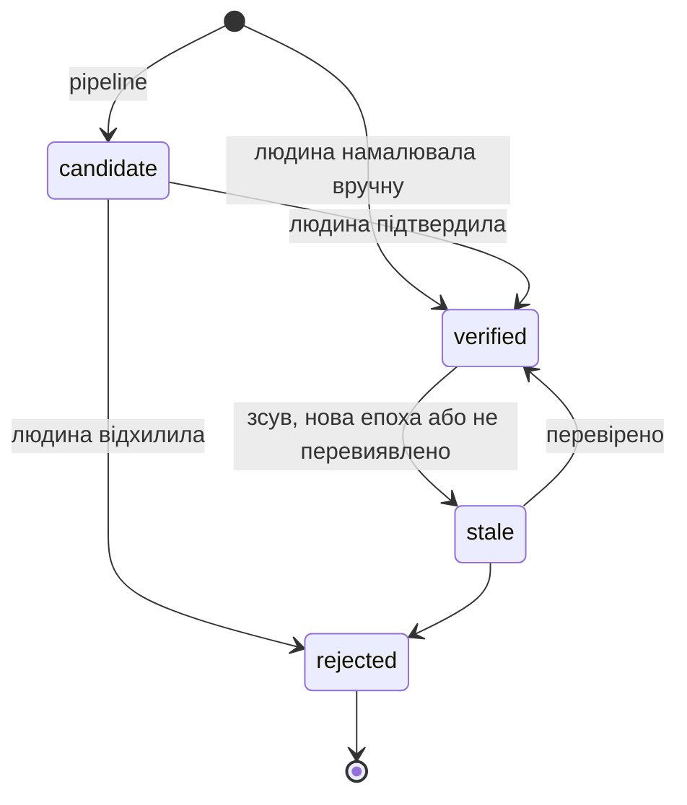
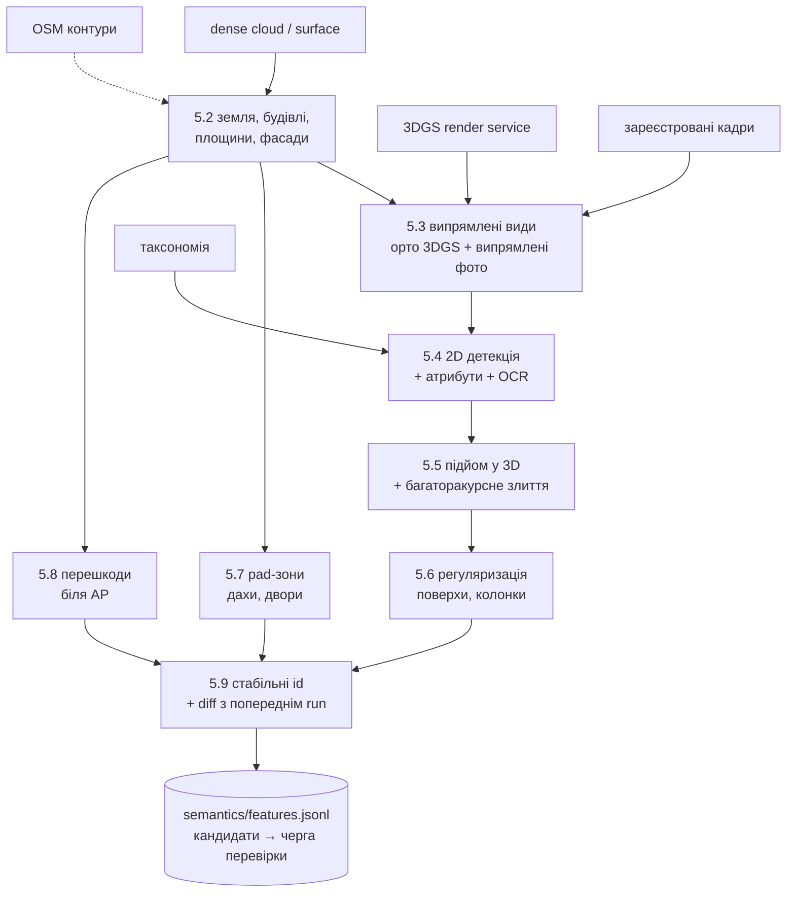
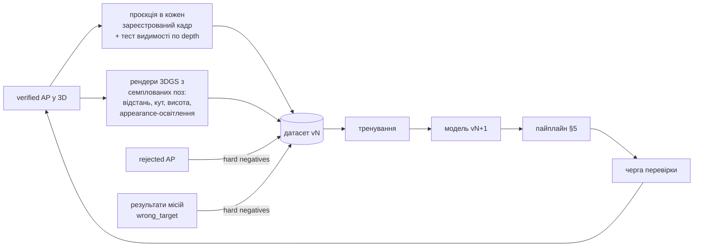

# Точки доступу: вікна, отвори, дахи, зони передачі

> Детальний дизайн семантичного шару й наведення на ціль. Системний контекст —
> [TARGET_ARCHITECTURE.md](TARGET_ARCHITECTURE.md). Рішення — ADR
> [0007](decisions/0007-access-point-taxonomy.md) (таксономія),
> [0008](decisions/0008-detect-2d-fuse-3d.md) (2D-детекція → 3D-злиття),
> [0009](decisions/0009-human-in-the-loop-planning-grade.md) (людина в контурі).
>
> Версія 2026-10-15. Статус: **запропоновано**.

---

## 1. Терміни та межі

**Точка доступу** (Access Point, AP; не плутати з Wi-Fi) — місце на об'єкті,
де дрон **передає**, **забирає** вантаж або **входить** в об'єм. Вікно,
балкон, ворота доку, люк, плаский дах, двір, дрон-порт — усе це AP. Вони
відрізняються класом, геометрією і способом передачі, але проходять **один
і той самий** пайплайн.

| Вид (`kind`) | Що це | Геометрія | Приклади |
|---|---|---|---|
| `opening` | отвір у поверхні (зазвичай вертикальній) | плаский полігон на поверхні-носії | вікно, двері, балконний проріз, ворота доку, ролета, люк у стіні чи даху |
| `pad` | придатна горизонтальна ділянка | полігон на площині + придатна площа | плаский дах, балконна плита, двір, рампа, майданчик |
| `marker` | штучна ціль з відомою геометрією | 6DoF-поза + розмір + id | AprilTag, H-майданчик, поштомат для дронів, дрон-порт |

Поряд з AP живуть **обмеження** (`constraint`): перешкоди, небезпеки,
заборонені зони, поверхня води. Вони не є цілями, але впливають на підліт.

**Спосіб передачі** (handover mode): `hover_handoff` — зависання навпроти
отвору, вантаж у зоні досяжності людини; `tether_lower` — спуск на тросі;
`drop` — скид; `land` — посадка; `pickup` — забір вантажу; `enter` — влітання
в об'єм (лише для дрон-портів, у майбутньому).

**Planning-grade.** Геометрія AP служить для **планування**: вибір цілі,
маршрут, коридор, референси. Останні метри — задача бортового наведення
([ADR-0009](decisions/0009-human-in-the-loop-planning-grade.md)).

---

## 2. Таксономія і доменні пакети

### 2.1 Принцип

Класи **не зашиті в код**. Таксономія — версіонований YAML у
`taxonomy/`, розбитий на **доменні пакети**. Ділянка вмикає потрібні пакети
(`site.yaml: taxonomy_packs`). Новий клас («люк складу нового типу»)
додається в YAML, а модель **дотреновується** за рецептом §10.7.

```
taxonomy/
├── core.yaml          # завжди: базові класи, атрибути, обмеження
├── residential.yaml   # житло, доставка їжі
├── logistics.yaml     # склади, хаби
├── emergency.yaml     # стихійні лиха
└── mappings/          # зовнішні датасети → наші класи; старі версії → нові
```

Ієрархія класів має вигляд `kind.class[.subclass]`. Модель може передбачити
батьківський клас (`opening.window`), якщо не впевнена в дочірньому
(`opening.window.roof_window`), і це вважається частково правильною відповіддю.

### 2.2 Пакети

| Пакет | Класи (основні) |
|---|---|
| **core** | `opening.window`, `opening.door`, `pad.roof_flat`, `pad.roof_pitched`, `pad.ground`, `constraint.obstacle`, `constraint.vegetation`, `constraint.no_go` |
| **residential** | `opening.window.{fixed,casement,roof_window}`, `opening.balcony` (проріз балкона/лоджії), `opening.door.balcony_door`, `pad.balcony_floor`, `pad.yard`, `marker.drop_box` |
| **logistics** | `opening.dock_door`, `opening.roller_shutter`, `opening.hatch.{wall,roof}`, `opening.gate`, `marker.drone_port`, `marker.apriltag`, `pad.loading_apron`, `pad.staging`, `constraint.no_go.forklift` |
| **emergency** | `constraint.water_surface`, `constraint.debris`, атрибут `occupant_signal` (людина/сигнал у вікні — динамічний, з TTL), `pad.roof_*` з атрибутом `reachable_by_water` |

### 2.3 Атрибути

Загальні атрибути отворів визначені в `core`, пакети додають свої:

| Атрибут | Значення | Як визначається |
|---|---|---|
| `state` | open / closed / unknown | класифікатор на кропі; **динамічний** (залежить від епохи) |
| `glazing` | glass / opaque / none / unknown | класифікатор |
| `obstruction` | none / grille / bars / net / awning / ac_unit / unknown | класифікатор + геометрія (виступи) |
| `balcony` | none / open / glazed | класифікатор + геометрія (виступ плити) |
| `label_text` | «7», «Д-12», номер будинку | OCR на кропі (номери доків, під'їздів) |
| `floor_index`, `column` | ціле | регуляризація (§5.6), не модель |
| `size_m`, `sill_height_m`, `facing_deg` | числа | геометрія |
| `occupant_signal` | none / person / flag / light | детектор на **свіжих** кадрах; TTL; лише підказка |

### 2.4 Формат класу (приклад)

```yaml
# taxonomy/logistics.yaml
pack: logistics
version: 1.0.0
requires: {core: ">=1.0"}
classes:
  - id: opening.dock_door
    parent: opening.door
    labels: {uk: "Ворота доку", en: "Loading dock door"}
    prompts: ["loading dock door", "warehouse roller door", "truck dock"]  # open-vocab bootstrap
    orientation: vertical
    size_prior_m: {width: [2.2, 4.5], height: [2.2, 5.5]}                   # фільтр у злитті
    attributes: [state, label_text, obstruction]
    handover:
      allowed: [pickup, hover_handoff]
      default: pickup
      standoff_m: 4.0
      min_clearance_m: 1.5
      approach_cone_deg: 30
    citygml: Door
```

### 2.5 Версіонування

* Новий клас або атрибут — **minor**; перейменування, злиття чи поділ
  класу — **major** з таблицею міграції в `mappings/`.
* Кожна Feature, датасет і модель зберігають рядок версії
  (`core@1.2+logistics@1.0`). Мітки старої версії автоматично
  переводяться в нову через `mappings/`.

### 2.6 Відповідність стандартам

Експорт у **CityJSON / CityGML 3.0 LOD3**: `Building` → `Building`, фасад →
`WallSurface`, дах → `RoofSurface`, `opening.window*` → `Window`,
`opening.door*`, `opening.dock_door`, `opening.gate` → `Door`. Класи без
відповідника експортуються як `GenericOccupiedSpace` з атрибутом
`aerosplat_class`. Так дані відкриваються в стандартних ГІС-інструментах.

---

## 3. Модель даних

### 3.1 AccessPoint

```jsonc
{
  "id": "ap_01JA3K7Q8M2X",                 // ULID, стабільний між run-ами (§5.9)
  "site_id": "podil",
  "class": "opening.window.casement",
  "kind": "opening",
  "taxonomy": "core@1.0+residential@1.0",
  "host": {"building": "B012", "facade": "N1"},
  "geometry": {
    "frame": "site_enu",                    // метри, ADR-0006
    "center": [12.41, -33.08, 14.62],
    "normal": [0.02, 0.99, 0.00],           // назовні
    "u_axis": [0.99, -0.02, 0.00],          // горизонталь уздовж фасаду
    "width": 1.42, "height": 1.61,
    "polygon_uv": [[-0.71,-0.80],[0.71,-0.80],[0.71,0.81],[-0.71,0.81]]
  },
  "wgs84": {"lat": 50.4651, "lon": 30.5172, "h_ellipsoid": 182.3, "h_amsl": 155.9},
  "uncertainty": {
    "center_cov": [[0.04,0,0],[0,0.09,0],[0,0,0.03]],   // м², з урахуванням σ реєстрації
    "sigma_size_m": 0.08,
    "sigma_normal_deg": 2.5
  },
  "attributes": {"state": "closed", "glazing": "glass", "obstruction": "none", "balcony": "none"},
  "address": {"floor_index": 3, "floor_label": "4", "column": 3, "ordinal_on_floor": 3},
  "confidence": 0.91,
  "lifecycle": "verified",                  // §3.4
  "valid": {"from_epoch": "baseline", "to_epoch": null},
  "access": {"handover_allowed": ["hover_handoff"], "last_feasibility": null},
  "provenance": {
    "origin": "pipeline",                   // pipeline | manual
    "run_id": "r_2026-10-20_01", "model": "mapper-seg@0.3.1",
    "support_views": 14, "evidence": ["img_3f2a…", "ortho:N1"],
    "edits": [{"by": "op:lukhashka", "at": "2026-10-21T10:02:11Z", "what": "snap+verify"}]
  }
}
```

### 3.2 Геометрія за видом

| Вид | Поля | Примітка |
|---|---|---|
| `opening` | `center`, `normal`, `u_axis`, `width`, `height`, `polygon_uv`, `orientation` | для люка в даху `orientation: horizontal`, `normal` вгору |
| `pad` | `polygon_enu`, `plane`, `usable_polygon`, `usable_area_m2`, `slope_deg`, `roughness_m`, `clearance_above_m` | `usable_polygon` уже враховує відступи (§5.7) |
| `marker` | `pose` (6DoF), `size_m`, `marker_id`, `family` | для AprilTag — сімейство і id |

### 3.3 Структурні сутності

* **Building:** `footprint` (полігон), висота, адреса з OSM, `floor_offset`
  (цокольний поверх, мансарда; задається людиною), список фасадів.
* **Facade:** площина (`point`, `normal`), `u_axis`, межі `(u,v)`, `v_ground`
  (рівень землі біля основи), азимут, назва (`N1`), вулиця (OSM), **карта
  покриття** (які ділянки фасаду бачили кадри з достатнім GSD і кутом).
  Без покриття детекції не довіряємо (§5.3).
* **RoofSurface / Ground:** площини та регіони, з яких будуються `pad`.

### 3.4 Життєвий цикл



* `rejected` **не видаляється**: це hard negative для ML і пам'ять, щоб
  пайплайн не пропонував той самий хибний кандидат знову.
* Ціллю (§6) може стати **лише** `verified`.

### 3.5 Провенанс і аудит

Кожна зміна дописується в `authored/audit.jsonl`: хто, коли, що змінив,
попереднє значення. Авторські Feature зберігаються **поза** run-директоріями
([ADR-0006](decisions/0006-project-site-epoch-capture.md)).

---

## 4. Адресація: як сказати «саме це вікно»

Диспетчер, мешканець чи оператор мають однозначно назвати отвір, і система
має однозначно цю назву розпізнати.

**Канонічна адреса:** `<site>/<building>/<facade>/<floor>/<column>`,
наприклад `podil/B012/N1/04/03`.
**Для людини:** «вул. Сагайдачного 12, північний фасад (на вулицю), 4 поверх,
3-тє вікно зліва».

| Частина | Правило |
|---|---|
| Будівля | стабільний id; назва — адреса з OSM або задана вручну |
| Фасад | октант азимуту зовнішньої нормалі (`N`, `NE`, …) + порядковий номер зліва направо (`N1`, `N2`); у назві — вулиця, якщо фасад на неї дивиться |
| Поверх | `floor_index` 0 = ряд біля землі; підпис за конвенцією (в Україні 1-й поверх = рівень землі) з поправкою `floor_offset` будівлі |
| Колонка | лік **зліва направо, якщо стояти обличчям до фасаду ззовні**. Ця конвенція фіксована, і UI завжди показує стрілку |

**Дві нумерації в межах поверху:** `column` — колонка регулярної сітки
фасаду; `ordinal_on_floor` — n-й **наявний** отвір на поверсі. Людина каже
«третє вікно», маючи на увазі друге значення. Якщо дві нумерації дають
різні отвори (наприклад, на поверсі пропущено вікно), резолвер повертає обидва
варіанти й позначає неоднозначність.

**Таблиці відповідності** (необов'язкові, на будівлю): квартира → (поверх,
колонки); док «7» → AP. Їх заповнює людина або OCR (`label_text`).

**Резолвер** (`aerosplat.targets.resolve`):
1. Структурована форма в UI — з першого етапу.
2. Вільний текст українською — пізніше: правиловий парсер; LLM лише як
   допоміжний парсер у структуровану форму, а рішення ухвалює детермінований
   резолвер.
3. Резолвер **завжди** повертає список кандидатів з оцінками й причинами
   неоднозначності і **ніколи** не вибирає ціль сам.

---

## 5. Пайплайн семантики

### 5.1 Огляд



### 5.2 Земля, будівлі, фасади

1. **Рельєф:** фільтр землі (cloth simulation або прогресивний морфологічний)
   → DTM; `nDSM = DSM − DTM`.
2. **Будівлі:** кластери `nDSM > 2.5 м`. Контури OSM використовуються як
   пріор, але не як істина, бо можуть бути застарілими.
3. **Площини:** послідовний RANSAC / region growing за нормалями на dense
   cloud або mesh. Площини класифікуються: вертикальні (`|n_z| < 0.15`) →
   стіни; горизонтальні вгору → дахи/земля; решта → скатні дахи.
4. **Фасад** — злиті копланарні стіни однієї сторони будівлі. Нормаль
   спрямована від центроїда контуру назовні. `u_axis` горизонтальна, `v`
   вгору, `v_ground` береться з DTM біля основи.
5. **Карта покриття фасаду:** для кожної клітинки (наприклад, 0.25 м)
   рахуються кадри, що бачать її з кутом < 60° до нормалі та GSD ≤ 2 см/px.

### 5.3 Випрямлені види

Детекцію робимо на зображеннях, де фасад видно **фронтально й метрично**:
отвори там прямокутні, вирівняні й одного масштабу, а піксель відображається
в `(u,v)` тривіально.

| Джерело | Як отримати | Плюс | Мінус |
|---|---|---|---|
| **Орто 3DGS** | ортографічний рендер уздовж `−n`, GSD 1–2 см/px + depth + alpha | повне, однорідне, з будь-яких джерел | артефакти 3DGS там, де мало ракурсів |
| **Випрямлені фото** | гомографія площини фасаду для кожного кадру з кутом < 60° | справжні пікселі | частковий охоплення, перспективні викривлення поза площиною |
| **Сирі фото** | як є | максимум деталей, балкони, виступи | потребує ray-casting |

**Детекції на орто 3DGS довіряємо лише там, де карта покриття добра.**
В інших місцях 3DGS «домальовує» фасад, і детектор знаходить вікна, яких
немає. Для дахів робимо надирне орто.

### 5.4 2D-детекція

Інтерфейс: `Detector.predict(image, classes) → [Instance(polygon|mask, class, score, attrs)]`.

| Реалізація | Роль |
|---|---|
| `OpenVocabDetector` | Grounding DINO / OWLv2 / YOLO-World + SAM 2 для масок; промпти беруться з таксономії. **Старт без даних** і «вчитель» для псевдоміток |
| `TrainedSegmenter` | наша instance-сегментація під версію таксономії; основна модель після §10 |
| `AttributeClassifier` | атрибути на кропах (state, glazing, obstruction, balcony) |
| `LabelOCR` | номери доків і будинків → `label_text` |

* Великі орто обробляються тайлами з перекриттям і NMS на стиках.
* Конкретну архітектуру моделі обираємо **бенчмарком** (§10.5), а не
  наперед. Ліцензію кожної моделі записуємо в реєстр: зараз проєкт
  некомерційний, але зміна статусу не має стати сюрпризом.

### 5.5 Підйом у 3D і багаторакурсне злиття

**Підйом.** Кожна 2D-детекція перетворюється на кандидат у координатах
`(u,v)` фасаду: з орто — напряму; з випрямленого фото — через гомографію;
з сирого фото — перетином променів кутів полігона з площиною. Додатково
перевіряємо глибину: якщо depth рендера/mesh у пікселі значно менший за
відстань до площини, детекція лежить на оклюдері (дерево, стовп) і
відкидається.

**Кластеризація.** На кожному фасаді будуємо граф кандидатів: ребро, якщо
`IoU_uv > 0.3` або центри ближчі за `0.5·min(size)`, і класи сумісні
(однакові або батько–нащадок). Компоненти графа об'єднуються (weighted box
fusion), кути полігона беруться медіаною.

**Довіра (log-odds):**

```
L = L0 + Σ_pos  q_i · logit(s_i)  −  Σ_neg  q_j · β
q  = cos(кут до нормалі) · min(1, GSD_ref / GSD) · (1 − оклюзія)
```

* Позитивний доказ — ракурси з детекцією; негативний — ракурси, де
  регіон добре видно (високе `q`, без оклюзії), але детектор нічого не знайшов.
* **Відблиски** (дзеркальне скло, вода) породжують фантомні вікна, але
  фантом зсувається зі зміною ракурсу, тому мультиракурсна консистентність
  його відсікає.
* **Пріори розміру** з таксономії відкидають злиття-монстрів, наприклад
  «вікно» шириною 9 м.
* **Невизначеність:** розкид кутів по ракурсах + перенесена Σ поз
  камер + RMSE георефу → `center_cov`.

### 5.6 Регуляризація, поверхи, колонки

Фасади майже завжди регулярні. Цим користуємось, але обережно:

1. **Ряди:** кластеризація `v`-центрів отворів (1D mean-shift); типова
   висота поверху `h_f` з інтервалів (пріор 2.7–3.6 м, перший поверх може
   бути вищим — магазини).
2. **Колонки:** кластеризація `u`-центрів.
3. **Прив'язка:** отвір зсувається до лінії ряду/колонки, якщо `|Δ| < τ`
   (≈0.15 м). Зсув записується в провенанс.
4. **Поверхи:** ряди сортуються від `v_ground`. Ряд, чий низ ≤ ~1.5 м над
   землею, отримує `floor_index = 0`. Решта нумеруються за порядком із
   перевіркою `h_f`. Прапорець **`floor_ambiguous`** ставиться, якщо ряд біля
   землі не видно (дерева, паркан), інтервали нерегулярні або відомий
   `floor_offset` суперечить даним.
5. **Виведені отвори.** Порожня клітинка сітки при **поганому** покритті
   і заповнених сусідах → кандидат `inferred` (низька довіра, ніколи не
   підтверджується автоматично). При **доброму** покритті порожня клітинка —
   це просто стіна, і нічого не виводиться.

Помилка поверху чи колонки — **найнебезпечніша** помилка всієї системи:
дрон прилетить до чужого вікна. Тому адреса з прапорцем `floor_ambiguous`
блокує підтвердження цілі без явної перевірки людиною (§6.3).

### 5.7 Pad-зони (дахи, двори, балкони)

1. Площина даху або землі; ухил `< 5°` для `land`, `< 15°` для `drop`.
2. Шорсткість (залишок від площини) `< 5 см`.
3. Перешкоди: `nDSM` над площиною `> 0.3 м` (кондиціонери, антени,
   парапети) → сітка зайнятості 10 см.
4. **Придатна зона:** ерозія вільного регіону на `r_дрона + запас + k·σ`;
   компоненти площею `≥ A_min`.
5. Кліренс над зоною (стовп зайнятості вільний на `H` м) і відкритість неба.
6. Для землі — семантична сегментація покриття на орто (дорога, рослинність,
   вода, авто) з виключенням доріг і води.
7. Балконні плити — малі горизонтальні площини, що виступають із фасаду;
   пов'язуються з отвором над ними.

### 5.8 Перешкоди біля AP

Для кожної AP аналізуємо об'єм перед нею (зайнятість):
* виступи над отвором (балкон вище, козирок, карниз) — обмежують `tether_lower`;
* дерева й стовпи в коридорі;
* **дроти** реконструкція надійно не бачить. Якщо поруч є стовпи або
  фасад виходить на вулицю, ставиться прапорець `wire_risk: possible`.
  Бортове виявлення перешкод — обов'язкова вимога до дрона.

### 5.9 Стабільні ідентифікатори між run-ами

1. Нові фасади зіставляються зі старими за площиною (після переякорювання,
   [TARGET_ARCHITECTURE §7.3](TARGET_ARCHITECTURE.md#73-стабільність-авторських-даних-при-перерахунку)).
2. Кандидати зіставляються з наявними AP угорським алгоритмом за `IoU_uv`;
   при збігу id зберігається.
3. `verified` AP, яку новий run не знайшов, **не видаляється**: вона отримує
   прапорець `not_redetected` і йде на перевірку. Можливо, це реальна зміна
   (будівлю зруйновано), а можливо — помилка детектора.

---

## 6. Вибір цілі (designation)

### 6.1 Принцип

**Система пропонує, людина вирішує.** Ціль — це `MissionTarget`, створений
людиною на основі `verified` AP, з доказами вибору та підтвердженням.

### 6.2 Способи вибору

| Спосіб | Як | Коли |
|---|---|---|
| **Клік** | у 3D, на ортофото фасаду або на фото; можна намалювати новий отвір (одразу `verified`, `origin: manual`) | оператор знає об'єкт; **перший етап, без ML** |
| **Адреса** | структурована форма або текст → резолвер (§4) | диспетчер отримав виклик «4 поверх, 3 вікно зліва» |
| **Фото** | фото будівлі + тап/коло на потрібному вікні | постраждалий або рятувальник надсилає фото |
| **Таблиця / OCR** | «квартира 47», «док 7» | житло з відомою схемою, склади |
| **API** | зовнішня система надсилає адресу + опис | інтеграція з диспетчеризацією |

**Вибір за фото** (`aerosplat.targets.photo`):
1. Отримуємо фото + точку (або полігон) на ньому.
2. Retrieval серед кадрів ділянки **і рендерів 3DGS** (рендери закривають
   ракурси, яких немає серед кадрів).
3. Learned matching → PnP+RANSAC → поза фото; кількість inliers визначає якість.
4. Промінь із точки тапу перетинається з поверхнями фасадів → `(u,v)` →
   найближчі AP з відстанями.
5. Результат накладається **на фото користувача** й на 3D для перевірки.
6. Якщо локалізація не вдалася, UI пропонує кандидатні фасади для ручного
   вибору. Фото зберігається як доказ із політикою зберігання (§11).

### 6.3 Неоднозначність і підтвердження

Підтвердження без явного ручного вибору **заблоковане**, якщо:
* відношення оцінок двох найкращих кандидатів < 1.5;
* AP чи адреса має `floor_ambiguous`, `stale` або `not_redetected`;
* σ центру більша за поріг для обраного способу передачі.

Екран підтвердження показує:
1. ортофото фасаду з виділеною AP і сусідами;
2. **рендер «що побачить дрон»** з пози зависання;
3. адресу людською мовою зі стрілкою напрямку ліку;
4. невизначеність і ризики (§7).

Підтвердження прив'язується до конкретного оператора й записується в аудит.

### 6.4 Стан цілі

`draft → confirmed → planned → dispatched → outcome {success | wrong_target | aborted(reason)}`.
Результат польоту повертається в систему: `wrong_target` стає найціннішим
hard negative і причиною перевірки адресації цієї будівлі.

---

## 7. Підліт і пакет наведення

### 7.1 Параметри передачі

Значення за замовчуванням задаються в таксономії (§2.4), оператор може
перевизначити їх для конкретної цілі.

| Клас | Способи | Standoff | Мін. кліренс | Конус підльоту |
|---|---|---|---|---|
| `opening.window*` | hover_handoff | 2–4 м | 1.5 м | 30° |
| `opening.balcony` | hover_handoff, tether_lower | 2–4 м | 1.5 м | 35° |
| `opening.dock_door` | pickup, hover_handoff | 3–5 м | 1.5 м | 30° |
| `pad.roof_flat` | land, tether_lower, drop | — | 2 м | вертикальний |
| `pad.yard` | tether_lower, drop | — | 3 м | вертикальний |
| `marker.*` | land, pickup | — | за маркером | за маркером |

Числа в таблиці — **плейсхолдери**, доки не відоме обладнання замовника (§13).

### 7.2 Геометрія

```
Зависання:  H = c + n·d_standoff + up·Δh,  курс = −n
Вхід:       E = c + n·D_entry (+ висота безпечного прольоту)
Коридор:    циліндр/конус E → H, радіус  r = r_дрона + m_безпеки + k·σ_total
σ_total² =  σ_AP² + σ_georef² + σ_GNSS(дрона)²
```

1. Зайнятість (ESDF) роздувається на `r`, і вздовж коридору рахується
   мінімальний кліренс.
2. Якщо прямий коридор заблоковано, перебираємо напрямки в межах конуса
   й обираємо той, що має максимальний кліренс.
3. Результат: `feasible` / `feasible_with_risks` / `infeasible` + причини
   (`overhang_above`, `tree_in_corridor`, `wire_risk`, `grille`,
   `below_water`, `sigma_too_large`, …).

### 7.3 Пакет термінального наведення

Бортова система мусить знайти **саме це** вікно серед десятка однакових.
Пакет (`missions/<id>/terminal/`) містить:
* рендери 3DGS уздовж коридору (наприклад, 30 / 15 / 8 / `d` м) з маскою
  цілі та **масками сусідніх AP**: ціль ідентифікується відносним
  розташуванням («третє зліва на четвертому ряду»), а не виглядом;
* клас, метричний розмір, нормаль, очікувану позу;
* id маркерів, якщо ціль — `marker`;
* `manifest.json` з версією контракту і версією таксономії.

Бортовий модуль — поза межами репозиторію; ми фіксуємо **контракт пакета**
і постачаємо бортову модель (§10).

### 7.4 Експорт

| Формат | Для чого |
|---|---|
| QGC `.plan` / MAVLink mission | PX4 / ArduPilot; висоти з явним фреймом (AMSL / над точкою старту) |
| DJI WPML (KMZ) | дрони DJI |
| GeoJSON / KML | рев'ю в ГІС і Google Earth |
| Сцена симулятора (mesh/USD + AP + коридори) | тестування підльоту в Isaac Sim / Gazebo **до** реальних польотів |

### 7.5 Поза межами

Динамічні перешкоди, погода, енергетика, дозволи на повітряний простір —
**не наша задача**. Заборонені зони імпортуються як шари `constraint.no_go`.

---

## 8. Склади й логістика

* **Тип ділянки** `depot`, пакет `logistics`.
* **Об'єкти:** ворота доків з номерами (OCR + таблиця), ролети, люки в
  стінах і даху, дрон-порти, майданчики старту/посадки, зони комплектації,
  заборонені зони (рух навантажувачів, люди).
* **Операції:** вибір точки забору («док 7», «люк Пд-2»), зони старту,
  маршрути від хаба. Модель AP та ж сама; відрізняються пакет, способи
  передачі (`pickup`, `land`) і правила зон.
* **Рекомендація:** на власних складах, де середовище контрольоване, ставити
  **фізичні маркери** (AprilTag) на ворота й майданчики. Маркер дає
  сантиметрову точність наведення, і це надійніше за будь-яку навчену
  детекцію. Система підтримує `marker` як повноцінний вид AP.
* **Інтер'єр** (розширення, пізніше): зйомка всередині через отвори
  (ручне відео) реєструється до екстер'єру через спільну геометрію прорізу,
  який видно з обох боків. Підділянка без GNSS отримує георефу через
  зовнішню модель.

---

## 9. Надзвичайні ситуації: епохи й повені

1. **Двійники заздалегідь.** Список пріоритетних об'єктів від служб
   реагування (лікарні, школи, багатоповерхівки в зонах затоплення) →
   епоха `baseline` з підтвердженими AP.
2. **Швидкий шлях після події** (ціль ≤ 30 хв на об'єкт):
   нові кадри (дрон, фото рятувальників, телефони) **локалізуються** в
   baseline без повного SfM → детекція змін (глибина нових кадрів проти
   рендера baseline, зміна вигляду) → оновлення лише змінених AP.
3. **Рівень води.** Вода сегментується на нових кадрах, межа маски
   перетинається з геометрією baseline (DSM), і робастною оцінкою
   отримується висота поверхні `h_w`. Альтернатива — гідропост + DEM.
   Для AP це дає стани `submerged` (верх отвору < `h_w`), `at_risk`
   (підвіконня < `h_w` + 1 м) або `accessible`; для дахів —
   `reachable_by_water`.
4. **Сигнали людей** (`occupant_signal`: людина, простирадло, ліхтар у
   вікні) детектуються **лише на свіжих кадрах**, мають TTL і є підказкою
   для диспетчера, а не ціллю. Це персональні дані (§11).
5. **UI:** слайдер «до/після», теплова карта змін, слайдер рівня води.

---

## 10. ML-цикл: універсальність через дані

### 10.1 Задачі

| # | Задача | Вхід | Де працює |
|---|---|---|---|
| T1 | instance-сегментація отворів | орто фасадів, фото | офлайн (картографування) |
| T2 | атрибути | кропи AP | офлайн |
| T3 | покриття поверхні (дах, дорога, рослинність, вода, авто) | надирні орто | офлайн |
| T4 | OCR міток | кропи | офлайн |
| T5 | сегментація води | свіжі кадри | швидкий шлях |
| T6 | детекція отворів з ракурсу дрона | відео дрона | **борт** (легка модель) |
| T7 | сигнали людей | свіжі кадри | швидкий шлях, пізніше |

### 10.2 Джерела даних

| Джерело | Що дає | Примітки |
|---|---|---|
| Публічні датасети фасадів (CMP Facade, eTRIMS, ECP, LabelMeFacade, Graz50) | випрямлені фасади з вікнами/дверима/балконами | маппінг класів у `taxonomy/mappings/`; **ліцензії перевірити до використання** (здебільшого research-only — сумісно з нашим статусом, але фіксуємо) |
| Відкриті загальні датасети (класи Window/Door) | перспективні фото | маппінг класів |
| Mapillary, Wikimedia Commons | реальні вуличні фото | ліцензія кожного кадру в провенансі |
| Власні захоплення | цільовий домен | основа валідації |
| **Рендери 3DGS** | необмежені ракурси, відстані, освітлення | доменний розрив: тренуємо на суміші, **оцінюємо лише на реальних** |
| Процедурні будівлі (BlenderProc) | рідкісні класи (люки, дрон-порти) | опційно |

### 10.3 Data engine: розмітка в 3D один раз



Одна будівля з 80 перевіреними вікнами і 300 кадрами дає тисячі 2D-міток
без ручної роботи на кожному кадрі.

### 10.4 Старт з нуля

1. Open-vocab «вчитель» (§5.4) дає псевдомітки на орто й фото.
2. Злиття (§5.5) фільтрує їх: мультиракурсна консистентність — безкоштовний
   сигнал якості.
3. Людина перевіряє вибірку в Facade editor (швидкий клавіатурний рев'ю).
4. На цьому тренується перша власна модель → повтор циклу.

### 10.5 Спліти й оцінка

* **Спліти — за ділянками й будівлями**, ніколи за кадрами (сусідні кадри
  однієї будівлі майже ідентичні, тож спліт за кадрами завищує метрики).
* **Доменні теги** кожного зразка: джерело, діапазон висоти, відстань, кут,
  освітлення, сезон. Метрики рахуються **по кожному тегу**.

| Рівень | Метрики |
|---|---|
| 2D | mAP50, mAP50-95, mask AP — по класах і доменних тегах |
| 3D (AP) | precision/recall за `IoU_uv ≥ 0.5` на фасаді, похибка центру (м), розміру, нормалі (°) |
| Адресація | точність поверху, колонки; top-1 резолвера адрес; top-1 вибору за фото |
| Місія (симулятор) | порушення кліренсу, частка `infeasible` |

**Золоті ділянки** — вручну перевірені та заморожені. Модель просувається
в реєстрі, лише якщо на них немає регресії понад шум.

### 10.6 Реєстр моделей

Model card містить: задачу, версію таксономії, знімок датасету (хеш),
метрики по доменах, призначення (офлайн/борт), відомі обмеження, ліцензію
базової моделі. Кожна Feature посилається на версію моделі, що її створила.
Бортова модель експортується в ONNX (далі TensorRT на пристрої) з тією
самою версією таксономії, що й пакет наведення.

### 10.7 Рецепт: новий клас домену

Приклад: «люк для дронів на складі замовника».

1. Додати клас у `taxonomy/logistics.yaml`: `parent`, `prompts`, пріори
   розміру, способи передачі.
2. Запустити open-vocab bootstrap на ділянках з пакетом `logistics`.
3. Перевірити 20–50 кандидатів у UI. Data engine розмножить їх на всі
   ракурси й рендери.
4. Дотренувати модель (fine-tune з новою головою класу), прогнати оцінку
   на золотих ділянках.
5. Просунути модель у реєстрі → перезапустити семантику.

Це і є «універсальність»: код пайплайна не змінюється, змінюються
таксономія, дані й ваги.

### 10.8 Активне навчання

Черга перевірки наповнюється за пріоритетами: `not_redetected` для
`verified` → `wrong_target` з місій → мультиракурсна неузгодженість →
низька довіра → нові класи.

### 10.9 Інфраструктура

* Тренування — config-driven (pydantic, як `RunConfig`), задачі в тій
  самій черзі з `resource: gpu`.
* Трекінг експериментів — MLflow з локальним файловим сховищем (або
  TensorBoard); без хмарних залежностей.
* Важкі залежності — в `aerosplat[ml]`.

---

## 11. Безпека, приватність, режими відмов

### 11.1 Безпека

* Геометрія **planning-grade**; без підтвердження людиною місії немає;
  запаси рахуються з σ; бортова перевірка цілі та уникнення перешкод
  обов'язкові ([ADR-0009](decisions/0009-human-in-the-loop-planning-grade.md)).
* Система **ніколи** сама не відправляє місію у зовнішню систему без
  підтвердженої цілі.

### 11.2 Приватність

* **Житлові вікна** — це зображення приватного простору. Правила:
  privacy filter при ingest (обличчя, номери авто); у публічних експортах
  і демо внутрішня частина засклених отворів розмивається; ML-датасети
  зберігаються з контролем доступу й без публікації.
* Фото для вибору цілі й `occupant_signal` — персональні дані:
  обмежений строк зберігання, доступ лише ролям, що працюють з ціллю.
* Інтернет-фото: зберігаються URL джерела, автор і ліцензія; на вимогу
  автора видаляються разом з похідними (провенанс робить це можливим).

### 11.3 Режими відмов

| Відмова | Наслідок | Пом'якшення |
|---|---|---|
| Відблиски, дзеркальні фасади | фантомні вікна | мультиракурсна консистентність, перевірка глибини за площиною |
| Повторювані фасади | помилка поверху/колонки | `v_ground` з DTM, `floor_ambiguous`, рендер «що побачить дрон», обов'язкове підтвердження |
| Перший поверх закритий деревами | зсув нумерації | прапорець, ручний `floor_offset` |
| Засклені балкони | «вікно у вікні» | атрибут `balcony: glazed`, ціль — зовнішній контур |
| Розмиті текстури Google | пропущені вікна | карта покриття; деталізацію дає власна зйомка |
| Риштування, тимчасові об'єкти | хибна геометрія | епохи, `not_redetected`, швидке оновлення |
| Ніч, сніг, дим | слабка детекція на свіжих кадрах | доменні теги в оцінці; baseline як опора |
| Застарілий двійник | ціль змінилась | дата епохи на кожному екрані; попередження, якщо baseline старий |

---

## 12. Етапи впровадження

| Етап | Зміст | Результат | Етап у TARGET §13 |
|---|---|---|---|
| **M0** | **Золота ділянка + ручна розмітка.** 1–2 об'єкти: багатоповерхівка + будівля з воротами/ролетою (склад, гараж, СТО). Зйомка: орбіта Earth Studio, ручні фото по периметру (≥ 150 кадрів, два рівні висоти, якщо можливо), Mapillary/Wikimedia, пізніше — дрон. Фасади, орто, **ручне** малювання AP, адресація | оператор сам задає вікна й отвори; перший перевірений набір і бенчмарк | S1–S3 |
| **M1** | Вибір цілі кліком і адресою; геометрія підльоту v0; експорт GeoJSON/QGC; сцена симулятора | перші місії для тестів доставки | S3, S6 |
| **M2** | Open-vocab bootstrap, злиття, регуляризація, черга перевірки | автоматичні кандидати | S5 |
| **M3** | Data engine, перша власна модель, протокол оцінки, реєстр | модель під наш домен | S5 |
| **M4** | Вибір за фото, пакет термінального наведення | сценарій «фото від постраждалого» | S6 |
| **M5** | Пакет `logistics`: доки, OCR, маркери; pad-зони дахів і дворів | склади | S6 |
| **M6** | Епохи, швидкий шлях, рівень води; бортова модель | сценарій повені | S7 |

M0 не потребує ML і дає цінність одразу: саме тут реалізується «задавати
самому». Кожна ручна розмітка стає тренувальними даними.

---

## 13. Відкриті питання

1. **Обладнання передачі** в замовника й служб реагування: трос, штанга,
   скид, посадка? Від цього залежать способи передачі та числа в §7.1.
2. **Платформа дронів:** PX4/ArduPilot (MAVLink) чи DJI? Визначає формат
   експорту й бортову інтеграцію.
3. **Список пріоритетних об'єктів** від служб реагування для baseline-двійників.
4. Чи можна ставити **фізичні маркери** на складах замовника?
5. **Хто підтверджує цілі** (роль, процедура) — для аудиту й прав доступу.
6. Чи потрібна **робота офлайн** у польових умовах (кеш тайлів OSM, без
   інтернету)?
