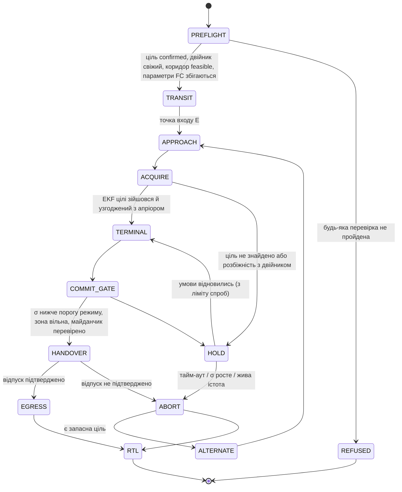
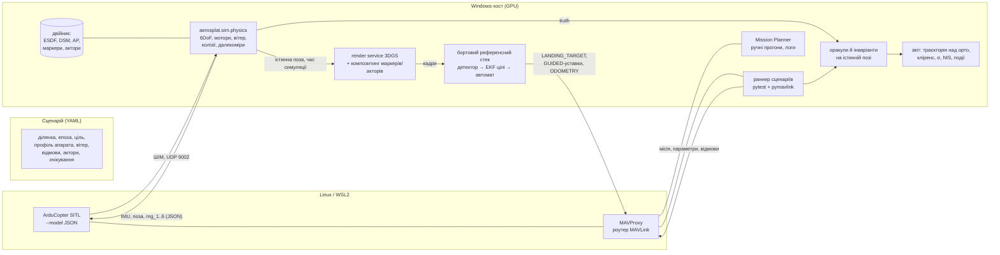

# Доставка (двір, вікно, сортувальна комірка) і SIL-симуляція з ArduPilot

> Робочий план на наступні етапи. Деталізує Фазу 8 з [ROADMAP §9](ROADMAP.md#фаза-8--цілі-місії-надзвичайні-ситуації-6-тижнів)
> і §5 та §7 з внутрішні вимоги надійності (SITL, EKF цілі).
> Домен точок доступу описано в [ACCESS_POINTS.md](ACCESS_POINTS.md).
>
> Версія 2026-10-18, оновлено 2026-10-19 (SIM-1: §4.5, §4.6, §4.10). Статус: **запропоновано**;
> SIM-0, 8.1a, 8.1b, SIM-1 виконано. Перед подальшою реалізацією потрібні ADR з §8.

---

## 0. Коротко

**Чи можемо ми зібрати повноцінний пайплайн тестування з ArduPilot + наша 3D-мапа + EKF?**
Так. Перевірити польотне ПЗ, планування й оцінювання цілі в симуляції (SIL) можна в
межах цього репозиторію. Для цього не треба ні Gazebo, ні Unreal:

* **ArduCopter SITL** — справжня прошивка, скомпільована під ПК. Логіка режимів,
  failsafe, геофенс, EKF3 і precision landing там ті самі, що на борту.
* **Фізику й сенсори дає наш двійник** через JSON-інтерфейс SITL: ArduPilot надсилає ШІМ
  моторів (UDP 9002), а ми повертаємо IMU, позу, швидкість і до шести далекомірів
  (`rng_1…rng_6`). Далекоміри рахуємо променями по нашій карті зайнятості. Колізії
  перевіряємо там само.
* **Камера** — це вже наявний render service 3DGS (поза → RGB/глибина за 15–20 мс).
  Він дає кадри для бортового «референсного» стеку: детектор, EKF цілі, логіку рішень.
* **Mission Planner** потрібен для ручних прогонів і розбору логів. **pymavlink/MAVProxy**
  ганяють сценарії автоматично в pytest, з оракулами на **істинній** позі з фізики.

**Чого симуляція не дасть** (і чого ми не повинні їй приписувати): аеродинаміки біля
стін і у дворах-колодязях, справжнього шуму сенсорів, доменного розриву «рендер ↔
справжня камера», тонких перешкод (дроти) і рухомих об'єктів, яких немає у двійнику.
Тому SIL — **необхідна, але не достатня** умова. Після неї йдуть стенд і польоти на
золотій ділянці (M0).

**Три сценарії доставки** відрізняються не так ціллю, як **тим, що дає точність на
останніх метрах**:

| Сценарій | Клас AP | Що дає точність у терміналі | Головний ризик |
|---|---|---|---|
| **Двір** | `pad.yard` | вертикальна «шахта» + маркер отримувача (килимок) або камера вниз | GNSS у колодязі, дроти, люди/тварини, розгойдування троса |
| **Вікно** | `opening.window` / `opening.balcony` | локалізація **відносно фасаду**: далекоміри до стіни + зіставлення сітки вікон з двійником | помилка поверху/колонки, людина за 2–4 м від гвинтів |
| **Сортувальний термінал** | `marker.sort_cell` | маркери (AprilTag) + зовнішня навігація в приміщенні, відома геометрія | немає GNSS, персонал у проходах, потік від гвинтів |

---

## 1. Що вже є і чого бракує

| Потрібно для доставки й SIL | Стан | Де |
|---|---|---|
| Site ENU ↔ WGS84, фіксований origin | ✅ | `aerosplat.geo.crs`, ADR-0006 |
| DTM / DSM / nDSM, будівлі, фасади, покриття | ✅ (1 м растр) | `aerosplat.semantics` |
| Точки доступу, таксономія, аудит, адресація | ✅ ручна розмітка | `aerosplat.authored`, `taxonomy/core.yaml` |
| Рендер за позою (persp/ortho, RGB/depth) | ✅ | `aerosplat.render` |
| **Карта зайнятості / ESDF** | ✅ (8.1a, carving) | `aerosplat.surface` |
| `pad`-зони дахів і **дворів** (§5.7) | ❌ | залишок 7.1 |
| Цілі (`MissionTarget`), підтвердження | ✅ (8.1b) | `aerosplat.mission.targets` |
| Геометрія підльоту, коридор, експорт місії | ✅ (8.1b; параметри під Copter-4.7.2 — SIM-1) | `aerosplat.mission` |
| Пакет термінального наведення | ❌ | 8.2 |
| Пакети `residential`, `logistics` | ❌ | `taxonomy/` |
| Внутрішні ділянки (термінал без GNSS) | ❌ | нове: §3.4 |
| SIL: SITL, фізика, сенсори, сценарії, оракули | ◐ L2 (SIM-0, SIM-1): SITL, раннер сценаріїв, відмови, оракули на істині; L3 (наша фізика, сенсори, камера) — ні | `aerosplat.sim`, §4.10 |
| EKF цілі | ❌ дизайн не затверджений | §5, ADR |

Для дизайну це значить: **спершу зайнятість і місія, потім симулятор**. Симулятор без
карти зайнятості — це проліт крізь стіни, а без експорту місії йому нічого виконувати.

---

## 2. Ідеї (беклог з оцінкою)

Цінність і вартість — відносні (●●● = висока). Залежності — номери з цієї таблиці.

| # | Ідея | Навіщо | Цінн. | Варт. | Залежить від |
|---|---|---|---|---|---|
| 1 | **Карта зайнятості + ESDF** з dense/DSM (вокселі 0.25–0.5 м, невідоме = зайняте) | коридори, кліренси, колізії й далекоміри в симуляторі | ●●● | ●● | — |
| 2 | **`aerosplat.mission` v0**: точки зависання/входу, коридор, перевірка кліренсу, експорт QGC WPL 110 + `.plan` + геофенс + rally + набір параметрів | перші місії, вхід для SITL | ●●● | ●● | 1 |
| 3 | **SITL-раннер L2**: сценарій → SITL → оракули → звіт; нічний CI | перша автоматична перевірка «місія не проходить крізь стіну» | ●●● | ●● | 2 |
| 4 | **JSON-бекенд фізики** з сенсорами з двійника (далекоміри, колізії, вітер) | реалізм біля будівель, перевірка уникнення перешкод ArduPilot | ●●● | ●●● | 1, 3 |
| 5 | **Карта видимості неба / тіні GNSS** з DSM | σ GNSS у дворі й біля фасаду (запаси коридору), модуляція шуму GPS у SITL | ●●● | ● | — |
| 6 | **Вставка маркерів у рендери** (AprilTag, H/D, килимок) з тестом глибини | детекція й precision landing у симуляції без реальних фото | ●●● | ● | — |
| 7 | **Динамічні актори** (люди, тварини, авто) — композитинг спрайтів/мешів у рендер 3DGS за глибиною + у карту зайнятості | безпекові сценарії «жива істота в зоні» | ●●● | ●● | 6 |
| 8 | **EKF цілі** + Монте-Карло-стенд L1 (NEES/NIS) | рішення «заходимо / тримаємо / відмова» з σ | ●●● | ●● | ADR |
| 9 | **Бортовий референсний стек** (companion): детектор → EKF → автомат станів → MAVLink (`LANDING_TARGET`, GUIDED-уставки) | замкнений контур у SITL, потім на залізі | ●●● | ●●● | 4, 6, 8 |
| 10 | **Внутрішні ділянки** + генератор планування терміналу з YAML (стелажі, комірки, проходи, маркери) | сортувальний термінал | ●● | ●● | 1 |
| 11 | **Локалізація «рендер ↔ кадр»** у 3DGS (learned matching + PnP) | вибір за фото (M4), навігація біля фасаду, валідація двійника | ●● | ●●● | — |
| 12 | **Перегляд польоту** у веб-UI: лог DataFlash/симуляції → траєкторія над сценою, еліпсоїди σ, події | розбір прогонів і реальних польотів | ●● | ●● | 3 |
| 13 | **Імпорт реальних логів** → «прогноз двійника ↔ факт» (GNSS, кліренс, вітер) | калібрування моделей §5 і §2.5 на правді | ●● | ●● | 12 |
| 14 | **Журнал небезпек** (hazard log) з трасуванням «небезпека ↔ тест» (`@pytest.mark.hazard("H-012")`) | доказова безпека для R2, база для SORA-подібного аналізу | ●●● | ● | — |
| 15 | **Перевірка параметрів перед злетом**: зчитати параметри FC через MAVLink і порівняти з пакетом місії | failsafe і геофенс — частина пакета, а не «налаштування на місці» | ●● | ● | 2 |
| 16 | Пакети таксономії `residential`, `logistics`, атрибут `marking` (H/D/circle/apriltag) | нові класи для трьох сценаріїв | ●● | ● | — |
| 17 | Евристика вітрової експозиції (кути будівель, колодязі) без CFD | прапорці ризику, турбулентність у сценаріях | ● | ●● | 1 |

---

## 3. Три сценарії доставки

### 3.1 Спільний каркас місії

Усі три сценарії — це той самий автомат станів. Відрізняються сенсори в `ACQUIRE/TERMINAL`,
спосіб передачі й пороги. Кожен вихід у `HOLD`/`ABORT` має **іменовану причину**, і ці
причини стають очікуваними результатами негативних тестів (§4.6).



* **PREFLIGHT** — повністю наша зона: ADR-0009 (ціль лише з `verified` і підтверджена
  людиною), вік двійника, σ проти порогу режиму передачі, коридор, вітер. До цього
  додається **звірка параметрів FC** з пакетом місії (ідея 15).
* **Точки неповернення.** `COMMIT_GATE` — останнє місце, де відмова дешева. Після відпуску
  вантажу повернути його неможливо, тому всі перевірки стоять **до** воріт.
* **Незалежність.** Геофенс, обмеження швидкості й висоти, уникнення за далекоміром
  (`AVOID_*`) і failsafe живуть **на борту в ArduPilot** і не залежать від нашого EKF
  чи двійника (принцип 9 з DOMAIN §3).

### 3.2 Доставка у двір (`pad.yard`)

**Чим двір особливий.** Це колодязь: будівлі з кількох боків закривають небо (GNSS
деградує саме тоді, коли дрон опускається), у ньому дерева, дроти, мотузки для білизни,
припарковані авто, діти й тварини. Корисна площа мала, а підліт можливий лише
**вертикально**.

**Що будуємо в пайплайні:**

1. **Кандидати `pad.yard`** — розширення pad-зон §5.7 на землю:
   * клітини DTM з `nDSM < 0.3 м` і низькою шорсткістю (є з 7.1);
   * мінус дороги, рослинність, вода й авто (сегментація надирного орто, T3; у v0 —
     шорсткість + ручна правка);
   * **оцінка «двірності»**: частка горизонту на висоті 10 м, закрита будівлями (з DSM).
     Вона відрізняє двір від вулиці й одразу передбачає погіршення GNSS.
2. **Вертикальна шахта.** Для кожного кандидата — радіус вільного циліндра `r(z)` від
   землі до безпечної висоти (над дахами + запас) за ESDF. Шахта придатна, якщо на кожній
   висоті `r(z) ≥ r_дрона + m + k·σ_total(z)`. **σ росте донизу**: що глибше в колодязі,
   то менше видно неба.
3. **Карта видимості неба** (ідея 5). Для точки `(x, y, z)` проганяємо промені по DSM у
   36–72 азимутах і отримуємо частку неба над маскою 15°. Звідти — **прогнозна σ GNSS** і
   прапорець багатопроменевості. Модель спершу евристична; калібрується реальними логами
   (ідея 13). Цей самий шар корисний для вікон (§3.3).
4. **Способи передачі** (числа — після відповіді про обладнання, ACCESS_POINTS §13 п. 1):

   | Спосіб | Як в ArduPilot | Плюси | Ризики / що тестувати |
   |---|---|---|---|
   | `tether_lower` | лебідка (`WINCH_TYPE`, `MAV_CMD_DO_WINCH`); у SITL є віртуальна лебідка і симуляція підвішеного вантажу (`SIM_SLUP_*`) | дрон лишається високо: менше потоку на людей, далі від дерев | розгойдування у вітрі, трос чіпляє гілки/дроти. Шахту перевіряємо й **для троса** (тонкий циліндр під дроном) |
   | посадка вантажу | `MAV_CMD_NAV_PAYLOAD_PLACE`: спуск до падіння тяги, відпуск захвату, підйом | не треба лебідки | детекція дотику за тягою; на форумі ArduPilot є звіти про хибні спрацьовування з легким вантажем. Обмежувати висоту відпуску далекоміром (`PLDP_RNG_MAX`) і **прогнати як окремий набір тестів** |
   | `drop` | захват/серво | найпростіше | лише міцні вантажі з малої висоти; люди в зоні = заборона |

5. **Маркер отримувача** («килимок доставки» з AprilTag/QR, який отримувач кладе сам).
   Це найдешевший великий виграш у надійності: сантиметрова точність через precision
   landing (`PLND_*`, повідомлення `LANDING_TARGET` від companion), підтвердження, що
   отримувач на місці, і він сам обрав вільне місце. Без маркера терміналом керує камера
   вниз + EKF, але з більшою σ і консервативнішими порогами.
6. **Перевірка зони перед відпуском:** детектор людей і тварин на камері вниз. Будь-яке
   спрацьовування → `HOLD` (DOMAIN §3 п. 4: живе над усім).

**Сценарії тестів:** людина заходить у двір під час спуску; погіршення GNSS за картою
неба; глітч GPS на висоті 15 м; пориви вітру з турбулентністю; маркер частково затінений
або закритий; маркер на **сусідньому** дворі (хибна ціль → розбіжність з апріором → стоп);
гілка в шахті, якої немає в старій епосі; трос розгойдується понад поріг.

### 3.3 Доставка у вікно (`opening.window`, `opening.balcony`)

**Чим вікно особливе.** Тут уже є фасади, AP, адресація й `floor_ambiguous`. Нове —
**останні 30 метрів**. Біля фасаду GNSS закритий наполовину й страждає від
багатопроменевості (σ — метри), а вікна однакові. Тому GPS-координата тут **не може
відрізнити «третє вікно на четвертому поверсі» від сусіднього**. Точність має дати
локалізація **відносно фасаду**.

**Як наводимось:**

1. **Кадр фасаду як система координат.** Оцінюємо позу дрона в `(u, v, n)` фасаду, а не
   в ENU. Ціль у цьому кадрі відома точно (полігон AP), тож задача зводиться до
   локалізації дрона відносно стіни.
2. **Відстань і курс до стіни (`n`, рискання).** 2–3 далекоміри вперед або лідар
   близькості дають площину стіни безпосередньо. Це точно й не залежить від GNSS.
   У SITL це `rng_*` з JSON-бекенду, пораховані по нашій зайнятості. Ці ж сенсори живлять
   **незалежне** уникнення ArduPilot (`AVOID_MARGIN`), тож межа «не ближче X м до стіни»
   діє на борту навіть при помилці нашого стеку.
3. **Положення вздовж стіни (`u, v`) — зіставлення сітки.** Бортовий детектор знаходить
   вікна в кадрі, а ми зіставляємо їх із сіткою отворів двійника (ряди/колонки з
   адресації) угорським алгоритмом. **Перевірка неоднозначності на борту:** рахуємо оцінку
   й для зсувів на ±1 колонку і ±1 поверх. Якщо відношення найкращої до другої < 1.5
   (те саме правило, що в §6.3 ACCESS_POINTS), → `HOLD`. Це бортове продовження
   найнебезпечнішої помилки системи.
4. **Рендер «що побачить дрон»** з пакета наведення (30/15/8 м, маски цілі й сусідів)
   дає детектору й зіставленню очікувану картинку, а оператору — те, що він підтверджує.
5. **Керування:** GUIDED, companion шле уставки позиції/швидкості в локальному кадрі.
   Обмеження швидкості біля фасаду — параметрами в пакеті місії.

**Спосіб передачі — питання продукту, не лише алгоритму:**

* **Людина бере вантаж з вікна** (`hover_handoff`). Людина опиняється за 2–4 м від гвинтів,
  а вантаж треба подати штангою чи тросом. Це R2 з найжорсткішими вимогами до утримання
  позиції (σ ≲ 0.2 м), захистом гвинтів і явним сигналом готовності від отримувача
  (кнопка в застосунку «я біля вікна»).
* **Приймач на вікні/балконі** (скринька на кронштейні з маркером). `opening`
  перетворюється на `marker`, і задача стає як у терміналі: сантиметри, без людини поруч.
  **Рекомендую запропонувати замовнику цей варіант як основний** для клієнтів, що
  погоджуються встановити приймач.

**Сценарії тестів:** двійник зсунутий на один поверх (має спрацювати перевірка сітки);
однакові сусідні вікна; вікно зачинене (атрибут `state`, динамічний); засклений балкон;
відблиск; пориви біля кута будівлі; втрата детекції на 2 с (σ росте → `HOLD`); людина
в сусідньому вікні; далекомір дає хибну відстань (розбіжність з двійником → стоп).

### 3.4 Сортувальний термінал (комірки)

**Чим термінал особливий.** Тут немає GNSS, зате є **відома геометрія** (креслення,
стелажі, комірки) і можливість обладнати середовище: маркери, маяки, датчики комірок,
блокування проходів. 3DGS тут — опція для реалізму, а не основа.

**Модель даних (нове):**

* **Внутрішня ділянка** — `Site.kind: indoor`, локальна система з origin від креслення.
  Прив'язка до WGS84 — за бажанням: через отвір дверей, видимий зовні й зсередини
  (ACCESS_POINTS §8), або просто фіксована точка будівлі. Для ArduPilot це origin EKF,
  який companion задає повідомленням `SET_GPS_GLOBAL_ORIGIN`, тож геофенс і місії в
  lat/lon працюють і в приміщенні.
* **Стелаж = фасад.** Площина з сіткою рядів і колонок; комірка — AP з адресою
  `<термінал>/<стелаж>/<ряд>/<колонка>`. Наявна адресація (`addressing.py`) і Facade editor
  перевикористовуються майже без змін. Таблиця відповідності «сортувальний код ↔
  комірка ↔ id маркера» — як таблиця «квартира ↔ вікна» (ACCESS_POINTS §4).
* **Таксономія `logistics`:** `marker.sort_cell` з атрибутом `loading: top_open | front`,
  `marker.apriltag`, `pad.charging`, `constraint.no_go.staff_zone`.
* **Джерело геометрії:** YAML-планування (або IFC/CAD) → **процедурний генератор**
  мешу, карти зайнятості й поз маркерів (ідея 10). Пізніше — реальний скан приміщення з
  відео телефону через наш пайплайн (адаптер `handheld`).

**Навігація без GNSS** (зовнішня навігація в EKF3: `EK3_SRC1_POSXY = 6` тощо):

| Джерело | Точність | Примітка |
|---|---|---|
| Карта AprilTag (стеля/підлога/стелажі) → поза на companion → `ODOMETRY` / `VISION_POSITION_ESTIMATE` | см | основне; розташування маркерів — частина двійника терміналу |
| UWB-маяки (`BCN_*`) | 10–30 см | незалежне резервне джерело; перемикання джерел EKF3 (`EK3_SRC2_*`) |
| Optical flow + далекомір | дрейф | лише деградований режим «зупинитись і сісти» |

**Термінальна фаза.** Наведення на маркер комірки (як precision landing, але зависання
над коміркою), відпуск у **відкриту зверху** комірку з 0.3–0.8 м. Фронтальні комірки
вимагають горизонтального вкладання — для мультикоптера це значно важче, тож
рекомендуємо комірки, відкриті зверху.

**Інтеграція з терміналом — головний важіль надійності:** датчик заповнення комірки
підтверджує доставку незалежно від дрона; блокування проходу, коли там персонал
(світлові завіси, турнікети) → місія заблокована; резервування проходів, якщо дронів
кілька.

**Фізика приміщення:** потік від гвинтів здуває легкі посилки з сусідніх комірок, біля
стелі й полиць змінюється тяга (ефект стелі/землі). Швидкості — 1–2 м/с.

**Симуляція:** у SITL є готова симуляція Vicon (`--serial5=sim:vicon:`, `VISO_TYPE`,
`EK3_SRC1_*=6`). З нею перші тести терміналу запускаються **без нашого зору**. Далі
Vicon замінюємо на власний локалізатор по маркерах, відрендерених у сцені.

**Сценарії тестів:** маркер комірки закритий; **неправильний маркер на комірці**
(невідповідність таблиці → стоп, а не «доставили не туди»); відмова UWB-маяка;
перемикання джерел EKF3; людина входить у прохід; комірка вже зайнята (датчик);
низька батарея посеред проходу.

---

## 4. SIL-пайплайн: ArduPilot SITL + наш двійник

### 4.1 Архітектура



**Ключові властивості:**

* **Lock-step.** SITL з JSON-моделлю крокує лише тоді, коли фізика відповідає. Тому
  рендер 3DGS на 15–20 мс і повільна фізика на Python не ламають часу: симуляція
  просто йде повільніше за реальний час. **Весь** стек (включно з companion) живе в
  **часі симуляції**, а не в настінному. Інакше результат залежатиме від навантаження
  машини.
* **Істина окремо від оцінки.** Оракули дивляться на позу з фізики, а не на те, що
  думає EKF3. Тільки так видно, що EKF «впевнено помиляється».
* **Один двійник.** Фізика, далекоміри, колізії, оракули й рендер беруть геометрію з
  тієї самої ділянки й епохи, що й планування. Окремого «світу для Gazebo» з власними
  розбіжностями немає.

### 4.2 Рівні тестування

| Рівень | Що в контурі | Швидкість | Для чого | Де запускати |
|---|---|---|---|---|
| **L0** | функції | мс | геометрія, коридори, EKF-математика, автомат станів; властивості (property-based) | CI на кожен PR |
| **L1** | кінематична модель + наш стек + рендери, **без ArduPilot** | тисячі прогонів/год | Монте-Карло EKF цілі (NEES/NIS), логіка рішень, пороги | CI (без камери) / локально з GPU |
| **L2** | SITL з **вбудованою** фізикою ArduPilot + наш раннер | ~реальний час або швидше (`--speedup`) | місія з нашого експорту, failsafe, геофенс, відмови; кліренс по траєкторії | нічний CI (Linux, без GPU) |
| **L3** | SITL + **наш JSON-бекенд** + рендер + companion | повільніше за реальний час | замкнений контур: далекоміри, уникнення, precision landing, термінальне наведення | локально з GPU, перед релізом |
| **L4** | стенд: справжній FC (без гвинтів) + companion-комп'ютер, який отримує рендери | реальний час | затримки, продуктивність на борту, кабелі й порти | вручну |
| **L5** | польоти на золотій ділянці → лог назад у систему | — | калібрування моделей (σ GNSS, вітер), валідація двійника | вручну, після проходження L2–L4 |

Правило з DOMAIN §5 стає конкретним: **апаратний політ — лише після зеленого L2 + L3 на
тому самому сценарії, ділянці й версії прошивки.**

### 4.3 Фізика: три варіанти і вибір

| Варіант | Плюси | Мінуси | Рішення |
|---|---|---|---|
| **A. Вбудована фізика SITL** (`sim_vehicle.py -v ArduCopter`) | нуль коду, стабільно | далекоміри не бачать наших будівель, колізій немає | **старт (L2)**: колізії рахуємо пост-фактум по траєкторії |
| **B. Власний JSON-бекенд на Python** | один двійник, сенсори з нашої геометрії, повний контроль відмов | треба написати й перевірити модель мультикоптера | **основний (L3)** |
| **C. Gazebo Harmonic + `ardupilot_gazebo`** | зрілі плагіни сенсорів, стандарт спільноти | другий світ (меш-експорт), погано на Windows, фотореалізм все одно наш | лише якщо знадобиться перехресна перевірка фізики |

**Модель для B (мінімум):** тверде тіло 6DoF; мотори з першим порядком
(`τ ≈ 30–50 мс`), тяга й момент ∝ ω²; лінійний і квадратичний опір; вітер (середній +
турбулентність, напр. Драйден); контакт із землею; колізія з ESDF (зіткнення =
провал тесту, а не «відскок»). Параметри — **профіль апарата** (маса, інерція, база,
мотори), спільний із параметрами ArduPilot. Валідація: той самий маневр у A і B дає
близькі відповіді (крок висоти, розворот) — це окремий тест.

### 4.4 Сенсори з двійника

| Сенсор | Як рахуємо | Куди йде |
|---|---|---|
| IMU, поза, швидкість | з фізики (+ шум/зсуви за профілем) | JSON → SITL → EKF3 |
| Далекоміри / близькість | промені по ESDF/мешу з поз монтажу | `rng_1…rng_6` → SITL → `AVOID_*`, precland |
| GNSS | моделює SITL; ми **модулюємо** його шум і глітчі за картою видимості неба (§3.2 п. 3) | EKF3 |
| Камера | render service: поза камери = поза з фізики × монтаж; + шум, розмиття від руху, затримка, втрати кадрів | companion |
| Маркери, килимок, H/D | текстуровані площини, композитинг у рендер за глибиною 3DGS | companion |
| Люди, тварини, авто | спрайти/меші за траєкторіями, композитинг за глибиною + динамічні вокселі в зайнятості | companion, оракули |
| Зовнішня навігація (термінал) | спершу Vicon-симуляція SITL; потім наш локалізатор по маркерах | EKF3 (`EK3_SRC*=6`) |

### 4.5 Сценарій (приклад)

Формат нижче — цільовий (L2–L4). **Реалізовано в SIM-1** (`aerosplat.sim.scenario`, перевірка
при читанні): усе, крім акторів і моделі GNSS — їх на L2 немає, тому файл з ними
**відхиляється**, а не тихо виконується без них.

```yaml
# sim/scenarios/yard_tether_person_enters.yaml
scenario: yard-tether-person-enters
site: default/dataset_v6
epoch: baseline
target: ap_01JA...               # verified pad.yard, підтверджена ціль
handover: tether_lower
vehicle: quad-5kg                # профіль фізики + базові параметри ArduPilot
ardupilot: {tag: Copter-4.x.y, params: [base.parm, winch.parm, precland.parm]}
environment:
  wind: {speed_mps: 6, dir_deg: 240, turbulence: moderate}
  gnss: {model: sky_view}        # шум і глітчі з карти видимості неба
actors:
  - {kind: person, path: [[12, -30], [15, -28]], speed_mps: 1.2, start_s: 95}
faults:
  - {at_s: 140, fault: gps_loss, duration_s: 10}   # раннер переводить у SIM_* для зафіксованої версії
expect:
  outcome: abort                 # людина в зоні → HOLD → тайм-аут → ABORT
  reason: live_being_in_zone
  invariants: [min_clearance, no_release_with_live_being, sigma_gate, fence]
seeds: 20                        # Монте-Карло: вітер, шум, час появи актора
```

* Відмови описуються **абстрактно** (`gps_loss`, `motor_degraded`, `rc_loss`,
  `gcs_loss`, `battery_sag`, `wind_gust`). Раннер переводить їх у конкретні `SIM_*`-параметри
  **зафіксованої** версії ArduPilot, бо їхні назви між версіями змінювались.
* Версія ArduPilot закріплюється тегом, а сценарій фіксує тег. Оновлення прошивки —
  окремий PR з повним прогоном набору.

**Як є в SIM-1** (приклад з набору `pytest -m sitl`):

```yaml
scenario: street-window-gps-loss
site: demo/street
scene: street                     # синтетична сцена (tests/mission_scenes.py); мітка
target: window
mission: missions/msn_01M58...    # тека експорту (відносно YAML) або msn_-id разом із site
occupancy: occupancy/             # двійник для оракулів; типово — прогін, на якому планували
vehicle: sitl-quad                # configs/sim/vehicles/sitl-quad.yaml
ardupilot: {tag: Copter-4.7.2}    # інший тег = відмова firmware_mismatch
environment:
  wind: {speed_mps: 0, dir_deg: 0, turbulence: none}
faults:
  - {fault: gps_loss, after: over_exit, at_s: 1}   # after: start | <роль точки> | <роль>:reached
expect:
  outcome: abort                  # complete | abort | refused | violation
  reason: gps_loss
  modes: [LAND]                   # має збігатися з тим, що з цього робить .parm
  tolerances: {react_s: 5}        # hover_m, hover_alt_m, heading_deg, altitude_m, land_m, ...
seeds: 1                          # seed k > 0 зсуває час відмов на ±1 с
speedup: 3
```

* `after` — точка відліку **в часі симуляції**: старт місії (`MISSION_START`), початок польоту
  до точки з роллю з `mission.json` (`over_entry`, `hover`, …) або момент, коли автопілот
  оголосив її пройденою (`hover:reached` — **після** утримання).
* Параметри відмов (`level`/`voltage_v` для `battery_sag`, `speed_mps`/`dir_deg` для
  `wind_gust`, `motor`/`thrust` для `motor_degraded`) перевіряються за видом відмови;
  чужі поля, перекриття однакових відмов, `abort` без відмови, що його спричиняє,
  `violation` інваріанта, який не перевіряється, — помилка файлу.
* Перед польотом раннер перевіряє узгодженість очікування з пакетом: `abort` на відмову,
  після якої пакет каже «продовжувати» (`FS_OPTIONS`), або `modes`, яких пакет не дає, —
  це **зламаний сценарій**, а не проходження.

### 4.6 Оракули й безпекові інваріанти

Перевіряються на **істинній** траєкторії, щокроку:

| Інваріант | Формула / умова | L2, SIM-1 (`aerosplat.sim.oracles`) |
|---|---|---|
| Кліренс | `ESDF(p_true(t)) ≥ r_дрона + m_min` для всіх `t` | ✅ `clearance`: `m_min` = min(мінімальний кліренс класу, транзитний запас); поверхні, яких місія торкається навмисно (ґрунт під домом і під точкою приземлення, площина цілі на підході), не рахуються, але відстань до площини цілі ≥ `r_дрона + m` класу |
| Невідоме = зайняте | жодного входу у вокселі `unknown` / `occupied` / `no_go` | ✅ там само: вхід у `occupied` / `unknown` / за межу сітки — провал з часом і точкою |
| Жива істота | жодного відпуску/посадки, коли в зоні є актор `person`/`animal`; жодного прольоту над ним нижче `h_min` | ❌ актори — SIM-4 (сценарій з `actors` на L2 відхиляється) |
| Ворота σ | жодного відпуску, якщо `σ_цілі > поріг(режим)` у момент рішення | ❌ EKF цілі — 8.2a; на L2 ворота σ працюють лише при плануванні (8.1b) |
| Реакція | після появи небезпеки → `HOLD` за ≤ `T_react` | ✅ `failsafe`: перший режим після тригера — з ланцюжка, що його дає `.parm` (наприклад `SMART_RTL`, інакше `RTL`, інакше `LAND`), за ≤ затримка тригера + `T_react`; не раніше тригера; без повернення в `AUTO`. Без відмови — жодного режиму, крім `AUTO` |
| Геофенс | траєкторія всередині включення і поза виключеннями; порушення → дія ArduPilot з пакета | ✅ `fence` (полігон, `FENCE_ALT_MAX`, `FENCE_RADIUS` — як завантажено) + `failsafe` для `fence_breach` |
| Кадри висот | місія в явному фреймі (AMSL / над домом); **навмисно хибний фрейм** у тесті має бути спійманий валідацією, а не в польоті | ✅ до польоту: фрейм кожного пункту, AMSL-висоти у відносних пунктах, зчитування місії з апарата назад; у польоті `altitude_frame`: дім там, де в плані, кожна пройдена точка — на своїй висоті над домом |
| Точність (позитивні сценарії) | похибка відпуску ≤ `ε(режим)` у ≥ 95% прогонів Монте-Карло | ◐ `hover`: досягнуто H у допуску й утримано, підхід не швидше запланованого; `heading`: на H обличчям до цілі вже при прибутті. Монте-Карло — `seeds` (зсув часу відмов), статистики ≥ 95% ще немає |
| Узгодженість EKF | середній NEES у межах χ² (95%) по прогонах; частка відкинутих воротами вимірювань — у межах очікуваного | ❌ оцінку EKF записуємо поруч з істиною (`trajectory.json`), але не судимо |
| Детермінізм | той самий seed → та сама послідовність рішень (допуск на числа) | ◐ seed фіксує час відмов; сам SITL з прискоренням не побітово відтворюваний, тому оракули мають допуски |
| Завершення | — (нове в SIM-1) | ✅ `completion`: `complete` — пройдено всі точки, посадка в ≤ 1.5 м від дому, роззброєно; `abort` — місію не завершено, апарат сів і роззброївся (після RTL — удома); у повітрі на тайм-ауті — провал |

**Позитивний сценарій і правильна відмова однаково зелені.** Тест «маркер на сусідньому
дворі» проходить, коли місія **відмовилась** із причиною `prior_mismatch`.

### 4.7 Хто що робить: Mission Planner, MAVProxy, pymavlink

| Інструмент | Роль у нас |
|---|---|
| **Mission Planner** (Windows) | ручні прогони сценаріїв, перегляд місії, геофенсу й параметрів, перехоплення керування оператором (тест людського фактора), розбір DataFlash-логів. **Не в CI** |
| **MAVProxy** | роутер MAVLink: SITL ↔ раннер ↔ companion ↔ Mission Planner (кілька `--out`) |
| **pymavlink** | раннер у pytest: завантаження місії, геофенсу й параметрів, армінг, ін'єкція відмов, читання телеметрії; розбір `.bin`-логів (EKF-інновації, події precland) |
| Наш експорт | QGC WPL 110 (`.waypoints`, читають і Mission Planner, і MAVProxy), QGC `.plan`, геофенс, rally, `.parm` |

### 4.8 Практичне: Windows + WSL2

**Стан (SIM-0, перевірено 2026-10-18).** WSL2 `Ubuntu-24.04` у режимі NAT; ArduCopter
**Copter-4.7.2** (коміт `fb773567`, на цю дату = `ArduCopter-stable`) в окремому
`git worktree` `~/ardupilot-aerosplat`; MAVProxy 1.8.75; pymavlink 2.4.50. Пін (тег + повний
коміт), шляхи, home і порти — у [`configs/sitl.yaml`](../configs/sitl.yaml). Оновлення
прошивки = зміна піна окремим PR із повним прогоном `pytest -m sitl`.

**Раз на машину** (Windows, корінь репозиторію):

```bash
pip install -e ".[sim]"                # pymavlink
python -m aerosplat.sim.sitl setup     # тег -> worktree -> waf configure --board sitl -> waf copter (~3 хв)
```

`setup` (`tools/sitl/setup_ardupilot.sh`) бере об'єкти й теги з наявного клону
(`ardupilot.source_clone`), а його checkout, гілки й `build/` не чіпає. Він ідемпотентний і
відмовляє, якщо тег указує не на зафіксований коміт або у worktree є локальні зміни. Передумови в
WSL: залежності збірки ArduPilot (`Tools/environment_install/install-prereqs-ubuntu.sh`) і venv
`~/venv-ardupilot` з empy 3.x, pexpect, future і MAVProxy.

**Тести:**

```bash
pytest                  # як і раніше; sitl-тести пропущено
pytest -m sitl          # сам піднімає SITL на сесію і зупиняє його (~75 с)
```

* Маркер `sitl` — лише на явний запит: `-m sitl`, `--sitl` або `AEROSPLAT_SITL=1`. SITL, який
  просто працює (скажімо, для ручного прогону з Mission Planner), звичайний `pytest` не чіпає:
  тест піднімає й саджає апарат.
* Якщо SITL уже запущено, `-m sitl` бере його і не зупиняє. `AEROSPLAT_SITL_AUTOSTART=0` — не
  запускати самому (тоді падіння), `AEROSPLAT_SITL_ENDPOINT=udpout:host:port` — інший SITL.
* Запитані, але неможливі sitl-тести (немає pymavlink, SITL не піднявся) — **падіння, не пропуск**.
* Смоук [`tests/sitl/test_sitl_smoke.py`](../tests/sitl/test_sitl_smoke.py): коміт із
  `AUTOPILOT_VERSION` = пін; heartbeat → GUIDED → arm → зліт на 10 м → LAND → автодизарм.
  Перевірки — за **істиною** `SIM_STATE` (старт у home ділянки ± 1 м; зависання 10 ± 1 м; не
  вище 11.5 м; дрейф < 2 м; після посадки < 0.3 м над стартом). Оцінку EKF
  (`GLOBAL_POSITION_INT`) лише порівнюємо з істиною: ≤ 1 м по висоті, ≤ 2 м у плані. У першому
  прогоні: висота 9.91 м, дрейф 0.06 м, розбіжність EKF по висоті 0.29 м.
* `SIM_STATE.lat/lon` (float) ArduPilot заповнює значеннями в degE7; беремо `lat_int/lon_int`.
* Маркер `hazard("H-NNN")` пов'язує тест із [журналом небезпек](HAZARDS.md).

**Ручний запуск** (наприклад, для Mission Planner):

```bash
python -m aerosplat.sim.sitl start                       # home = origin default/dataset_v6
python -m aerosplat.sim.sitl start --site default/dataset_splater
python -m aerosplat.sim.sitl start --location 40.8910,-74.2163,233,90 --speedup 2
python -m aerosplat.sim.sitl status
python -m aerosplat.sim.sitl endpoint                    # рядок підключення pymavlink
python -m aerosplat.sim.sitl stop
```

Як це влаштовано:

* Скрипти `tools/sitl/*.sh` виконуються у WSL через `wsl.exe -d Ubuntu-24.04 --exec env K=V … bash
  <скрипт>`. Саме `--exec`: `wsl -- …` ще раз розбирає аргументи оболонкою (`$3` зникає).
* `run_sitl.sh` — супервізор на передньому плані: `arducopter` і MAVProxy; падає один —
  зупиняє обидва. Запускає лише зафіксовану збірку (HEAD worktree і штамп збірки = пін).
  SITL виходить, коли зникає його батьківський процес, тому Windows тримає прихований
  `wsl.exe` (`CREATE_NO_WINDOW`; з `DETACHED_PROCESS` `wsl.exe` не передає жодного виводу).
* `arducopter --home` = origin ділянки з каталогу (як `sim_vehicle.py --custom-location`);
  каталог читається лише на читання (`site.yaml` або SQLite `mode=ro`), без каталогу —
  знімок origin `dataset_v6` із конфігу. `-w`: параметри = лише дефолти `copter.parm`.
* `sim_vehicle.py` не використовуємо: без терміналу він запускає процеси через
  `run_in_terminal_window.sh` у фоні, і ними важко керувати з тестів. Наша команда
  відповідає `sim_vehicle.py -v ArduCopter -f quad -N -w --custom-location=…`.
* Логи, `eeprom.bin`, DataFlash і tlog — у WSL, `~/.aerosplat/sitl/i0/`; `session.txt` —
  з якими параметрами запущено. Екземпляр `-I N` зсуває всі порти на `10·N`.

**Мережа (NAT; системних налаштувань не змінюємо):**

| Хто | Кінцева точка | Примітка |
|---|---|---|
| MAVProxy ↔ SITL | `tcp:127.0.0.1:5760` у WSL | SERIAL0 |
| pytest / pymavlink | MAVProxy `--out udpin:0.0.0.0:14560`; з Windows `udpout:<IP WSL>:14560` | клієнт пише першим (heartbeat), відповіді йдуть тим самим потоком, тож вхідне правило брандмауера Windows не потрібне; IP WSL (`hostname -I`) після перезапуску WSL змінюється, тому визначаємо його щоразу |
| Mission Planner | MAVProxy `--out udp:<IP хоста>:14550`; IP хоста = шлюз за замовчуванням у WSL (як у `sim_vehicle.py`) | у MP: UDP, порт 14550 |

`pymavlink tcpin` для тестів не підходить: після першого клієнта він не приймає нових
з'єднань.

**Дзеркальна мережа — опція, яку вмикає власник** (`%UserProfile%\.wslconfig`, потім
`wsl --shutdown`):

```ini
[wsl2]
networkingMode=mirrored
```

Тоді `localhost` спільний, і harness сам переходить на `127.0.0.1` (`wslinfo --networking-mode`)
і для pytest, і для Mission Planner. Сам harness цей файл не змінює.

**Відкрите:**

* UDP в обидва боки між Windows і WSL (NAT) працює для `venv\Scripts\python.exe` без змін
  брандмауера (можливо, завдяки вже наявному правилу для python.exe).
* **Mission Planner — підключення без змін системи (2026-10-19).** MP встановлено
  (`C:\Program Files (x86)\Mission Planner`). SITL сам слухає TCP `5760` (MAVProxy), **`5762`** і
  `5763` (SERIAL1/2) на `0.0.0.0` у WSL, а WSL2 переадресовує localhost Windows на ці порти. Тож
  MP підключається як **TCP-клієнт** — вихідне з'єднання, вхідне правило брандмауера не потрібне:
  у MP праворуч угорі **TCP** → **Connect** → host `127.0.0.1`, port **`5762`** (для екземпляра
  `-I N` — `5762 + 10·N`). Перевірено з Windows тим самим шляхом (pymavlink `tcp:127.0.0.1:5762`
  і `tcp:<IP WSL>:5762`): heartbeat `MAV_TYPE_QUADROTOR / ARDUPILOTMEGA` від запущеного SITL. **Власник
  підключився цим шляхом і завантажив план місії (2026-10-19) — критерій SIM-0 «Mission Planner
  бачить апарат» ✅ закрито.** UDP 14550 (вихід MAVProxy `--out
  udp:<IP хоста>:14550`) лишається запасним шляхом і може потребувати правила брандмауера.

Загальне:

* SITL збирається й запускається в **WSL2 (Ubuntu)** або Docker. Render service і GPU
  лишаються на Windows (там gsplat уже працює через `tools/gsplat_env.bat`).
* Фізичний бекенд можна запускати як у Windows (поряд із рендером), так і в WSL. UDP 9002
  працює в обидва боки.
* Місцезнаходження SITL = origin ділянки. Тоді Site ENU і локальний NED SITL відрізняються
  лише поворотом осей. **Абсолютна висота ділянок Earth Studio ще не перевірена**
  ([ROADMAP](ROADMAP.md), статус 6.1; TARGET §5), тому до її перевірки місії експортуємо у
  висотах **над домом**, а AMSL позначаємо як неперевірену. Harness передає SITL висоту origin
  як є (номінально еліпсоїдну як AMSL); на висоти над домом це не впливає.
* Нічний CI (GitHub Actions, Linux): L0–L2 без GPU. Збірку SITL кешуємо або беремо
  готовий образ. L3 — локально або на self-hosted раннері з GPU. На Linux без WSL
  `python -m aerosplat.sim.sitl …` викликає ті самі скрипти через `bash` напряму (цей шлях
  покрито юніт-тестом команди, але наживо ще не запускався).

### 4.9 Чесні межі симуляції

* **Аеродинаміка** біля стін, у дворах, біля стелі — лише стохастична турбулентність, не
  CFD. Висновки «пройде біля стіни у вітер 8 м/с» з SIL не робимо.
* **3DGS не має надійної поверхні**: колізії та далекоміри беремо з ESDF/мешу, не зі
  сплатів (TARGET §6.3).
* **Освітлення запечене** (особливо Earth Studio). Детектор, що працює на рендерах, —
  ще не детектор, що працює в житті. Оцінка детекторів — лише на реальних кадрах
  (ACCESS_POINTS §10.2).
* **Точність двійника Earth Studio ≈ 2–3 м.** Для перевірки коридорів із великими
  запасами вистачає, для фінального наведення на вікно — ні, потрібен M0.
* **Дроти й тонкі перешкоди** відсутні у двійнику. Їх додаємо в сценарії **вручну** як
  актори-перешкоди, щоб перевірити реакцію на бортовий далекомір.

### 4.10 L2-раннер (SIM-1): стан, команди, результати

**Стан (SIM-1, перевірено 2026-10-19).** `aerosplat.sim.runner` літає місії, експортовані
`aerosplat.mission`, у зафіксованому ArduCopter SITL (Copter-4.7.2, вбудована фізика) і судить
їх за **істинним** станом `SIM_STATE` проти двійника (ESDF 8.1a). Звіт — поруч з експортом:
`missions/<id>/sim/<сценарій>/report.html`, `report.json`, `trajectory.json`.

```bash
python -m aerosplat.sim.params snapshot                       # раз на пін: таблиця параметрів збірки
python -m aerosplat.sim.runner scenario.yaml                  # піднімає SITL на instance 1, звіт
python -m aerosplat.sim.runner scenario.yaml --preflight      # лише перевірки, без SITL
python -m aerosplat.sim.runner scenario.yaml --endpoint udpout:<ip>:14560   # чужий SITL як є
pytest -m sitl                                                # смоук SIM-0 + 9 сценаріїв L2 + 7 SIM-2n (§4.11), ~15 хв
```

| Модуль `aerosplat.sim` | Що робить |
|---|---|
| `scenario` | формат §4.5, перевірка при читанні |
| `params` | таблиця параметрів **самої зафіксованої збірки**: імена й типові значення — `PARAM_REQUEST_LIST` зі свіжого SITL, одиниці, діапазони й переліки — `param_parse.py` з її ж джерел; знімок `configs/ardupilot/Copter-4.7.2.params.json` (1370 параметрів) |
| `faults` | абстрактні відмови → `SIM_*`; що з тригером робить `.parm` (ланцюжок режимів, затримка) |
| `mavmission` | протокол місії: місія, геофенс, rally; кожне завантаження читається назад і звіряється |
| `runner` | префлайт → SITL → параметри → завантаження → політ → оракули → звіт |
| `oracles`, `record`, `report` | §4.6 на істині; запис у часі симуляції; HTML/JSON |

**Прогін, крок за кроком.**

1. **Префлайт без SITL** — кожна проблема є відмовою з назвою: тека неповна
   (`package_incomplete`); фрейм пункту не той або AMSL-висоти у відносних пунктах
   (`altitude_frame`); `.waypoints` ≠ `.plan` ≠ `mission.json` у межах 1 см, точка поза
   перевіреними відрізками (legs) або геофенс `.plan` ≠ плану (`mission_mismatch`); ім'я
   `.parm`, якого немає в зафіксованій збірці (`unknown_parameter`, з підказкою нової назви),
   або значення поза документованим діапазоном (`parameter_value`); інший тег у сценарії
   (`firmware_mismatch`); відмова, яка на цьому апараті не може спрацювати
   (`fault_unavailable`). Сценарій, що суперечить пакету (очікує `abort`, а пакет каже
   «продовжувати»), — зламаний сценарій, тест падає.
2. **SITL.** Свіжий екземпляр (`-w`, параметри = типові `copter.parm`) з home = рядок дому
   місії; екземпляр, запущений не раннером, не зупиняється ніколи. Ґрунт симулятора плаский на
   висоті дому (`SIM_TERRAIN 0`): інакше SITL бере SRTM за координатами ділянки (на синтетичній
   вулиці — ґрунт на 2.7 м вище дому за 17 м від нього).
3. **Параметри й завантаження.** Коміт апарата = пін (`AUTOPILOT_VERSION`); жива таблиця =
   знімок. Шари: профіль апарата (`configs/sim/vehicles/sitl-quad.yaml`: пороги батареї) →
   раннер як GCS (`MAV_GCS_SYSID 245`) → середовище (вітер, ґрунт) → `.parm`; кожен `PARAM_SET`
   підтверджено. Геофенс, rally, місія — `MISSION_ITEM_INT`, назад, порівняння.
4. **Політ.** GUIDED → arm → `MISSION_START`. Відмови — за розкладом у **часі симуляції**
   (час автопілота). Записується `SIM_STATE` (≈10 Гц), оцінка EKF поруч, режими, поточна й
   пройдена точки місії, `STATUSTEXT`, `FENCE_STATUS`, `EKF_STATUS_REPORT`, батарея — до посадки
   й роззброєння або тайм-ауту.
5. **Оракули й звіт** (§4.6). Звіт: вердикти «очікувано / отримано», траєкторія над двійником
   (висоти колонок, невідомі колонки, план, геофенс, H/E, відмови), висота над домом і кліренс
   за часом, події, застосовані параметри.

**Набір `pytest -m sitl`** — синтетична вулиця з `tests/mission_scenes.py`, місія до вікна
(зліт на 9 м, зупинка в E (0, 3, 9), підхід до H (0, 12, 9) зі швидкістю 1 м/с обличчям до
вікна, утримання 10 с, назад, посадка), прискорення 3×. Прогін 2026-10-19: **10 passed, 1 xfailed, 7 хв** (смоук SIM-0 + 9 сценаріїв).

| Сценарій | Що змінено | Очікувано | Результат |
|---|---|---|---|
| `street-window-delivered` | — | `complete` | ✅ H утримано 12.3 с, зсув 0.11 м; підхід ≤ 1.00 м/с; кліренс ≥ 4 м (поріг 2.0), до фасаду ≥ 2.87 м; курс 0° ± 1.8°; висоти точок ≤ 0.10 м від плану; посадка 0.04 м від дому |
| `street-window-yaw-east` | `CONDITION_YAW` 90° на підході на північ | `complete` + `heading` | ✅ 90° ± 1.6° на H, уже за 7.9 с до прибуття |
| `street-window-through-wall` | H у будівлі; план і файли узгоджені | `violation: clearance` | ✅ вхід в `occupied` на y = 15.0 м (стіна); SITL стін не має, «долетів» |
| `street-window-gps-loss` | `gps_loss` на зворотному відрізку | `abort` → `LAND` | ✅ `LAND` через 8.1 с, за цей час 11.5 м за місією без GPS; сів за 0.6 м від дому |
| `street-window-gps-loss-at-h` | `gps_loss` під час утримання за 3 м від фасаду | `abort` → `LAND`, без зіткнень | ❌ **xfail, H-011**: `LAND` через 8.0 с, дрейф ≈ 0.5 м/с, вхід у стіну на висоті 4.2 м (−7.1, 15.0); тричі в ту саму точку |
| `street-window-fence-breach` | точка за полігоном фенсу | `abort` → `SMART_RTL` | ✅ `SMART_RTL` у ту саму мить, коли істина перетнула полігон; виліт до 6.7 м; сів удома |
| `street-window-rc-loss` | `rc_loss` (`SIM_RC_FAIL 1`) | `abort` → `SMART_RTL` | ✅ через 1.1 с (`RC_FS_TIMEOUT` 1 с); сів удома |
| `street-window-gcs-loss` | раннер-GCS замовк | `abort` → `SMART_RTL` | ✅ через 5.1 с (`FS_GCS_TIMEOUT` 5 с); сів удома |
| `street-window-battery-low` | `battery_sag: low` (`SIM_BATT_VOLTAGE` 10.3 В) | `abort` → `SMART_RTL` | ✅ через 10.1 с (`BATT_LOW_TIMER` 10 с); сів удома |

Офлайн-відмови (`pytest`, без SITL): пакет з іменами 8.1b → `unknown_parameter`; AMSL-висоти
у відносних пунктах і пункт у `frame 0` → `altitude_frame`; змінені `.waypoints`, точка поза
legs, інший фенс у `.plan` → `mission_mismatch`; немає origin → `package_incomplete`;
`infeasible` → `mission_infeasible`; інший тег → `firmware_mismatch`. Очікувана відмова —
зелений тест і звіт.

**Що показав SITL і що виправлено.**

1. **Імена параметрів 8.1b (відкрите питання 8.1b) — неправильні для Copter-4.7.2.** 4.7
   перейменував і перевів у метри: `RTL_ALT` [см] → `RTL_ALT_M` [м], `RTL_ALT_FINAL` →
   `RTL_ALT_FINAL_M`, `RTL_CLIMB_MIN` → `RTL_CLIMB_MIN_M`, `RTL_SPEED` [см/с] → `RTL_SPEED_MS`
   [м/с], `WPNAV_SPEED*` [см/с] → `WP_SPD*` [м/с]. ArduPilot невідоме ім'я мовчки ігнорує:
   старий пакет «застосувався б» без RTL-висоти й швидкостей. Виправлено в
   `aerosplat.mission.export`; додано `FENCE_ALT_MAX_TP 1` і `RTL_ALT_TYPE 0` (кадр висот явно),
   `FS_OPTIONS 8` (жоден failsafe не ігнорується в AUTO, почату посадку не перериває; типове
   16) і `FS_DR_ENABLE 1`. Тест звіряє кожне ім'я й значення пакета зі знімком збірки.
2. **`CONDITION_YAW` перед H (відкрите питання 8.1b) — розміщено правильно.** Copter запускає
   його одразу після старту відрізка до H (`Mission: 6 WP`, потім `Mission: 5 CondYaw`); при
   команді 90° на підході на північ апарат дивиться на схід уже за 7.9 с до H. Оскільки підхід
   іде вздовж −a, курс збігається з напрямком руху. Після H наступна точка повертає курс
   `WP_YAW_BEHAVIOR`: апарат розвертається на 180° на відрізку від вікна.
3. **Швидкість підходу не виконувалась**: `DO_CHANGE_SPEED` після прохідної точки E діє
   запізно, бо Copter планує наступний відрізок наперед зі старою швидкістю. Запланований
   підхід 1 м/с летів 2.4 м/с. Тепер у E зупинка (`entry_hold_s` = 2 с, профіль), підхід
   ≤ 1.00 м/с; оракул `hover` перевіряє швидкість підходу.
4. **Rally-висота зберігається в цілих метрах** (`AP_Rally::RallyLocation.alt`, int16):
   14.89 м ставало 14 м, нижче перевіреної висоти. Звірка завантаження спіймала це на
   dataset_v6; експорт тепер округлює вгору.
5. **Втрата GPS (H-011).** `FS_DR_ENABLE` на коптері без wind-relative навігації не спрацьовує
   (EKF3 не оголошує dead reckoning); діє `FS_EKF_ACTION` після того, як дисперсія перевищить
   `FS_EKF_THRESH`, — через 8 с, а місія тим часом триває в AUTO. `LAND` без позиції дрейфує
   ≈ 0.5 м/с, оцінка EKF розходиться з істиною на ~11 м. За 3 м від фасаду — зіткнення.
6. **`BATT_CRT_VOLT` у `copter.parm` = 0**: дія пакета `BATT_FS_CRT_ACT` не спрацювала б
   ніколи. Пороги — у профілі апарата; раннер попереджає про дію без тригера і відмовляє
   відмові, яка не може спрацювати.
7. Деталі протоколу, від яких залежать оракули: Copter тримає **одне** очікуване
   `MISSION_ITEM_REACHED` (точку, за якою йдуть DO-команди, перезаписує наступна), тож
   «пройдено» беремо ще з `Reached command #N` і з просування місії в AUTO; DO/CONDITION-пункти
   повертаються у `frame 0` без позиції, `NAV_LAND param4` — лише знак.

**dataset_v6.** Прогонів `default/dataset_v6` з occupancy у каталозі цієї машини немає, тому
взято експорти 8.1b (нотатки сесій, `missions-8.1b-dataset_v6/`) і карту зайнятості, на якій їх
планували (legacy-хмара, carving, ядро 300×300 м @0.5 м; лише в scratchpad сесії 8.1b, не в
репозиторії).

1. **Експорти 8.1b як є — відмова, і це правильно.** У `.plan` немає origin (експорт до SIM-1);
   з origin у сценарії — `unknown_parameter`: 7 імен 4.5/4.6 (п. 1 вище).
2. **Ті самі місії, переплановані** з їхнього `mission.json` поточним планувальником (та сама
   ціль, AP, профіль, дім і сітка; геометрія збіглася точно, різниця лише в зупинці в E) і
   експортовані заново:
   * вікно B12/NE4 (`hover_handoff`, standoff 6 м, транзит 14.9 м над домом, ризик
     `wire_risk` прийнято): **PASS** — кліренс ≥ 3.86 м (поріг 2.0), до площини фасаду
     ≥ 5.88 м; H утримано 22.1 с, зсув 0.07 м; курс 222° ± 0.6° уже за 11.8 с до прибуття;
     7 точок на висоті плану (≤ 0.18 м); сів за 0.03 м від дому;
   * майданчик на даху B16 (`land`, транзит 19.4 м): **PASS** — кліренс ≥ 3.88 м (поріг 2.5),
     над дахом ≥ 5.05 м; H утримано 21.8 с; сів за 0.06 м від дому. Підхід вертикальний, тож
     швидкість спуску задає `WP_SPD_DN`, а не швидкість підходу.
   * Перша спроба для вікна зупинилася на звірці завантаження: rally-висота 14.892 → 14 м (п. 4).

Застереження: origin dataset_v6 приблизний (середнє кадрів Earth Studio), σ_georef 0.5 м
гіпотетичний, точки доступу поставлено скриптом. Це перевірка пайплайна на реальній геометрії,
а не придатність цієї доставки.

**Межі L2 (чесно).** Колізій у фізиці немає — зіткнення видно лише в оракулі після польоту.
Ґрунт SITL плаский на висоті дому; висота приземлення над поверхнею двійника звітується, не
судиться. GNSS без модуляції за картою неба. SITL з прискоренням 3× не побітово відтворюваний
(оракули мають допуски; `seeds` зсуває лише час відмов). `motor_degraded` і `wind_gust`
перевірено лише відображенням у `SIM_*`, у польоті — ні. Mission Planner не перевірено (SIM-0).
Нічний CI — чернетка `.github/workflows/nightly-sitl.yml`, **не запускалась**.

**Рішення для власника.** (1) Що робити при втраті GNSS біля фасаду (H-011): `LAND` дрейфує в
стіну; `FS_EKF_ACTION 2` (AltHold) не сідає, але теж дрейфує; справжній захід — позиціонування
без GNSS (оптичний потік, далекоміри, локалізація відносно фасаду; L3, 8.2b). *Оновлення: SIM-2n
(§4.11) — у конфігурації без GNSS (ExternalNav + потік + відхід від стіни) сценарій проходить у
SITL; варіант лише з GNSS лишається xfail.* (2) `FS_OPTIONS 8`
і `FS_DR_ENABLE 1` у пакеті. (3) Зупинка в E 2 с. (4) Допуск на виявлення втрати GPS 10 с
(`GPS_LOSS_DETECT_S`) — це виміряні 8 с із запасом, а не вимога безпеки. (5) Пороги батареї
профілю `sitl-quad` (3S: 10.5 / 10.0 В) — заглушка до вибору апарата.

### 4.11 Без GNSS (SIM-2n): стан, команди, результати

**Стан (SIM-2n, ADR-0015 етап 1, перевірено 2026-10-19).** Та сама місія до вікна летить у SITL
**без жодного GNSS від увімкнення до посадки**: EKF3 на ExternalNav від companion-емулятора
(`aerosplat.sim.extnav`), оптичний потік — деградований режим. Рішення й поправки —
[ADR-0015 §7](decisions/0015-gnss-denied-navigation.md); журнал —
2026-10-19-sim-2n (внутрішній журнал).

```bash
python -m aerosplat.sim.params snapshot --variant extnav    # раз на пін: Copter-4.7.2.extnav.params.json
python -m aerosplat.sim.runner scenario.yaml                # як §4.10; сценарій з `nav:`
pytest -m sitl tests/sitl/test_gnss_denied.py               # 7 сценаріїв, ~7 хв
```

**Що з чого складається.**

| Частина | Де | Що |
|---|---|---|
| Профіль навігації | `PlanningProfile.nav` (`mission.json`, `.plan` `aerosplat.nav`, `.parm`) | `gnss: primary\|monitor\|none`; `extnav` — заявлені σ 0.5 м, σ_z 1 м, курс 2°, швидкість 0.1 м/с, 10 Гц, 50 мс, камера `imx290:4mm`; `flow`. Коридор бере σ_nav замість σ_GNSS (`sigma.nav_source`) |
| Пакет `gnss: none` | `export.nav_parameters` | `GPS1_TYPE 0`, `VISO_TYPE 1`, `VISO_DELAY_MS 50`, `VISO_POS_M_NSE 0.5`, `VISO_YAW_M_NSE 0.05`, `VISO_VEL_M_NSE 0.1`; набір 1: `EK3_SRC1_POSXY 6`, `VELXY 6`, `POSZ 1`, `VELZ 0`, `YAW 6`; набір 2: `EK3_SRC2_POSXY 0`, `VELXY 5`, `POSZ 1`, `VELZ 0`, `YAW 1`; `EK3_SRC_OPTIONS 0`; `ARMING_NEED_LOC 1`. `monitor` — те саме з `GPS1_TYPE 1`. `primary` — пакет SIM-1 без змін |
| Ворота | `export.nav_problems`; раннер | пакет, що не реалізує профіль або бере щось від GPS (`EK3_SRCn_*` = 3, курс 2/3/8), — відмова експорту й `mission_mismatch` у раннері; сценарій з іншим `gnss`, ніж пакет, — `mission_mismatch` |
| Апарат | `configs/sim/vehicles/sitl-quad-extnav.yaml` | `boot_params`: `FLOW_TYPE 10`, `RNGFND1_TYPE 100`, `SIM_FLOW_ENABLE 1`; `RNGFND1_MAX 30`, `RNGFND1_ORIENT 25` |
| Завантаження SITL | `Runner.boot_params` → `Sitl.start(boot_defaults=)` | драйвери апарата + **уся навігаційна частина пакета** + світ: `SIM_TERRAIN 0`, `SIM_GPS1_ENABLE 0` (`none`) або `SIM_GPS1_LCKTIME 30` (`monitor`); кожне значення читається назад (`nav_config`) |
| Companion | `aerosplat.sim.extnav` | origin = Site origin (`SET_GPS_GLOBAL_ORIGIN` до підтвердження `GPS_GLOBAL_ORIGIN`); `ODOMETRY` (`LOCAL_FRD`/`BODY_FRD`) з `SIM_STATE` + шум, зсув Гаусса–Маркова, затримка, пропуски (`vps_loss`), зони без фіксації; реакції ADR §2.5; монітор GNSS |
| Оракули | `oracles.py` | нові `wall_descent` (усі прогони) і `navigation` (без GNSS); решта — §4.10 |
| Камера | `configs/sim/cameras/imx290.yaml`, `aerosplat.sim.camera` | 1920×1080, 2.9 мкм; f 2.8/4/6 мм → fx 966/1379/2069 px, HFOV 89.7°/69.7°/49.8°; rolling shutter 16.0 мс (60 к/с), 32.0 мс (30 к/с); дисторсія не відкалібрована |

**Реакції companion на втрату VPS** (немає фіксації 0.5 с + затримка): одразу
`MAV_CMD_SET_EKF_SOURCE_SET 2` (потік). Стіна ближче 6 м за передніми далекомірами → GUIDED,
відхід по нормалі стіни 0.5 м/с (кадр тіла, курс утримується) до 6 м, гальмування 1 с, LAND.
Інакше місія триває на потоці бюджет дрейфу (5 с типово), далі GUIDED-зупинка (і відхід, якщо стіна
близько) та LAND. Фіксація знову 1 с → набір 1; місія продовжується, лише якщо її ще не зупинено.
**Далекоміри — заміна:** промені (курс, ±30°, до 20 м, σ 5 см) у зайнятість двійника з істинної
пози, доки фізика SIM-2 не дасть `rng_*`.

**Набір `tests/sitl/test_gnss_denied.py`** — та сама вулиця й місія, що в §4.10, план з
`gnss: none` (`gnss: monitor` для спуфінгу), апарат `sitl-quad-extnav`, прискорення 3×.

| Сценарій | Що змінено | Очікувано | Результат |
|---|---|---|---|
| `street-window-gnss-none` | VPS σ 0.5 м + зсув 0.2 м / 30 с | `complete` | ✅ H утримано 12.3 с, у середньому 0.64 м від H (похибка VPS 0.78 м СКВ); оцінка EKF ↔ істина p95 0.69 м, max 0.90 м; жодного фіксу GNSS; origin прочитано назад точно; кліренс ≥ 4 м, до фасаду ≥ 2.64 м; сів 0.57 м від дому |
| `street-window-vps-loss-transit` | `vps_loss` назавжди через 4 с після H, бюджет 3 с | `abort` → GUIDED → LAND | ✅ набір 2 через 0.5 с; місія 3 с на потоці (5.4 м, похибка ≤ 0.98 м), GUIDED через 3.5 с, LAND; сів 0.5 м від дому, стін ближче 4.5 м при зниженні немає |
| `street-window-vps-gap` | `vps_loss` 2 с там само, бюджет 6 с | `complete` | ✅ набір 2, через 2.8 с назад набір 1; похибка на потоці ≤ 0.62 м; місію завершено, сів 0.10 м від дому |
| `street-window-vps-loss-at-h` | `vps_loss` під час утримання за 3 м від фасаду (H-011) | `abort` → відхід → LAND | ✅ набір 2 і відхід через 0.5 с: стіна 3.1 м → 6.0 м за 6.5 с (курс утримано), LAND; сів 6.7 м від стіни, при зниженні стін ближче 4.5 м немає; похибка на потоці ≤ 0.70 м. **H-011 закрито для цієї конфігурації** |
| `street-window-no-extnav` | companion не шле `ODOMETRY` | `refused: arming_refused` | ✅ «Arm: Need Position Estimate», «VisOdom: not healthy», «Fence requires position» |
| `street-window-no-origin` | companion не шле origin | `refused: arming_refused` | ✅ лише «Fence requires position»: `ARMING_NEED_LOC` відносну позицію ExtNav пропускає (ADR-0015 §7 п. 4) |
| `street-window-gnss-spoof` | `gnss: monitor`, GNSS +20 м на північ під час підходу | `complete` + спуфінг виявлено | ✅ розбіжність GNSS ↔ VPS 21 м, позначено через 0.77 с; оцінка EKF p95 0.39 м (за GNSS не пішла); місію завершено |

Старий сценарій SIM-1 `street-window-gps-loss-at-h` (лише GNSS, без companion) лишається
**xfail** — документ незахищеного випадку H-011.

**Межі (чесно).** VPS — модель над істиною, а не зір (SIM-3). Потік, далекомір і компас SITL
ідеальні, ґрунт плаский, вітру немає. Далекоміри — заміна, лише вперед: у транзиті стіна позаду не
видна. Аварійних майданчиків немає — посадка на місці. Числа реакцій і σ — заглушки.

**Рішення для власника.** (1) Бічні/задні далекоміри або інший спосіб бачити стіну позаду.
(2) GNSS як монітор — так чи ні (виявлення спуфінгу працює). (3) Числа реакцій: 0.5 с, 6 м, 6 м,
бюджет 5 с; допуск оцінки EKF з VPS 1.5 м (p95). (4) Процедура на апараті: пакет навігації
завантажується **до перезавантаження** (ADR-0015 §7 п. 2).

### 4.12 VPS на двійнику: тестовий апарат і бенч здійсненності (ADR-0015, шар A)

**Тестовий апарат (рішення власника 2026-10-19, ADR-0015 §6)** — профіль
`configs/sim/vehicles/x500-pi5-imx290.yaml`: рама класу X500 V2 (колісна база 500 мм, пропелери
10″ → кінці на 0.377 м, **r_drone 0.40 м**), Pixhawk 6C/6X (ArduPilot 4.7), **Raspberry Pi 5 8 ГБ**
по UART MAVLink2 921600 (TELEM2), **IMX290 4 мм, нахил униз-вперед** (бенч бере 45°), опційно IMX296
global shutter для VIO (`configs/sim/cameras/imx296.yaml`, об'єктив не обрано), модуль optical flow
з лідаром униз, три далекоміри вперед (0°, ±30°), GNSS M10 лише як монітор. **Фізика SITL — та сама
вбудована «+»-модель**; профіль додає пороги 4S (14.0 / 13.2 В, оцінка) з пакетом SITL 16.8 В
(інакше пороги 4S спрацювали б на землі) і дані для планувальника / VPS. Оцінки (маса 2.0 кг,
4S 5000 мА·год, 8 / 12 м/с, нахил камери) перелічено в `frame.estimated`. `hardware_params` — лише
для заліза (`SERIAL2_PROTOCOL 2`, `SERIAL2_BAUD 921`, `FLOW_TYPE 6`, `RNGFND1_TYPE 24`), перевірені
за таблицею параметрів зафіксованої збірки. Політ цього профілю в SITL у цій зміні **не
проганявся**. `PlanningProfile.r_drone_m` за замовчуванням (0.5 м) не змінено.

**Бенч** — `aerosplat.vps` (будова — ARCHITECTURE §3.26):

```bash
# наземна станція, GPU: атласи, набір запитів, експорт папки, локалізація, звіт
tools\gsplat_env.bat venv\Scripts\python -m aerosplat.vps.bench run ^
    --run-dir projects\default\sites\dataset_1910\epochs\baseline\runs\20261019-105253 --out <dir>
# companion (Raspberry Pi 5), лише numpy + OpenCV: скопіювати src/ і <dir>/960x540 (62 МБ)
python3 -m venv vps && vps/bin/pip install numpy "opencv-python-headless>=4.8,<5"
PYTHONPATH=src vps/bin/python -m aerosplat.vps.bench localize --data <dir> --threads 4,1 \
    --resolutions-filter 960x540 --report report_pi5
```

Умови (dataset_1910, run `20261019-105253`, сплат `splat_wgs84.pt`): область 120×120 м навколо
найвищої будівлі (зона зльоту); ключові кадри — сітка 30 м × висоти 25/40/55 м над DTM × 8 курсів,
нахил −45°, вузли всередині будівель відкинуто → **472 кадри**. Запити — 100 випадкових поз усередині
області (висота 20–60 м над DTM, будь-який курс, тангаж/крен ±5°), апріорна поза = істина + шум
(σ 3 м гориз., 1 м верт., 5° курс). Групи: `clean` (JPEG 97), `mild` / `strong` (яскравість,
контраст, гамма, розмиття, шум, JPEG 50–95), `noprior` (30 запитів без апріорної пози),
`off_atlas` (30 кадрів за 150–300 м від області з апріорною позою, що каже «всередині» —
**кожна прийнята фіксація там хибна**). Хибна фіксація = прийнята поза з похибкою > 2 м.

| Роздільність / ознаки | Атлас | `clean`: фіксація / хибні | гориз. похибка p50 / p95 / max | курс p95 | `strong`: фіксація / хибні | `noprior` | `off_atlas` прийнято | час p50, 12 / 4 / 1 потік |
|---|---|---|---|---|---|---|---|---|
| 960×540 ORB | 13 МБ, 22 с | 90 % / **0** | 0.06 / 0.23 / 0.57 м | 0.27° | 88 % / **0** | 53 %, 0 хибних | **0 / 30** | 36 / 40 / 71 мс |
| 960×540 AKAZE | 24 МБ, 42 с | 94 % / **0** | 0.04 / 0.15 / 0.18 м | 0.13° | 91 % / **0** | 53 %, 0 хибних | **0 / 30** | 77 / 103 / 145 мс |
| 1920×1080 ORB | 21 МБ, 44 с | 88 % / **0** | 0.04 / 0.13 / 0.18 м | 0.11° | 89 % / **0** | 53 %, 0 хибних | **0 / 30** | 92 / 106 / 144 мс |
| 1920×1080 AKAZE | 36 МБ, 197 с | 95 % / **0** | 0.02 / 0.09 / 0.15 м | 0.10° | 93 % / **0** | 60 %, 0 хибних | **0 / 30** | 323 / 369 / 459 мс |

Етапи (960×540 ORB, 1 потік): ознаки 22 мс, зіставлення 35 мс, PnP 2 мс. Відмови в межах атласу —
переважно `too_few_inliers` / `too_few_matches` (кадри з малою кількістю стабільних ознак),
поодинокі `poor_geometry`, `pnp_failed`. Заявлена σ_h ≈ 0.43 м (з них 0.3 м — підлога σ_map) у
**100 %** фіксацій покриває похибку з запасом ×2; p95 похибка/σ_h = 0.2–0.6 — на рендерах σ
консервативна втричі. ПК: AMD Zen 4 (Family 25 Model 117, 12 логічних ядер), OpenCV 4.14, RTX 4060 для рендера.

**Що це показує і чого ні (чесно).** Атлас і запити — **з одного й того самого сплату**: це стеля
методу (геометрія, зіставлення, логіка відмов, час), а не доменний розрив. Збурення `strong` майже
не змінили результат — отже вони **не** моделюють справжній розрив (сезон, тіні, авто, будівництво,
дисторсія, rolling shutter, розмиття від вібрації, інший час доби); відповідь дають лише кадри
справжньої IMX290 над золотою ділянкою (L4/L5). Що показано: на картах двійника VPS дає σ
дециметрів на 20–60 м, **жодної хибної фіксації в 1 440 спробах** (усі групи, 4 конфігурації; ще 800 повторів `clean` з 4 і 1 потоком),
відмова поза атласом — 100 %, без апріорної пози пошук за глобальним дескриптором слабкий (53–60 %,
але без хибних). **Час Raspberry Pi 5 не виміряно**; «1 потік» на ПК — не модель Pi (Cortex-A76
2.4 ГГц, грубо в 2–3 рази повільніший за ядро ПК на цьому коді — оцінка, не вимір). Команда вище
дає справжнє число з тієї самої папки.

**Рішення для власника.** (1) Екстрактор: ORB 960×540 — найшвидший (≈ 70 мс на ядро ПК, кілька Гц на
Pi за оцінкою) з p95 0.23 м; AKAZE точніший і з меншою кількістю відмов, але 2–4 рази повільніший.
(2) Нахил IMX290 (45° — припущення бенча). (3) Пороги відмов (40 inlier-ів, частка 0.30, σ_h 1.5 м) і
σ_map 0.3 м — до калібрування на реальних кадрах. (4) Далекоміри ±30°: `RNGFNDx_ORIENT` ArduPilot має
кроки 45°, тож для proximity автопілота вони — «вперед-ліворуч/праворуч» (45°); логіка стіни
companion працює з ±30°.

### 4.13 VPS у контурі (SIM-3): стан, команди, результати

**Стан (SIM-3, ADR-0015 етап 2, перевірено 2026-10-20).** Модель похибки VPS із SIM-2n замінено
справжнім конвеєром: на кожному такті VPS (3 Гц, профіль апарата) companion бере **істинну** позу
SITL, ставить камеру (поза апарата + кріплення IMX290 4 мм під −45°), рендерить кадр 960×540 у
процесі (`RenderEngine`, сплат run `20261019-105253`), накладає rolling shutter з істинної
кутової швидкості й ефекти камери (`mild`), і локалізатор з **апріорною позою від автопілота**
(`GLOBAL_POSITION_INT` + `ATTITUDE`, не від істини) вирішує, що відправити: `ODOMETRY` з
коваріацією локалізатора й часом захоплення або нічого. До польоту наземна станція будує атлас
коридору місії й карту локалізовності з тих самих рендерів; хеш атласу — у пакеті, companion з
іншим атласом не стрімить, і автопілот не армиться. Будова — ARCHITECTURE §3.27; поправки до
ADR — [ADR-0015 §8](decisions/0015-gnss-denied-navigation.md).

```bash
# наземна станція, GPU: атлас коридору + локалізовність + новий пакет (вхідна тека лише читається)
tools\gsplat_env.bat venv\Scripts\python -m aerosplat.vps.route ^
    --run-dir projects\default\sites\dataset_1910\epochs\baseline\runs\20261019-105253 ^
    --mission <тека експорту, gnss: none> --out <нова тека> --accept-risks
# прогін: сценарій з nav.vps (speedup 1)
tools\gsplat_env.bat venv\Scripts\python -m aerosplat.sim.runner scenario.yaml -I 7
# набір (дані + GPU, інакше модуль пропускається), ~11 хв
set AEROSPLAT_SCENARIO_INSTANCE=7
tools\gsplat_env.bat venv\Scripts\python -m pytest -m sitl tests/sitl/test_vps_in_loop.py
```

**Що з чого складається.**

| Частина | Де | Що |
|---|---|---|
| Маршрут | `vps.route.route_poses` | дім → стовп зльоту (курс установки 0°) → точки плану з утриманнями → посадка; курс — як летить ArduCopter; час — трапеція з прискоренням 1 м/с² (менше за Copter: тривалості розривів завищені) |
| Атлас коридору | `build_route_atlas`, `AtlasLayout` | кожні 4 м × 6 курсів; біля цілі (підхід, утримання, вихід) кожен 1 м, ±0.5 м убік, курси 0/±8/±16/±30/180°, при утриманні ±0.5 м уздовж; AKAZE 960×540 профілю. На SW3: 837 ключових кадрів, 392 тис. точок, 26.5 МБ, ~80 с на RTX 4060 |
| Локалізовність | `localizability`, `find_gaps` | запит щосекунди треку посередині між позами, відхилення від плану (транзит σ 0.5 м / курс ±10°, біля цілі 0.3 м / ±5°), `mild`, апріорна поза = істина + σ 3 м / 5°; по сегментах — частка фіксацій, σ_h, похибка, хибні; розриви від останньої фіксації до першої |
| Знахідка `vps_gap` | `attach` → `plan.findings` | розрив зльоту або внутрішній довший за бюджет дрейфу шару B (5 с) — **блокує** (де, скільки); посадковий звітується, а його частина до стовпа посадки рахується як внутрішній |
| Пакет | `MissionPlan.vps`, `.plan` `aerosplat.vps`, `vps/atlas.npz`, `vps/localizability.json` | атлас за `content_hash` (sha256), якір зльоту (дім, 0°, σ 0.3 м / 3°); `ExtNavSpec.velocity false` → `EK3_SRC1_VELXY 0` (фіксація — лише поза) |
| Companion | `sim.vpsloop.VpsCompanion` | якір до відриву (`EXTENDED_SYS_STATE`); такти 3 Гц у робочому потоці, зайнятий потік пропускає такт; втрата — 2.5 такту без фіксації (0.83 с); апріорна σ росте 0.5 м/с без фіксації; результат не раніше `VISO_DELAY_MS` після захоплення |
| Відмови | `vps_degrade` (`severe`: сутінки, розфокус, шум), `vps_prior_offset` | кадри деградують / локалізатор отримує апріорну позу зі зсувом |
| Оракул | `vps` | жодної **надісланої** фіксації з істинною похибкою > 2 м; кадрів у повітрі ≥ `min_rate_hz` профілю (2/с) |

**Локалізовність маршруту SW3 (до польоту, 81 запит).** Хибних — 0.

| Сегмент | Запити | Фіксації | σ_h p50 | похибка p95 | Відмови |
|---|---|---|---|---|---|
| зліт | 11 | 73 % | 0.43 м | 0.07 м | `no_features` нижче 5.6 м |
| транзит | 9 | 100 % | 0.43 м | 0.04 м | — |
| підхід | 11 | 73 % | 0.43 м | 0.07 м | `too_few_inliers` за ~3 м до H |
| **утримання в H (3 м від фасаду)** | 20 | **40 %** | 0.43 м | 0.19 м | `too_few_inliers` / `too_few_matches` |
| вихід, повернення | 14 | 100 % | 0.43 м | 0.05 м | — |
| посадка | 16 | 56 % | 0.43 м | 0.04 м | `no_features` нижче ~9 м |

Розриви: зліт 3.5 с, найдовший внутрішній 5.0 с (утримання в H — рівно бюджет, не більше),
посадковий 7.3 с (звітується). Блокуючих немає, але запас біля H нульовий.

**Набір `tests/sitl/test_vps_in_loop.py`** — `x500-pi5-imx290`, `gnss: none`, speedup 1, instance 7.
Прогін 2026-10-20: **4 passed, 1 xfailed, 10 хв** (плюс ~2 хв на атлас).

| Сценарій | Що змінено | Очікувано | Результат |
|---|---|---|---|
| `sw3-window-vps-loop` | — | `complete` | ✅ 283 кадри в повітрі, 3.00/с; надіслано 76 %; **хибних 0**; похибка надісланих p50 0.06 / p95 0.22 / max 1.19 м; затримка p50 0.13 с (локалізатор 116 мс, рендер 5 мс); EKF ↔ істина з VPS p95 0.75 м, max 1.20 м; H утримано 22.2 с, у середньому **0.16 м** від H; сів 0.22 м від дому. Втрата VPS у стовпі зльоту (до ~5.6 м) — потік 4.0 с; фінальне зниження — на потоці |
| `sw3-vps-blind-departure` | `vps_degrade severe` від старту | `abort` → GUIDED → LAND | ✅ 106 кадрів, усі `no_features`, надіслано 0; потік із відриву, бюджет 5 с, зупинка, сів 0.5 м від дому; кліренс ≥ 4 м |
| `sw3-vps-degraded-at-h` | `vps_degrade severe` на 5-й с утримання | `abort`, без зіткнень | ❌ **xfail, H-015 / H-011**: передні промені бачать 6.0 м крізь віконний отвір (стіна — 3 м), тож відхід завершується одразу; LAND на місці знижується за 1.0 м від нижньої частини фасаду й входить у невідомий простір на 5.7 м над вулицею |
| `sw3-vps-wrong-atlas` | на companion атлас з іншим хешем | `refused: atlas_mismatch` | ✅ companion не шле ні якоря, ні VPS; «PreArm: VisOdom: not healthy», «Need Position Estimate» |
| `sw3-vps-wrong-prior` | апріорна поза +15 м на північ 2.5 с на виході | `complete`, 0 хибних | ✅ 7 кадрів у вікні — усі відмови (`prior_mismatch` ×2, `too_few_inliers` ×3, `poor_geometry`, `low_inlier_ratio`); потік 2.3 с; місію завершено; хибних 0 |

SIM-1 і SIM-2n після змін companion (§4.10, §4.11) — без змін (instance 7).

**Що показала реальність (і що виправлено).**

1. **На землі VPS не працює.** Камера під −45° з висоти ~0.2 м бачить ґрунт на відстані руки:
   `no_features` до ~5 м. ADR §2.3 («перша поза — від VPS ще на землі») для цієї камери
   нездійсненне. Тепер — **якір зльоту**: пакет несе обстежену точку й курс установки, companion
   шле їх до відриву, далі стовп зльоту на потоці до першої фіксації (розрив зльоту в
   локалізовності).
2. **Біля фасаду двійник Earth Studio — розмазня.** У H (3 м від стіни) кадр — голкоподібні
   гаусіани, ~170 ознак замість ~1000; зі зсувом 0.5 м / 8° фіксацій немає. Атлас лише з
   ключових кадрів маршруту давав блокуючий розрив 8–10 с; щільна решітка біля цілі — 40 %. У
   польоті H утримано на фіксаціях — але це **рендер проти того самого рендера**: справжня камера
   там побачить цеглу й рами, яких у двійнику немає. Останні метри мусить нести шар C (8.2b).
3. **Час ExternalNav.** ArduPilot переводить мітки companion у свій час за **найменшою** баченою
   затримкою і віднімає `VISO_DELAY_MS`. Якір з нульовою затримкою зробив би кожну фіксацію на
   `VISO_DELAY_MS` старшою: EKF ↔ істина p95 0.89 м за похибки VPS 0.19 м. Тепер жодна фіксація не
   йде раніше задекларованої затримки (100 мс), якір позначено так само: p95 0.75 м. Решта —
   EKF без швидкості з ExternalNav при 3 Гц.
4. **Розклад тактів**, прив'язаний до `SIM_STATE` (10 Гц), давав 2.5 Гц замість 3 — тепер сітка
   своя.
5. **Далекоміри-заміна бачать ґрунт** при торканні: «стіна 0.0 м» → відхід у GUIDED уже на землі.
   Охорона від стіни тепер закінчується на 1.5 м над ґрунтом (далекомір униз).
6. **Посадка на місці небезпечна біля будівель (H-015).** І відхід після деградації в H, і
   зупинка за бюджетом поблизу E (перші спроби) сідали в невідомий простір під маршрутом; без
   невідомого — лише над точкою зльоту.

**Межі (чесно).** Атлас, карта локалізовності й «камера» — **з одного сплату**: це стеля методу, не
доменний розрив справжня IMX290 ↔ двійник (сезон, тіні, авто, дисторсія, вібрація, інший час доби);
`mild` і rolling shutter (лише обертання) його не моделюють. Час — ПК (Zen 4, 12 потоків), не
Raspberry Pi 5; рендер (~5 мс) у затримці зайвий. Потік, далекомір униз і компас SITL ідеальні,
вітру немає, фізика — вбудований квадрокоптер, не X500. Далекоміри вперед — заміна (промені в
зайнятість). Один маршрут, одна ділянка.

**Рішення для власника.** (1) Шар C (8.2b) як умова польоту до вікна без GNSS: VPS у H на двійнику
Earth Studio не можна вважати надійним. (2) Аварійні майданчики (ADR-0015 §2.4) замість посадки на
місці (H-015) — до L4. (3) Бюджет дрейфу 5 с і поріг втрати 2.5 такту; карта локалізовності на SW3
має розрив рівно 5.0 с у H. (4) Якір зльоту: як ставити апарат на точку й курс (процедура, σ 0.3 м /
3° — припущення). (5) Виміряти час локалізатора на Pi 5 і задати `latency_ms` пакета за його
мінімумом.

---

## 5. EKF цілі — чернетка для ADR

Два рівні з DOMAIN §7.2 лишаються: **EKF3 ArduPilot** відповідає за стан апарата (ми його
лише коректно живимо), **EKF цілі** — за те, де ціль. Нижче — пропозиція дизайну другого.

### 5.1 Кадр і стан

* **Кадр:** локальний NED від origin EKF3. Апріор із двійника переводиться з Site ENU
  через WGS84 з
  `Σ_prior = Σ_AP + Σ_georef + Σ_GNSS_bias`.
  Сенсорні вимірювання **відносні** (камера, далекомір), тому зсув GNSS апарата
  скорочується: апарат і ціль зсуваються разом.
* **Стан за типом цілі:**

  | Ціль | Стан | Модель процесу |
  |---|---|---|
  | майданчик, маркер, комірка | `p_t ∈ R³` (+ `ψ_t` для маркера) | статична, малий шум лише на дрейф кадру |
  | вікно | поза дрона в кадрі фасаду `(u, v, n, ψ)`; ціль відома в цьому кадрі | кінематика з IMU/EKF3 як керуючий вхід |
  | рухома (пізніше: дах авто, човен) | `[p, v]` | постійна швидкість; IMM — за потреби |

### 5.2 Вимірювання

| Вимірювання | `h(x)` | Шум |
|---|---|---|
| Апріор із двійника | **лише ініціалізація**: другий раз не вливаємо, інакше подвійний облік | `Σ_prior` |
| Камера: центр цілі в пікселях | проєкція `π(K, T_cam_body, T_body_local, p_t)` | `σ_px²` **+ перенесена невизначеність пози апарата**: 1° кута на 20 м — це ≈ 35 см, і цей внесок домінує |
| AprilTag: відносна поза 6DoF | PnP | коваріація з PnP, роздута на емпіричний коефіцієнт |
| Далекомір вниз / вперед | висота над площиною майданчика / відстань до стіни | паспорт сенсора + відхилення від площини |
| Зіставлення сітки вікон | `(u, v)` дрона з угорського зіставлення | з залишків зіставлення; **лише якщо пройдена перевірка неоднозначності** |

### 5.3 Захист від хибних даних

* **Ворота за інновацією:** NIS проти χ²(m) на рівні 99%. Відкинуте вимірювання
  рахується. Серія відкинутих → прапорець `inconsistent` → `HOLD`.
* **Узгодження з апріором:** після збіжності — відстань Махаланобіса між апостеріором і
  апріором. Якщо вона більша за χ²₃(0.999), це **застарілий двійник або чужа ціль** →
  стоп і запит оператору (DOMAIN §7.4), а не «довіряємо камері».
* **Ріст σ без вимірювань:** `P` росте з шумом процесу. Перевищення порогу →
  `HOLD`/`ABORT`, ніколи не посадка за останнім значенням.
* **Незалежна перевірка майданчика** (вільність, площинність, живі істоти) — окремо від
  фільтра. Фільтр каже «де», а не «чи можна».

### 5.4 Рішення (ворота `COMMIT`)

Commit, лише якщо **одночасно**:
`√λ_max(P_гориз) < σ_commit(режим)` · узгодження з апріором OK · незалежна перевірка
зони OK · немає живих істот · `inconsistent = false`.
Пороги `σ_commit` — дані таксономії (`handover`), не константи коду. Орієнтири для
обговорення: посадка на маркер 0.1 м, комірка 0.1 м, трос у двір 0.5 м, вікно 0.2 м.

### 5.5 Зв'язок з precision landing ArduPilot

ArduPilot має власний оцінювач цілі для precland (`PLND_EST_TYPE`). Якщо подавати йому
**нашу вже відфільтровану** оцінку через `LANDING_TARGET`, вийдуть два фільтри
послідовно з неврахованою кореляцією. Варіанти для ADR:
(а) шлемо в ArduPilot **сирі** кути на ціль, а наш EKF лише ухвалює рішення `COMMIT`/`HOLD`;
(б) шлемо нашу оцінку, а їхній оцінювач ставимо в режим без фільтрації.
Рекомендую (а) для посадки й комірки, а для вікна — GUIDED-уставки з нашої оцінки
(precland там не застосовний).

### 5.6 Реалізація й перевірка

* numpy, float64, оновлення у формі Джозефа, явна симетризація `P`. Той самий код у L1,
  L3 і на companion; порт на C++ — лише якщо не вистачить продуктивності на борту.
* **Властивості (L0):** `P` лишається симетричною й додатно визначеною; без вимірювань
  слід `P` не спадає; вимірювання з нескінченним шумом нічого не змінює; ворота
  відкидають викид у 10σ.
* **Монте-Карло (L1):** середній NEES у χ²-межах; NIS «білий»; занижена σ — **провал**
  (вона небезпечніша за завищену).
* **Ін'єкція відмов (L1–L3):** хибний маркер, перекриття, затримка кадрів 200 мс,
  дрейф IMU, зсув двійника на 1 поверх/колонку/двір.
* **Replay:** записаний прогін, відтворений у фільтрі, дає ту саму послідовність рішень.

---

## 6. План робіт

Нумерація продовжує Фазу 8 ROADMAP. Трек **SIM** йде паралельно з 8.x і залежить від
неї лише через 8.1 (місія). Тривалості — грубі орієнтири для однієї людини.

| Крок | Зміст | Тривалість | Критерій готовності |
|---|---|---|---|
| **SIM-0** | ArduCopter SITL у WSL2 (зафіксований тег), MAVProxy, Mission Planner на Windows; pytest-маркер `sitl`, смоук «армінг → зліт → посадка» через pymavlink; журнал небезпек v0 (ідея 14) | 1 тиж. | `pytest -m sitl` зелений локально; Mission Planner бачить апарат. **Виконано** (MP — 2026-10-19, TCP 5762) |
| **8.1a** | **ESDF / зайнятість** (C4): воксельна сітка з dense + DSM, `unknown` = зайняте, запит кліренсу вздовж відрізка; CPU-тести на синтетиці | 1–2 тиж. | коробка → точні відстані; кліренс коридору крізь стіну = 0 |
| **8.1b** | **`aerosplat.mission` v0**: `MissionTarget` з `verified` AP, точки H/E, коридор `r = r_дрона + m + k·σ_total`, `feasible`/`…_with_risks`/`infeasible` з причинами; експорт WPL 110, `.plan`, геофенс, rally, `.parm`; негативні тести інваріантів | 2 тиж. | місія до вікна й на дах `dataset_v6` експортується; навмисно заблокований коридор → `infeasible` з причиною |
| **SIM-1** | **Раннер L2**: YAML-сценарій → SITL (вбудована фізика) → місія з 8.1b → оракули по `SIMSTATE` + ESDF → `report.html`; абстрактні відмови → `SIM_*`; нічний CI | 2 тиж. | перший наскрізний результат: «клік по AP → місія → SITL пролетів → кліренс OK»; 5+ негативних сценаріїв зелені. **Виконано 2026-10-19** (§4.10): 2 позитивні + 6 негативних сценаріїв L2 зелені, 1 відома небезпека (H-011) зафіксована як xfail; dataset_v6 — вікно й дах PASS; нічний CI — лише неперевірена чернетка |
| **8.1c** | `pad.yard` + шахта + **карта видимості неба** (ідеї 5, §3.2); пакети таксономії `residential`, `logistics` | 2 тиж. | двори на `dataset_v6` знайдено й ранжовано; σ GNSS(z) у звіті місії |
| **SIM-2** | **JSON-бекенд фізики** (B): 6DoF, мотори, вітер, колізії, `rng_1…6` з ESDF; тест узгодженості з вбудованою фізикою; модуляція GNSS за картою неба | 3 тиж. | ті самі сценарії L2 проходять на B; `AVOID_*` зупиняє апарат перед стіною за нашими далекомірами |
| **SIM-3** | **Камера в контурі**: рендер у часі симуляції, вставка маркерів (ідея 6), шум/затримка; детектор AprilTag на companion; precland через `LANDING_TARGET` | 2 тиж. | посадка на килимок у дворі `dataset_v6` у SITL з похибкою ≤ 0.1 м у ≥ 95% seed-ів |
| **8.2a** | **ADR EKF цілі** (§5) → реалізація + стенд Монте-Карло L1 | 2–3 тиж. | NEES у межах; усі негативні сценарії §5.6 дають правильне рішення |
| **SIM-4** | **Сценарії двору** повністю: лебідка/`PAYLOAD_PLACE`, актори (ідея 7), вітер, глітчі GNSS | 2 тиж. | набір із ≥ 15 сценаріїв (⅔ негативних) зелений |
| **8.3a** | **Термінал**: `Site.kind: indoor`, генератор планування з YAML, стелаж-як-фасад, адреси комірок, таблиця сортувальних кодів | 2 тиж. | термінал із 2 стелажів × 24 комірки генерується; адреса ↔ маркер однозначна |
| **SIM-5** | **Сценарії терміналу**: спершу Vicon-сим SITL, потім наш локалізатор по маркерах → `ODOMETRY`; UWB як резерв; персонал у проході | 2–3 тиж. | доставка в комірку в SITL; «хибний маркер на комірці» → стоп |
| **8.2b** | **Вікно**: пакет наведення (рендери з масками), локалізація відносно фасаду, зіставлення сітки з перевіркою неоднозначності | 3 тиж. | у SITL зсув двійника на поверх ловиться на борту; потребує M0 для реалістичних фасадів |
| **SIM-6** | Перегляд польоту у веб-UI (ідея 12), імпорт реальних логів (13), стенд L4 з companion-комп'ютером | 2–3 тиж. | реальний лог накладається на двійник; затримка контуру на залізі виміряна |

**Порядок і чому так:**

1. SIM-0 → 8.1a → 8.1b → SIM-1 — найкоротший шлях до першого **наскрізного** результату
   на вже наявних даних (`dataset_v6`). Без нього решта — архітектура на папері.
2. Двір (8.1c, SIM-2…SIM-4) раніше за вікно: він менш залежить від деталізації фасадів, а
   маркер отримувача дає точність без M0.
3. Термінал (8.3a, SIM-5) майже не залежить від реконструкції, тож його можна вести
   паралельно, якщо з'явиться друга людина.
4. Вікно (8.2b) — останнім: воно найбільше потребує реальної зйомки (M0) і найризиковіше.

**Паралельно на боці власника** (без цього L5 неможливий):
M0 — золота ділянка (ACCESS_POINTS §12); **макет терміналу** — стелаж на 12–24
комірки з AprilTag у гаражі чи офісі, найдешевший реальний полігон для внутрішнього
сценарію; вибір апарата й companion-комп'ютера для стенду L4.

---

## 7. Нові питання до власника

1. **Обладнання передачі** для кожного сценарію: лебідка, захват, штанга? (повторює
   ACCESS_POINTS §13 п. 1 — від цього залежать §3.2 п. 4 і пороги §5.4).
2. Чи прийнятний для замовника **маркер на боці отримувача** (килимок у дворі, приймач на
   вікні)? Це найбільший окремий виграш у точності й безпеці.
3. **Термінал:** чи є креслення (CAD/IFC)? Комірки відкриті зверху чи фронтальні? Чи можна
   встановити маркери, UWB-маяки, датчики заповнення комірок і блокування проходів?
4. **Апарат для симуляції:** клас (маса, рама, мотори) — для профілю фізики й параметрів.
5. **Сенсори на борту:** камера вниз/вперед, далекомір вниз, далекоміри/лідар вперед,
   UWB, companion-комп'ютер (DOMAIN §8 п. 7).
6. **Де крутити SITL:** WSL2 на цій станції чи окрема Linux-машина; чи прийнятний нічний
   CI на GitHub Actions.
7. **Версія ArduPilot**, під яку фіксуємо набір (стабільна гілка Copter на момент старту).

---

## 8. Потрібні ADR

| ADR | Тема |
|---|---|
| 0011 | Архітектура симуляції: SITL + JSON-бекенд + render service, lock-step, час симуляції, «істина ≠ оцінка» |
| 0012 | EKF цілі: кадр, стан, вимірювання, ворота, зв'язок із precland (§5) |
| 0013 | Внутрішні ділянки: локальний кадр без GNSS, origin EKF, стелаж як фасад |
| 0014 | Експорт місій: формати, фрейми висот, склад пакета (геофенс, rally, параметри), звірка параметрів перед злетом |

---

## Джерела

* ArduPilot — JSON-інтерфейс SITL: <https://github.com/ArduPilot/ardupilot/blob/master/libraries/SITL/examples/JSON/readme.md>
* ArduPilot — симульовані периферійні пристрої (Vicon, маяки, далекоміри, лідар, optical flow, precland, лебідка, підвішений вантаж): <https://ardupilot.org/dev/docs/adding_simulated_devices.html>
* ArduPilot — Precision Landing and Loiter: <https://ardupilot.org/copter/docs/precision-landing-and-loiter.html>
* ArduPilot — Copter Mission Command List (Payload Place): <https://ardupilot.org/copter/docs/mission-command-list.html>
* Обговорення надійності Payload Place: <https://discuss.ardupilot.org/t/why-does-package-place-payload-place-not-work-sometimes/60976>
