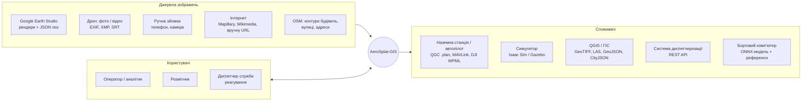
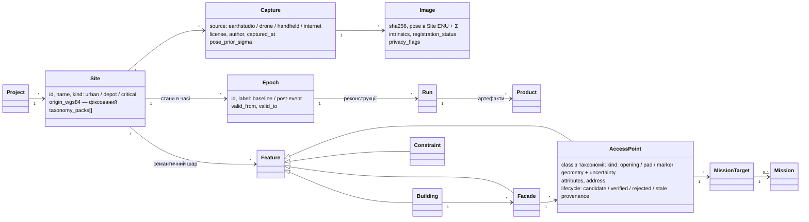
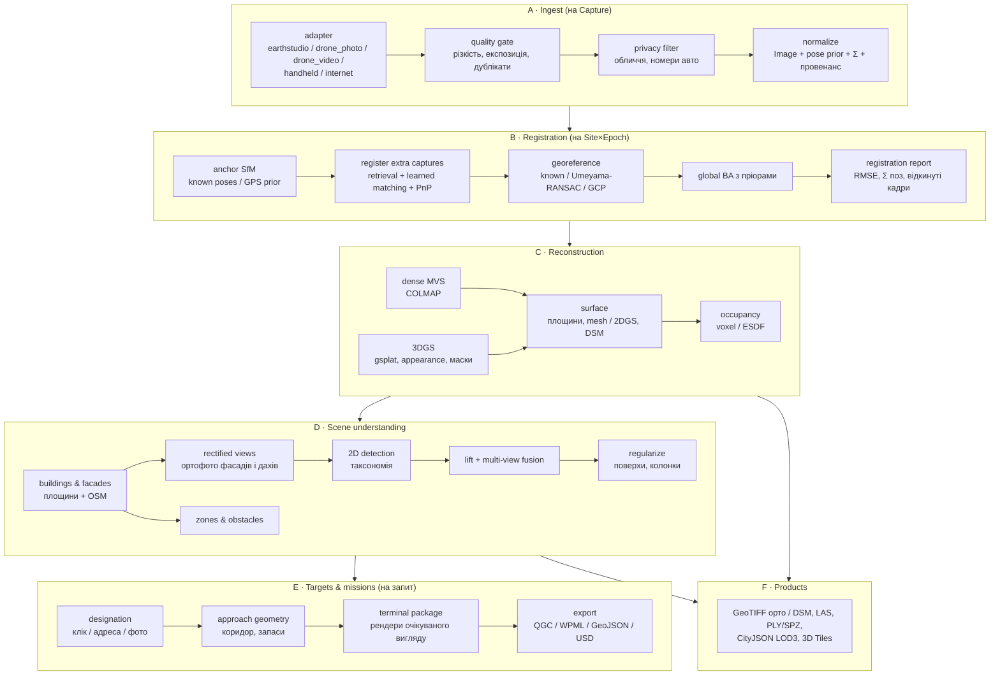
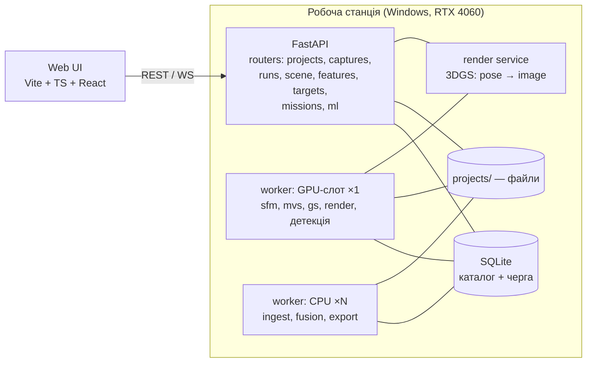

# AeroSplat-GIS — цільова архітектура (v1.x)

> Документ описує, **якою має стати система**. Фактичний стан коду описано в
> [ARCHITECTURE.md](ARCHITECTURE.md), порядок робіт — у [ROADMAP.md](ROADMAP.md).
> Домен «вікна / отвори / дахи / зони передачі вантажу» деталізовано в
> [ACCESS_POINTS.md](ACCESS_POINTS.md). Ключові рішення зафіксовано в ADR
> [0006](decisions/0006-project-site-epoch-capture.md)–[0010](decisions/0010-platform-and-ui-stack.md).
>
> Версія 2026-10-15. Статус: **запропоновано**. Реалізація йде поетапно,
> див. §13.

---

## 1. Навіщо система і де її межі

### 1.1 Сценарії

| Сценарій | Хто | Що потрібно від нас |
|---|---|---|
| **Тестування доставки їжі дронами** | замовник (доставка) | 3D-двійник району, точки передачі вантажу (балкони, вікна, двори, дахи, поштомати/маркери), геометрія підльоту, сцени для симулятора |
| **Доставка засобів першої необхідності** під час стихійних лих (повінь, руйнування) | служби реагування | заздалегідь підготовлені двійники критичних будівель + швидке оновлення після події; вибір **конкретного** вікна чи даху; стан «під водою / над водою» |
| **Склади і хаби** | логістика | точки завантаження (ворота доків, люки, дрон-порти), зони старту й посадки, заборонені зони |
| **Дослідження** | ми | якість реконструкції, детекції, метрики, відтворюваність |

### 1.2 Що система робить

1. Збирає зображення з **будь-яких джерел**: Google Earth Studio, дрон
   (фото й відео), ручна зйомка, фото з інтернету. Реєструє їх в одній
   **геоприв'язаній метричній** системі координат.
2. Будує представлення сцени: щільну хмару, 3DGS, поверхню, карту зайнятості.
3. Будує **семантичний шар**: будівлі, фасади, дахи, **точки доступу**
   (вікна, двері, ворота доків, люки, балкони, майданчики, маркери), перешкоди.
4. Допомагає оператору **вибрати ціль** і рахує **геометрію підльоту**
   (planning-grade), а потім експортує місію та пакет для бортового наведення.
5. Веде **цикл даних для ML**: розмітка, датасети, тренування, оцінка, реєстр моделей.
6. Надає веб-UI для всього перерахованого.

### 1.3 Що система НЕ робить (явна межа)

* **Не автопілот** і не бортова система. Фінальні метри до вікна дрон долає
  за власним сенсором (детектор + visual servoing). Ми готуємо для цього
  референси й модель ([ADR-0009](decisions/0009-human-in-the-loop-planning-grade.md)).
* **Не диспетчеризація** замовлень, флоту чи UTM. Інтеграція з ними йде
  через API та експорт.
* **Не гарантує** точності, достатньої для польоту без бортової перевірки.
  Кожна геометрія має явну невизначеність.

---

## 2. Архітектурні принципи

| # | Принцип | Наслідок |
|---|---|---|
| P1 | **Geodetic-first.** Усе живе в метричній системі майданчика (Site ENU), прив'язаній до WGS84 | одиниці «умовні» — це помилка, а не режим роботи |
| P2 | **Джерело важливе лише до реєстрації.** Після `register` код не знає, звідки кадр | жодних `if earthstudio` після стадії ingest (продовження принципу [REAL_DRONES.md](REAL_DRONES.md)) |
| P3 | **Авторські дані окремо від похідних.** Розмітка, підтвердження й цілі людини не лежать у run-директоріях | перезапуск пайплайна не стирає роботу людини ([ADR-0006](decisions/0006-project-site-epoch-capture.md)) |
| P4 | **2D-детекція → 3D-злиття.** Детектуємо на зображеннях, зливаємо на геометрії | детектор замінний, 3D-логіка тестована ([ADR-0008](decisions/0008-detect-2d-fuse-3d.md)) |
| P5 | **Таксономія — це дані, а не код.** Нові класи (люк складу, дрон-порт) додаються YAML-ом і тренуванням | універсальність домену ([ADR-0007](decisions/0007-access-point-taxonomy.md)) |
| P6 | **Система пропонує, людина вирішує.** Ціль не стає активною без підтвердження | безпека ([ADR-0009](decisions/0009-human-in-the-loop-planning-grade.md)) |
| P7 | **Невизначеність усюди.** Кожна позиція має σ, кожна детекція має confidence і провенанс | запаси в плануванні рахуються, а не вгадуються |
| P8 | **Відтворюваність.** Run незмінний: `manifest.json` фіксує конфіг, коміт, хеші входів і версії моделей | продовження поточного `--resume`/manifest |
| P9 | **Провенанс і ліцензія кожного кадру.** Інтернет-фото й Google мають свої умови | можна відфільтрувати датасет за ліцензією без переробки |

---

## 3. Контекст системи



---

## 4. Доменна модель

Повна модель семантики — у [ACCESS_POINTS.md §3](ACCESS_POINTS.md#3-модель-даних).
Тут наведено каркас.



**Сутності:**

| Сутність | Суть | Хто створює |
|---|---|---|
| **Project** | робочий простір (замовник, навчання, полігон) | людина |
| **Site** | ділянка ≤ ~1 км² з **фіксованим** ENU-початком | людина (точка на карті + bbox) |
| **Epoch** | стан ділянки в часі: `baseline` і `post-flood-2026-11-03` | людина |
| **Capture** | партія зображень одного джерела з однаковими умовами та ліцензією | ingest |
| **Image** | кадр із позою, Σ пози, інтринсиками, провенансом | ingest → register |
| **Run** | незмінний прогін пайплайна для Site×Epoch з конфігом | jobs |
| **Product** | артефакт run-а: sparse, dense, splat, surface, occupancy, semantics | pipeline |
| **Feature** | семантична сутність у Site ENU: будівля, фасад, точка доступу, обмеження | pipeline (кандидат) і людина (підтвердження/редагування) |
| **MissionTarget** | «саме це вікно, цим способом передачі», з доказами вибору | людина |
| **Mission** | геометрія підльоту + експорт + пакет наведення | pipeline за запитом |
| **Dataset / Model** | версіонований датасет і модель у реєстрі ML | ml |

---

## 5. Системи координат

```
WGS84 (EPSG:4979, еліпсоїдальна висота)                      ← зберігається завжди
   │  pyproj
   ▼
Site ENU (метри, origin = Site.origin_wgs84, фіксований при створенні Site)
   │                                                          ← уся геометрія, пози, Feature
   ├─► Facade frame (u — горизонталь уздовж фасаду, v — вгору, n — назовні)
   │      └─ координати отворів у метрах на площині фасаду
   ├─► Image frame (пози камер, COLMAP-конвенція)
   └─► Viewer frame (Y-up, масштаб — тільки у в'ювері, ADR-0001)

Висоти для людини: AMSL (геоїд EGM2008) і «над землею» (від DSM/терену).
Поверхи: індекс ряду отворів від рівня землі біля фасаду (ACCESS_POINTS §5.6).
```

**Зміни відносно поточного коду:**

* Зараз ENU-origin = **середнє** (lat, lon, alt) кадрів датасету
  (`earthstudio_to_colmap.py`). Для кількох захоплень однієї ділянки це
  неприйнятно, бо кожне нове захоплення зсуває систему і разом з нею всю
  розмітку. Тепер origin задається **один раз на Site**.
* Earth Studio моделює Землю як **сферу**, і його рендери узгоджені саме з нею
  (перевірено 2026-10-15). Тому run Earth Studio реконструюється у сферичному
  ENU ділянки, а в WGS84 Site ENU переводяться **продукти** — афінним
  відображенням, точним до < 1 мм на 1 км² (стадія `georef`). Каталог, сервер
  і все, що далі, бачать лише WGS84
  ([ADR-0006, поправка](decisions/0006-project-site-epoch-capture.md)).
* Різниця сфера→еліпсоїд — до 1.43 м на 1 км² — виміряна й записується в
  `registration_report` разом з `A, b` і залишками. Абсолютна висота
  (еліпсоїд чи геоїд) ще не перевірена.

---

## 6. Конвеєр (DAG)

Стадії згруповано у **шість треків**. Кожна стадія — функція з контрактом
вхід→вихід; кешування за хешем входів і конфігу (розвиток поточного
`--resume`).



### 6.1 Стадії та модулі

| Трек | Стадія | Модуль (цільовий) | Вихід | Є зараз |
|---|---|---|---|---|
| A | adapters | `aerosplat.ingest.{earthstudio,drone,video,handheld,internet}` | `Capture`, `Image[]` | частково (`geo/earthstudio_to_colmap`, `geo/exif_injector`) |
| A | quality | `aerosplat.ingest.quality` | прапорці, відсіяні кадри | — |
| A | privacy | `aerosplat.ingest.privacy` | розмиті копії + маски | — |
| B | anchor SfM | `aerosplat.sfm` | sparse model | ✅ (`sfm_runner`) |
| B | register extra | `aerosplat.sfm.register` | пози нових кадрів + Σ | — |
| B | georef | `aerosplat.geo.georef` | `site_transform`, RMSE | частково (known poses) |
| C | dense | `aerosplat.mvs` | `fused.ply` | ✅ (`dense_runner`) |
| C | 3DGS | `aerosplat.gs` | splat + render service | ✅ (власний тренер; gsplat у Фазі 2) |
| C | surface | `aerosplat.surface` | площини, mesh, DSM | — |
| C | occupancy | `aerosplat.surface.occupancy` | voxel grid / ESDF | — |
| D | semantics | `aerosplat.semantics.*` | `Feature[]` (кандидати) | — |
| E | targets | `aerosplat.targets` | `MissionTarget` | — |
| E | mission | `aerosplat.mission` | місія + пакет | — |
| F | export | `aerosplat.export` | файли стандартних форматів | — |

### 6.2 Реєстрація різнорідних джерел — головний технічний ризик

SIFT погано зіставляє **рендер Google** зі **справжнім фото**: різні
домен, освітлення, час і рівень деталізації. Тому:

1. **Якірне захоплення** (anchor) задає систему. Пріоритет: власний дрон із
   GPS > Earth Studio з відомими позами > ручна зйомка з GPS.
2. **Додаткові захоплення** реєструються в якірну модель:
   * retrieval кандидатів (глобальні дескриптори на основі DINOv2 або
     аналогічні) → learned matching (SuperPoint+LightGlue через hloc
     або MASt3R) → PnP+RANSAC → спільний BA;
   * пріори поз зі слабкими вагами: EXIF GPS (±5–10 м), компас, висота.
3. Кожен кадр отримує **статус**: `registered` / `weak` / `rejected` і Σ пози.
   Інтернет-фото без EXIF реєструються **лише** через matching.
4. Звіт реєстрації — обов'язковий артефакт. Якщо RMSE георефу більший за
   поріг, run позначається ⚠️, і зони підльоту отримують більші запаси.

Компонент ізольовано за інтерфейсом `Registrar`, щоб matcher можна було
замінювати й порівнювати в бенчмарку.

### 6.3 Представлення сцени (навіщо кожне)

| Представлення | Призначення | Не для |
|---|---|---|
| sparse + пози | геодезичний каркас, реєстрація | візуалізації |
| dense cloud (MVS) | метрична геометрія, площини, DSM, LAS | фотореалізму |
| 3DGS (gsplat, SH, appearance) | фотореалістичний рендер, **ортофото фасадів**, синтетичні дані для ML, референси підльоту | колізій (у сплатів немає чіткої поверхні) |
| surface (mesh / 2DGS) | площини фасадів і дахів, нормалі, перетин променів | — |
| occupancy (voxel / ESDF) | перевірка коридорів підльоту, кліренси | рендеру |

TRIPS **не відроджуємо**: його ніша (рендер хмари точок) покривається
парою 3DGS + dense, а код лишається в `legacy/`. 2DGS — кандидат для
`surface` після бенчмарку проти площин із MVS.

---

## 7. Зберігання

### 7.1 Фізичний layout

```
projects/<project>/
├── project.yaml
└── sites/<site>/
    ├── site.yaml                    # origin_wgs84, bbox, kind, taxonomy_packs
    ├── captures/<capture_id>/
    │   ├── capture.yaml             # джерело, ліцензія, автор, умови
    │   ├── images/                  # оригінали (лише читання)
    │   ├── images_private/          # після privacy filter (для публікації/ML)
    │   └── images.jsonl             # sha256, EXIF/XMP, пріори, прапорці якості
    ├── epochs/<epoch>/
    │   ├── epoch.yaml
    │   └── runs/<run_id>/           # ПОХІДНЕ: можна видалити й перерахувати
    │       ├── manifest.json        # конфіг, коміт, хеші входів, версії моделей
    │       ├── sfm/ mvs/ gs/ surface/ occupancy/ semantics/
    │       └── reports/             # registration, quality, detection
    ├── authored/                    # АВТОРСЬКЕ: ніколи не генерується пайплайном
    │   ├── features.gpkg | .jsonl   # підтверджені/відредаговані Feature
    │   ├── targets/                 # MissionTarget + докази (фото, текст)
    │   └── audit.jsonl              # хто, що, коли змінив
    └── missions/<mission_id>/       # експорт + пакет наведення
```

### 7.2 Каталог

* **SQLite** (один файл на інсталяцію) містить індекс проєктів, ділянок,
  захоплень, run-ів, задач, Feature і MissionTarget. Великі дані лежать
  у файлах. Поки працюємо на одній робочій станції, SQLite вистачає.
* Перехід на **PostgreSQL + PostGIS** — коли з'явиться кілька користувачів
  одночасно або сервер. Схема від початку пишеться через SQLAlchemy/SQLModel,
  щоб зміна СУБД не зачіпала домен.
* Міграції схеми — Alembic.

### 7.3 Стабільність авторських даних при перерахунку

Новий run з іншим BA трохи зсуває геометрію, тому авторські Feature
**переякорюються**:

1. Similarity-трансформація старий run → новий за спільними кадрами (пози).
2. Feature переносяться, а площина фасаду уточнюється за новою поверхнею.
3. Якщо залишок > порогу (наприклад, 0.3 м), Feature переходить у стан
   `stale` і потрапляє в чергу на перевірку. Мовчки нічого не зсувається.

### 7.4 Міграція з поточного layout

`data/<ds>/footage` → `captures/<id>/images`; `data/colmap_output_<ds>` →
`runs/<id>/sfm|mvs`; `data/<ds>_*.pt` → `runs/<id>/gs`. `RunLayout` стає
«видом» на новий layout. Скрипт `tools/migrate_dataset.py` переносить
наявні датасети, а `DATASET_PATHS` у сервері замінюється читанням каталогу.

---

## 8. Рантайм і сервіси



* **Черга задач** живе в SQLite: таблиця `jobs` із пріоритетом, станом
  і `resource` (`gpu` | `cpu`). GPU-слот один (8 GB VRAM), тому GPU-задачі
  йдуть строго послідовно. Redis/Celery не потрібні, доки немає кількох машин.
* **Ізоляція збоїв.** Кожна задача — окремий процес-воркер (CUDA OOM не
  валить API). Усередині задачі стадії виконуються in-process, як зараз.
* **Події.** Воркер пише події в БД, API транслює їх через WebSocket:
  прогрес стадії, лог, метрики, прев'ю рендерів тренування.
* **Render service** — довгоживучий процес із завантаженою сценою 3DGS.
  Віддає рендер за позою (перспектива або орто). Його використовують UI
  («що побачить дрон»), семантика (ортофото фасадів) і ML (синтетика).
* **CLI** лишається повноцінним: `aerosplat run|serve|worker|doctor|export`.
  UI — лише один із клієнтів того самого API.

### 8.1 API (ескіз v2)

| Ресурс | Методи |
|---|---|
| `/api/v2/projects`, `/sites` | CRUD; `site` створюється з точки на карті + bbox |
| `/sites/{id}/captures` | upload (resumable), імпорт Earth Studio, пошук Mapillary в bbox |
| `/sites/{id}/epochs/{e}/runs` | `POST` запуск з конфігом, `GET` статус, `WS …/events` |
| `/sites/{id}/scene` | `scene-meta` + потоки splat/cloud (узагальнення поточного `spatial-chunk`) |
| `/sites/{id}/render` | `POST {pose, intrinsics, mode: persp|ortho}` → PNG/depth |
| `/sites/{id}/features` | GeoJSON з фільтрами `kind`, `class`, `state`, `bbox`; `PATCH` (verify, reject, edit) з аудитом |
| `/targets/resolve` | адреса / текст → кандидати + неоднозначність |
| `/targets/designate-by-photo` | фото + точка на ньому → кандидати |
| `/targets`, `/targets/{id}/mission` | створити ціль, розрахувати місію |
| `/missions/{id}/export?format=` | `qgc`, `wpml`, `geojson`, `bundle` |
| `/ml/datasets`, `/ml/models`, `/ml/review-queue` | реєстр і черга перевірки |

Ендпоінти `/api/v1/*` лишаються, доки поточний в'ювер не перейде на v2.

---

## 9. Веб-UI

Стек: **Vite + TypeScript + React**, карта **MapLibre GL JS** (2D-контекст,
OSM-тайли, без ключів), **власний WebGL2-рендерер** сплатів (Фаза 4.2,
варіант B) як незалежний модуль `web/renderer` з тонкою React-обгорткою.
Обґрунтування — [ADR-0010](decisions/0010-platform-and-ui-stack.md).

### 9.1 Екрани

| Екран | Що робить | «Вау» |
|---|---|---|
| **Dashboard** | карта всіх ділянок, статуси run-ів, черга задач | кластери на карті, живі індикатори GPU |
| **Site workspace** | шари (захоплення, продукти, семантика, цілі), 3D + 2D карта поруч, стрічка фото внизу | клік по фото → кінематографічний переліт у позу камери, отвори проєктуються на фото |
| **Ingest wizard** | drag&drop фото/відео/експорту Earth Studio; Mapillary в bbox; звіт якості й приватності | прев'ю покриття: які фасади ще не зняті (карта «сліпих зон») |
| **Run monitor** | DAG стадій, логи, метрики, графіки PSNR | живе прев'ю тренування 3DGS: сцена «проявляється» на очах |
| **Facade editor** | ортофото фасаду, сітка поверхів і колонок, кандидати, approve/reject/draw | клавіатурний рев'ю (A/R/E), автопідказки сітки |
| **Targeting** | пошук за адресою, вибір кліком, вибір за фото | вікно «що побачить дрон» з позиції зависання |
| **Mission** | коридор підльоту, кліренси, ризики, експорт | анімований проліт по коридору, теплова карта кліренсів |
| **Epoch compare** | до/після, карта змін, рівень води | слайдер рівня води, затоплені отвори «гаснуть» |
| **ML** | датасети, моделі, метрики, черга активного навчання | матриця помилок по доменах (джерело, висота, ракурс) |

### 9.2 Структура фронтенду

```
web/
├── app/                 # React-застосунок (Vite)
│   ├── features/        # dashboard, site, ingest, runs, facade, targeting, mission, epochs, ml
│   ├── api/             # згенерований з OpenAPI клієнт + TanStack Query
│   └── state/           # Zustand: вибір, шари, камера
├── renderer/            # WebGL2 splat/cloud/mesh-рендерер, без React
│   ├── splat/ cloud/ overlays/   # оверлеї: полігони отворів, коридори, фрустуми камер
│   └── picking/         # ray-cast по depth для кліку в 3D
└── legacy/              # поточний appGLSL.js — до завершення міграції
```

---

## 10. ML-платформа (каркас)

Деталі — у [ACCESS_POINTS.md §10](ACCESS_POINTS.md#10-ml-цикл-універсальність-через-дані).

* **Таксономія** — версіонований YAML; моделі та датасети посилаються на її версію.
* **Data engine:** точка доступу, розмічена в 3D **один раз**, автоматично
  дає 2D-мітки для кожного фото, де вона видима, і для будь-якого рендера
  3DGS. Це головний множник даних.
* **Три рівні моделей:** open-vocabulary «вчитель» для старту без даних;
  офлайн-модель картографування (точна, важка); бортова модель (легка,
  ONNX/TensorRT).
* **Спліти — за ділянками й будівлями**, а не за кадрами. Інакше метрики
  завищені через витік.
* **Реєстр моделей** зберігає model card (дані, таксономію, метрики по
  доменах, обмеження). Кожна Feature пам'ятає, якою моделлю створена.
* Важкі ML-залежності винесено в extras `aerosplat[ml]`, щоб ядро ставилось
  без них.

---

## 11. Нефункціональні вимоги

| Вимога | Ціль |
|---|---|
| Масштаб | Site ≤ ~1 км², ≤ ~2 000 кадрів, 3DGS ≤ 4M сплатів (бюджет 8 GB VRAM) |
| Швидкий шлях після події | локалізація нових кадрів у baseline + оновлення семантики за **≤ 30 хв** для одного об'єкта без повного перетренування |
| Повний пайплайн | ≤ ніч на одну ділянку на RTX 4060 |
| Точність (planning-grade) | ціль: σ центру отвору ≤ 0.5 м при власній зйомці, ≤ 2–3 м з чисто Earth Studio; **значення вимірюються**, а не декларуються |
| Безпека | без `pickle` у мережевому контурі (safetensors/PLY); API лише на localhost, доки немає автентифікації |
| Приватність | розмиття облич і номерів авто до будь-якого експорту чи ML; внутрішня частина засклених отворів розмивається в публічних експортах; ML-датасети — лише з контролем доступу (див. ACCESS_POINTS §11) |
| Тести | CPU-тести для всієї геометрії (фреймів, злиття, регуляризації, адресації, коридорів); golden-сайти для регресій детекції |

---

## 12. Ризики

| Ризик | Ймовірність | Вплив | Пом'якшення |
|---|---|---|---|
| Рендери Google ↔ реальні фото не зіставляються | висока | високий | learned matchers, якір — власна зйомка, ручні GCP в UI |
| Фасади з Earth Studio «розмазані» → вікна не детектуються | висока | середній | Earth Studio — лише контекст; деталізацію дає власна зйомка фасадів |
| Повторювані фасади → помилка поверху або колонки | середня | **критичний** | явна адресна конвенція, рівень землі з DSM, обов'язкове підтвердження людиною, рендер «що побачить дрон» |
| Дроти та тонкі перешкоди невидимі для реконструкції | висока | критичний | прапорець ризику на кожному коридорі; бортове виявлення перешкод — вимога до дрона |
| Немає реальних даних | **є зараз** | високий | «золота ділянка» (ACCESS_POINTS §12, M0) |
| Ліцензії інтернет-фото та Google | середня | середній | провенанс кожного кадру; фільтр датасетів за ліцензією |
| Розпорошення: занадто багато фронтів | висока | високий | порядок етапів §13; кожен етап дає цінність окремо |

---

## 13. Шлях від поточного стану

| Етап | Зміст | Цінність окремо |
|---|---|---|
| **S1** | Каталог Project/Site/Epoch/Capture, новий layout, міграція `dataset_v6`, фіксований Site ENU, `scene-meta.metric` | метрична сцена, кілька захоплень однієї ділянки |
| **S2** | Черга задач + воркер + API v2 + каркас веб-UI (dashboard, ingest, run monitor, 3D-перегляд) | керування без CLI |
| **S3** | Площини, фасади, ортофото фасадів, **ручна** розмітка точок доступу в Facade editor, адресація | оператор сам задає вікна, а розмітка стає першим датасетом |
| **S4** | Реєстрація додаткових джерел (ручна зйомка, інтернет), gsplat + appearance | якісні фасади з реальних фото |
| **S5** | Open-vocab bootstrap → злиття → регуляризація → черга перевірки; data engine; перша власна модель | автоматичні кандидати |
| **S6** | Цілі: адреса, фото; геометрія підльоту, експорт, пакет наведення, сцена для симулятора | місії для тестів доставки |
| **S7** | Епохи, швидкий шлях, рівень води, зміни; бортова модель | сценарій повені |

Відповідність етапів фазам ROADMAP — у [ROADMAP.md §9](ROADMAP.md#9-розширення-2026-10-доставка-точки-доступу-веб-ui).
